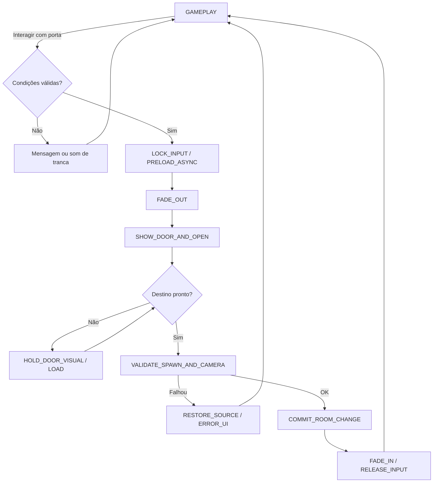
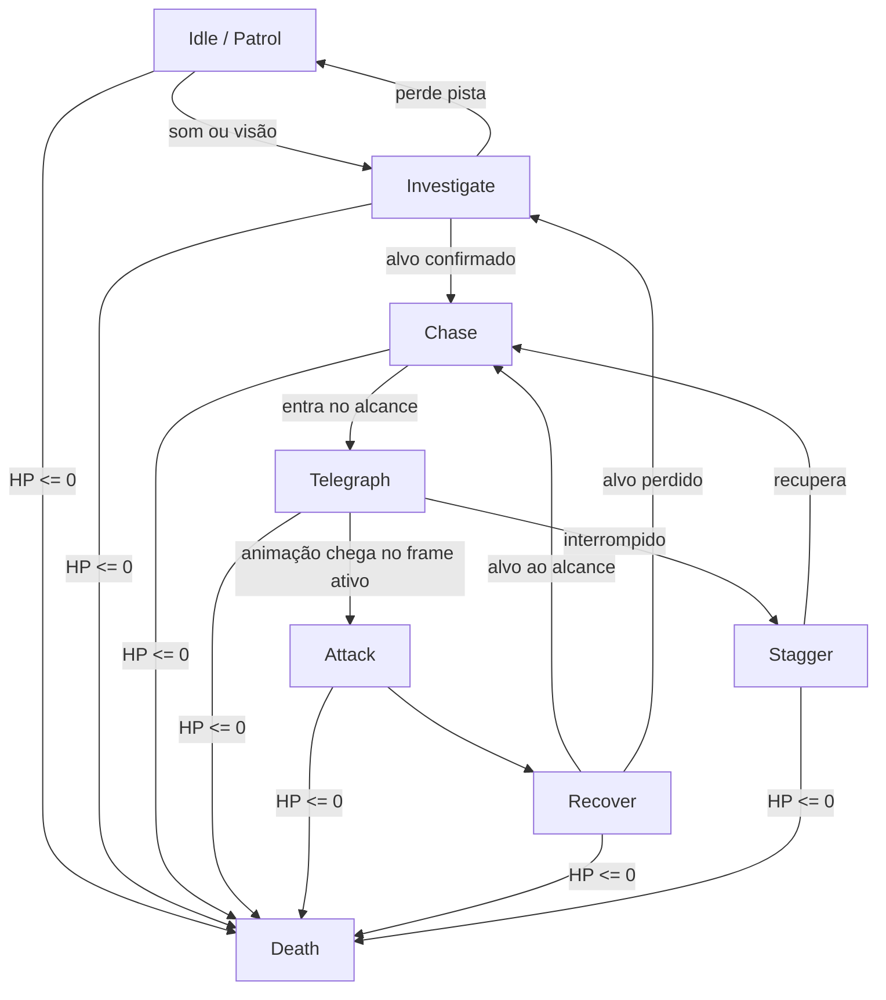
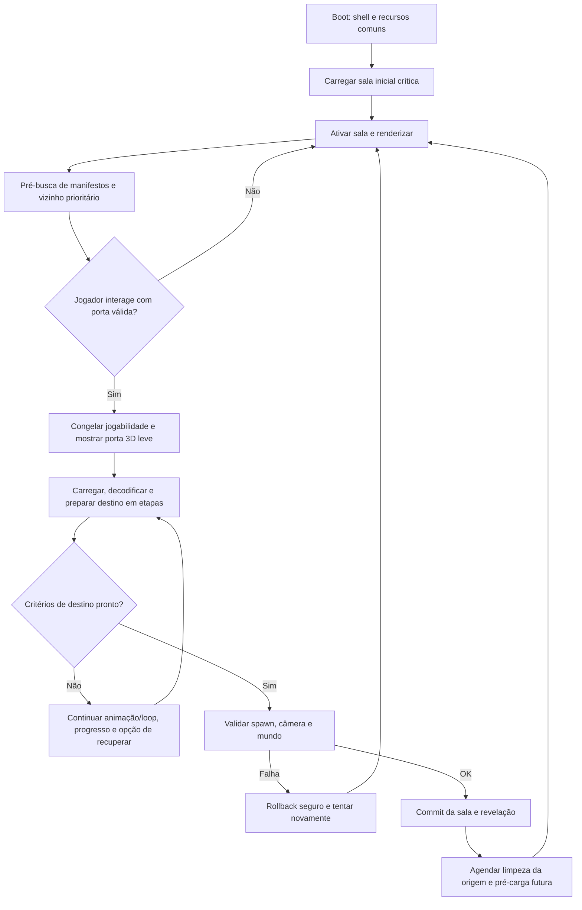

# LIMIAR: ECOS DA QUARENTENA
## GDD COMPLETO v1.6 — Câmeras Fixas, Portas, Streaming, Dano Localizado, Lanterna Tática e Perseguidor Persistente

> **Conceito:** jogo original de terror e sobrevivência em terceira pessoa, inspirado na linguagem de design dos *Resident Evil* clássicos (especialmente exploração, câmera fixa, escassez de recursos e interconexão de cenários), sem reutilizar personagens, nomes de criaturas, cenários ou história da franquia.
>
> **Estado do projeto:** documento de pré-produção. **Nenhum recurso, fase, inimigo, animação de porta ou teste foi implementado/validado por este documento.** Todos os números são parâmetros iniciais de balanceamento, a ajustar após playtests.
>
> **Novidade v1.1:** sistema de transição cinematográfica entre salas com porta animada no escuro, carregamento assíncrono, persistência bidirecional e integração com câmeras fixas, saves e controles.
>
> **Ampliação v1.2:** streaming por camadas, perfis de cenário 3D baked e fundo pré-renderizado, carregamento por prioridades, gerenciamento de memória/VRAM, efeitos práticos econômicos, configurações de qualidade, testes de stress e metas mensuráveis de fluidez. Metas **não** são resultados testados.
>
> **Ampliação v1.3:** inimigos mortos desaparecem de maneira controlada e econômica, com animação de morte, limpeza fora do enquadramento, persistência no save, exceções narrativas, saque independente e descarte correto de recursos.
>
> **Ampliação v1.4:** hitboxes por região corporal, bônus de dano na cabeça, chance real de acerto crítico letal com destruição da cabeça em inimigos elegíveis, reação física e audiovisual, proteção de chefes, opções gráficas de violência e integração com cadáveres/streaming/save. Valores são **hipóteses de balanceamento**, não testes.
>
> **Ampliação v1.5:** tiros nas pernas com dano localizado, queda, ruptura/desmembramento em armas e inimigos elegíveis, conversão do humanoide em rastejador agressivo, animações, colisão de corpo reduzida, persistência entre salas, otimização gráfica e matriz de testes. **Somente especificação; nenhuma implementação ou certificação.**

> **Ampliação v1.6:** lanterna com bateria encontrável, dois feixes, dano fraco e atordoamento por exposição à luz, combinações com tiro na cabeça/perna, visual mais escuro sem comprometer navegação, e setpiece de 3 salas com E18 imortal que rompe cenário, é derrubado por postura e libera uma melhoria única. Streaming, save, desempenho, acessibilidade e testes detalhados nos §§30–33. **Somente especificação; nada foi programado ou certificado.**

| Campo | Definição |
|---|---|
| Gênero | Survival horror, aventura, exploração, puzzles e combate tático |
| Câmera | Ângulos fixos cinematográficos, transições por zonas, raros enquadramentos especiais |
| Plataforma inicial | PC e web (Vite + Three.js / GitHub Pages); opção de port nativo posterior |
| Linguagem | Português do Brasil; internacionalização prevista |
| Público-alvo | Quem aprecia survival horror de recursos limitados e exploração metódica |
| Arte | Low-poly estilizado PS1/PS2 aprimorado, iluminação autoral, sombras e texturas econômicas |
| Duração planejada | 8–12 h na campanha; 12–16 h para explorar tudo |
| Estrutura | 8 capítulos, ~64 salas, 18 arquétipos de inimigos, 7 encontros com chefes |
| Perspectiva | Terceira pessoa, personagens 3D, cenários 3D e câmera fixa |
| Controles | Teclado/mouse + gamepad; movimentação tanque ou moderna selecionável |
| Classificação indicativa pretendida | Terror, violência de fantasia e sangue; classificação oficial a definir |

---

# 1. VISÃO, IDENTIDADE E REGRAS DE DESIGN

**Premissa:** no município fictício de Santa Avelina, um hospital de pesquisa foi evacuado após o lançamento irregular de um composto regenerativo chamado **A-13**. Na madrugada em que a instalação deveria ser lacrada, o sistema de rádio transmite um pedido de socorro assinado por alguém oficialmente morto há seis anos. A técnica de resgate **Helena Duarte** entra no complexo para encontrar o irmão desaparecido, **Caio**, descobrir a origem das transmissões e escapar antes da descontaminação definitiva.

**Fantasia central:** sobreviver a um lugar labiríntico, perceber a ameaça antes de vê-la, guardar a última bala para a porta seguinte e descobrir que uma rota conhecida mudou.

**Cinco pilares:**
1. **Tensão pela informação parcial:** câmeras fixas revelam pistas e ocultam riscos sem produzir mortes arbitrárias.
2. **Exploração com retorno:** chaves, atalhos, elevadores, passagens bloqueadas e mudanças persistentes no cenário.
3. **Combate custoso:** fugir, atordoar, desmembrar funcionalmente e eliminar são escolhas com custos distintos.
4. **Inimigos reconhecíveis:** cada espécie possui silhueta, som, padrão de deslocamento, ataques telegrafados e contra-ataques.
5. **História ambiental:** prontuários, gravações, documentos, sinais de luta, diálogos curtos e pequenos eventos dinâmicos.

**Não fazer:** hordas permanentes; inimigos que teletransportam sem justificativa; munição infinita no modo padrão; saltos de câmera que invertem comandos; puzzles sem pistas; chefes vencidos apenas por uma animação roteirizada; sustos que removem controle sem aviso; portas que abrem menu de pausa por engano.

# 2. SINOPSE E PERSONAGENS

## 2.1 Personagens

| Personagem | Papel dramático | Jogabilidade |
|---|---|---|
| **Helena Duarte** | Protagonista; determinada, mas sem treinamento militar de elite | Resgate, primeiros socorros e armas improvisadas |
| **Caio Duarte** | Irmão desaparecido e pesquisador terceirizado | Mensagens codificadas e motivação para explorar |
| **Dra. Elisa Valença** | Responsável científica pelo A-13 | Decisões ambíguas, documentos contraditórios |
| **Nilo Farias** | Segurança noturno sobrevivente | Aliado temporário que abre uma passagem, mas não luta por você |
| **“A Voz”** | Transmissão desconhecida no rádio do hospital | Direcionamento incompleto; pistas confiáveis e enganos deliberados |

## 2.2 Estrutura narrativa em três atos

- **Ato I — Isolamento (capítulos 1–2):** entrada, primeiras criaturas, falta de comunicação e descoberta de que os registros de evacuação foram adulterados.
- **Ato II — Anatomia da mentira (capítulos 3–6):** centro cirúrgico, estação de água, estufas e arquivos; A-13 se propaga por resíduos orgânicos e por um sistema de circulação hospitalar.
- **Ato III — Última transmissão (capítulos 7–8):** complexo subterrâneo, escolha entre destruir amostras ou preservar provas, confronto com o núcleo e fuga.

**Finais:** **Contenção** (destrói A-13 com provas parciais) e **Exposição** (recupera registros e expõe responsáveis, desde que tenha concluído três objetivos opcionais). Opcionalmente, um epílogo de Caio muda conforme o resgate de um NPC e o acervo documental, sem transformar o jogo em narrativa excessivamente ramificada.

# 3. CICLO DE JOGO

1. Entrar em nova sala e **observar o enquadramento**.
2. Escutar ruídos, ler o mapa, localizar portas, objetos e possíveis saídas.
3. Decidir **evitar, atordoar ou matar** ameaças; considerar munição, vida e **carga da lanterna** (vide §30).
4. Coletar itens, solucionar puzzle, obter uma chave ou liberar atalho.
5. Voltar a uma área conhecida, agora alterada por eventos persistentes.
6. Atingir uma **sala segura**, organizar baú, salvar e preparar a próxima expedição.
7. Enfrentar encontro especial/chefe; abrir a região seguinte.

**Ritmo-alvo:** exploração 45%, combate 25%, puzzles 20%, narrativa/cenas 10%. Não são percentuais rígidos; devem ser calibrados por capítulo.

# 4. CÂMERA FIXA CINEMATOGRÁFICA — ESPECIFICAÇÃO

## 4.1 Funcionamento

Cada ambiente é dividido em **zonas de câmera** (`cameraZones`) com volumes invisíveis. Cada zona indica posição, alvo, campo de visão, prioridades, transição e referência de direção. O jogador move-se em 3D; a câmera **não o segue livremente**. Trocas acontecem ao cruzar limites de zonas ou em eventos autorizados.

**Tipos de planos:**
- **Estabelecimento:** plano aberto que comunica arquitetura, iluminação e rotas.
- **Tensão:** diagonal, corredor comprido, porta ao fundo, espaço negativo.
- **Perigo:** plano baixo, primeiro plano parcialmente ocluído, mas com saída legível.
- **Investigação:** enquadramento mais próximo de objeto, interruptor ou pista.
- **Chefe:** 2–4 câmeras coordenadas por posição/fase, mantendo ataques legíveis.

## 4.2 Regras obrigatórias de justiça

- No mínimo **0,6 s de estabilidade visual** ao atravessar um corte de câmera comum, sem sucessão de cortes rápidos.
- Se o jogador mantiver uma direção pressionada no instante de troca, **conservar o vetor de movimento no mundo** até soltar o direcional ou alterar intencionalmente sua direção. Evita a inversão automática da movimentação.
- Não esconder a única saída de uma sala por mais de um enquadramento sem dica de mapa, luz ou som.
- **Inimigos podem ficar fora do quadro**, mas golpes letais exigem aviso sonoro/visual e janela de reação; agarrões por trás têm pista sonora e proteção na entrada de uma nova zona.
- Garantir **pelo menos uma câmera** que permita compreender cada puzzle e **cada telegráfico de chefe**.
- Se o jogador for ocluído por parede, usar máscara local/dither/recorte controlado, nunca teletransporte de câmera imprevisto.
- Barrar tiros por geometrias reais; **linha de visão do inimigo ≠ estar dentro do enquadramento**.
- Quando um chefe inicia ataque de área, proibir troca para uma câmera que esconda a zona perigosa.

## 4.3 Modos de movimentação

**Tanque clássico:** esquerda/direita giram o personagem; frente/trás avançam/recuam no eixo do corpo. Pode usar corrida segurando botão.

**Moderno:** direcional baseado no plano projetado da câmera; enquanto o botão permanecer pressionado em corte, travar o último vetor mundial (`inputLatch`). Ao soltar, recalcular pela câmera nova. Opção de suavização de rotação entre 100–180 ms.

**Mira:** botão de mirar prepara arma, postura reduz velocidade e assistente escolhe **alvo dentro do cone**, por prioridade de perigo/distância. Permitir alternar alvo, mirar acima/abaixo e cancelar. Assistência ajustável por dificuldade; nenhuma mira através de paredes.

## 4.4 Exemplo de registro de câmera (modelo conceitual)

```json
{
  "id": "ala_leste_corredor_cam02",
  "roomId": "hosp_corredor_leste",
  "zone": {"type": "box", "center": [4, 1.5, 8], "size": [8, 4, 7]},
  "position": [9.5, 4.8, 3.2],
  "lookAt": [3.0, 1.35, 8.4],
  "fov": 49,
  "priority": 2,
  "transition": "cut",
  "minHoldMs": 600,
  "preserveWorldInputUntilRelease": true,
  "occlusionMode": "player-dither",
  "bossSafeView": false
}
```

## 4.5 Transições entre salas — portas cinematográficas clássicas (PADRÃO DO JOGO)

**Decisão de design v1.1:** substituir a proposta anterior de apenas abrir portas no cenário por uma **transição cinematográfica ao estilo dos survival horrors clássicos**: ao interagir com uma porta válida, a imagem do cenário desaparece, surge uma porta isolada em um ambiente quase negro, a maçaneta se move, a folha abre lentamente e então o jogador aparece no próximo ambiente sob uma nova câmera fixa. Essa sequência **esconde o carregamento assíncrono** e aumenta a tensão. A estética, o enquadramento e os modelos serão originais de LIMIAR; não copiar assets, texturas, áudio ou vídeos de outros jogos.

**Regras principais:**
- O mundo é representado por um **grafo de salas** (`RoomGraph`); cada conexão física é uma porta/portal com **duas extremidades**, uma em cada sala, e dados de spawn/câmera explícitos.
- A porta é um **objeto 3D interativo no cenário** e possui um **modelo cinematográfico leve separado**, mostrado na tela de transição. Não é necessário animar toda a sala nem manter os dois cenários carregados.
- O sistema deve servir para **entrar e voltar**: recepção → corredor e corredor → recepção preservam flags, itens, inimigos, puzzles e a posição correta de retorno.
- **Porta trancada não inicia animação.** Mostra texto e som próprios; somente quando a condição for satisfeita a travessia é permitida. Chaves de uso único podem ser marcadas como utilizadas de forma persistente.
- O jogador não pode receber dano, sofrer agarrão, disparar, interagir ou abrir menus enquanto a transição estiver ativa. O simulado local da sala anterior fica suspenso. Travas de puzzle, eventos roteirizados e chefes respeitam as regras de rota.
- Na saída, **não atravessar de novo por engano**: bloquear interação até o jogador se afastar ou soltar o botão, limpar o estado de entrada e conceder proteção contra colisão/ataque na posição de aparecimento por uma janela curta, definida em QA.

### 4.5.1 Sequência exata da animação

| Etapa | Referência de duração | Imagem / som / lógica |
|---|---:|---|
| 1. Aproximar e pressionar ação | imediato | Verificar distância, ângulo, colisão e condição de desbloqueio; apresentar texto de porta trancada, se aplicável. |
| 2. Preparar a transição | 0–150 ms | Travar o input de gameplay, registrar origem e destino e **iniciar o pré-carregamento** sem bloquear o loop de renderização. |
| 3. Escurecer a sala atual | 150–350 ms | Fade para preto com som ambiente atenuado; cortar HUD e elementos de interação. |
| 4. Mostrar a porta no escuro | 250–600 ms | Exibir modelo 3D leve iluminado por um feixe lateral; câmera frontal ou ligeiramente baixa. |
| 5. Maçaneta e destravamento | 250–500 ms | Som da maçaneta, giro discreto da fechadura, pequena vibração da folha. |
| 6. Abrir a folha | 700–1.400 ms | Dobradiças rangem, a porta gira no pivô correto, o vão revela **escuridão**, bruma leve ou luz própria da área de destino. |
| 7. Ocultar a passagem e sincronizar | 150–400 ms (se pronto) | Porta ocupa o enquadramento ou o quadro escurece. Se a próxima sala não estiver pronta, **manter loop visual/sonoro discreto**, sem tela congelada. |
| 8. Entrar na sala nova | 250–450 ms | Som de fechamento atrás da personagem, novo enquadramento fixo, HUD retorna e controle é restaurado apenas após validar spawn, câmera e colisões. |

**Meta orientativa:** animação total de **~2–3,5 segundos em sala já carregada**, podendo durar mais apenas quando o dispositivo realmente exigir; duração final e enquadramento serão validados por playtest. A duração da animação não deve ser usada como temporizador artificial que termina antes de `destinationReady`. No caso de travessias repetidas, oferecer uma opção de **transição rápida** (≈0,6–1,2 s quando os assets já estão disponíveis), mas nunca cancelar um carregamento pendente sem resolver o estado do jogo.

### 4.5.2 Tipos de porta e variações de animação

| Tipo | Locais | Animação original | Áudio/efeito | Condição |
|---|---|---|---|---|
| `wood` | Administração, arquivo | Maçaneta desce, madeira move no pivô, rangido prolongado | Madeira, corrente de ar | Normal ou chave |
| `metal` | Hospital, manutenção | Trava metálica recua e a folha abre com peso | Clique + metal grave | Chave ou fusível |
| `double` | Enfermarias, centro cirúrgico | Duas folhas abrem com pequena assimetria | Dobradiças duplas | Destrancada |
| `security` | Laboratório | Luz vermelha muda, pinos retraem, porta desliza | Trava elétrica, motor curto | Crachá / energia |
| `hatch` | Túneis, subsolo | Volante gira e escotilha abre para cima | Pressão e aço | Ferramenta |
| `elevator` | Hub vertical | Painel acende, portas correm, curta travessia vertical | Motor e sino próprios | Energia / andar |
| `boss` | Arenas de chefes | Abertura lenta e intencional, luz no vão | Pulso grave, pressão | Flag de história; ida e volta podem ter regras diferentes |
| `broken` | Áreas danificadas | Porta emperra, personagem força a passagem | Impacto + estalo | Evento roteirizado, **não** repetido em todo backtracking |

**Direção visual:** fundo negro/cinza-carvão, modelo centralizado, luz volumétrica sutil e reflexos econômicos; preservar legibilidade em telas pequenas. O sistema deve permitir trocar a cor da luz, o lado da dobradiça, o nível de ferrugem e o áudio por setor **sem copiar modelos de franquias existentes**.

### 4.5.3 Interação com a porta dentro do cenário

1. Cada porta tem `collider`, `trigger`, `interactionPoint`, `openingDirection`, `sideA`, `sideB` e estado de acesso. Exibir *[E] Abrir* ou botão correspondente do gamepad quando a protagonista estiver a cerca de **1,2–1,6 m**, olhando aproximadamente para a porta, sem obstáculo no caminho. Ajustar números em testes.
2. Se `locked`, `requiresKey`, `requiresPower` ou `storyBlocked`, exibir mensagem diegética específica e reproduzir somente som curto: **não** fazer fade e não iniciar carregamento de destino que não possa ser acessado.
3. Se livre, emitir `DOOR_TRAVEL_REQUEST`, com origem, extremidade de saída, destino, checkpoint transitório e identidade da tentativa (`transitionId` único).
4. Bloquear pedidos duplicados. O mesmo botão não pode virar comando para `PauseView`, `DocumentView`, interagir com o novo cenário ou abrir outra porta.
5. Ao entrar na área seguinte, posicionar a personagem de acordo com o **spawn do outro lado**, não na coordenada da porta anterior. O primeiro ângulo de câmera é escolhido **antes de revelar a sala**, evitando mostrar a câmera antiga por um frame.
6. Se a porta estiver bloqueada **apenas de um lado**, guardar `unlockedFromSide` e o estado em `doors`; o retorno deve respeitar o desenho de progressão. Portas de arena podem ficar seladas durante o combate e abrir após a vitória.

### 4.5.4 Máquina de estados e carregamento (obrigatória)



**Conceito de transação:** carregar, validar e então **confirmar** a troca. Antes de `COMMIT_ROOM_CHANGE`, `currentRoomId`, posição persistida, flags e save devem continuar representando a sala de origem. Ao concluir, atualizar tudo junto. Caso `Promise` falhe, asset venha 404, arquivo esteja corrompido, contexto WebGL seja perdido ou ocorra falha na validação de spawn, retornar à sala de origem e oferecer **Tentar novamente** sem softlock e sem consumir chave duas vezes.

**Política de carregamento:**
- **Pré-carregar salas vizinhas** ao entrar no ambiente atual; usar grafo, distância e orçamento de memória. Manter à mão modelos leves de portas, animações, áudio e câmera inicial do vizinho.
- `SectorLoader.loadRoom(destination)` retorna `Promise<LoadedRoom>`; nenhuma cena é inserida como ativa enquanto não houver geometria de colisão, spawn, câmera e scripts indispensáveis. Modelos cosméticos podem ter fallback e completar depois.
- O renderizador da transição funciona em uma **cena Three.js própria e muito leve**, com câmera/pivô do modelo de porta; a animação e o loop de espera continuam desenhando frames enquanto a sala carrega em segundo plano.
- Sincronizar **audio** por estado; reduzir áudio do ambiente antigo durante o fade, reproduzir áudio da porta independente de sala e entrar com o novo ambiente somente após o commit.
- Tempo de carregamento deve ser **medido por sala e por dispositivo**, não inventado como desempenho garantido. A transição pode levar mais tempo em celulares/PCs lentos; um indicador discreto aparece depois de um limite de espera, com opção de voltar à sala anterior em falha.
- Durante troca de abas ou pausa do navegador, suspender o progresso visual com `visibilitychange`, sem perder `transitionId`. Não aplicar transição duas vezes por callbacks duplicados, debounce ou reconexão.
- Em PWA offline, verificar disponibilidade de bundles do capítulo antes de oferecer áreas que dependem de download. **Sem rede e sem assets necessários**, avisar e recuperar sem destruir o save.

### 4.5.5 Exemplo de dados de uma passagem bidirecional

Este é um **exemplo de configuração**, não implementação compilada. `yawDeg` indica a orientação do personagem em graus; o jogo converte para radianos. Os IDs de câmera devem existir no registro de cada sala.

```json
{
  "id": "D001_recepcao_corredor",
  "type": "wood",
  "initialState": "unlocked",
  "cinematic": {
    "model": "assets/doors/door-wood-transition.glb",
    "clip": "open_inward",
    "durationMs": 2400,
    "doorwayLight": "#463b37",
    "audio": ["knob_wood_01", "hinge_wood_02", "close_wood_01"]
  },
  "sideA": {
    "roomId": "hosp_recepcao",
    "interactionPoint": [2.2, 0.0, 6.1],
    "enterDestination": {
      "roomId": "hosp_corredor_leste",
      "spawnId": "from_recepcao",
      "position": [1.8, 0.0, 1.9],
      "yawDeg": 90,
      "cameraId": "ala_leste_corredor_cam02"
    }
  },
  "sideB": {
    "roomId": "hosp_corredor_leste",
    "interactionPoint": [1.8, 0.0, 1.2],
    "enterDestination": {
      "roomId": "hosp_recepcao",
      "spawnId": "from_corredor",
      "position": [2.2, 0.0, 5.25],
      "yawDeg": 180,
      "cameraId": "recepcao_cam01"
    }
  },
  "triggerCooldownMs": 500,
  "allowFastRevisit": true,
  "persistsUnlockedState": true
}
```

**Validação automática dos dados (build/dev):** ambos os `roomId` devem existir; destino A/B deve apontar para a sala oposta; `spawnId`, `cameraId` e arquivos de modelo/áudio precisam ser encontrados; o ponto de aparecimento precisa estar **dentro de navegação válida**, não colidir com porta, parede ou NPC. Detectar conexões unidirecionais intencionais e sinalizá-las claramente no mapa.

### 4.5.6 Pseudocódigo de implementação em Three.js / TypeScript

O código abaixo fixa os contratos e a ordem de execução. As classes são **interfaces planejadas** para a etapa de implementação; não são módulos já criados nem código verificado em execução.

```ts
async function travelThroughDoor(doorId: string, fromSide: "A" | "B") {
  if (transition.state !== "GAMEPLAY") return;
  const edge = doorGraph.get(doorId);
  const result = doorAccess.check(edge, fromSide, gameState);
  if (!result.allowed) {
    ui.showDoorFeedback(result.reason);
    audio.play("door_locked");
    return;
  }

  const token = transition.begin({ doorId, fromSide, sourceRoomId: world.currentRoomId });
  const destination = edge.destinationFrom(fromSide);
  input.lockGameplay("door-transition");
  interactions.disable();
  world.pauseSimulationForTransition();

  // A animação não aguarda o download da sala para começar.
  const loadPromise = sectorLoader.loadRoom(destination.roomId);
  try {
    await doorTransitionRenderer.fadeToBlack(token);
    await doorTransitionRenderer.playOpening(edge.cinematic, token);
    const room = await doorTransitionRenderer.holdUntilReady(loadPromise, token);
    const validated = world.prepareArrival(room, destination);
    if (!validated.ok) throw new Error(validated.reason);

    // Commit atômico: não salva destino antes de haver sala utilizável.
    world.commitRoomChange(validated, token);
    cameraZones.activate(destination.cameraId);
    player.setTransform(destination.position, destination.yawDeg);
    input.requireReleaseOfInteractAndMovement();
    doorSystem.suppressImmediateReentry(doorId, edge.triggerCooldownMs);
    await doorTransitionRenderer.fadeIntoRoom(token);
    transition.complete(token);
  } catch (error) {
    if (transition.isCurrent(token)) {
      world.restoreSourceRoom(token);
      await doorTransitionRenderer.restoreSourceView(token);
      ui.showDoorRetry(error);
      transition.abort(token);
    }
  } finally {
    // Finalizar apenas a tentativa atual; nenhuma promessa atrasada deve mudar a sala.
    if (transition.isOwnedBy(token)) {
      interactions.enable();
      world.resumeSimulation();
      input.unlockGameplay("door-transition");
      transition.release(token);
    }
  }
}
```

**Observação de implementação:** `holdUntilReady` pode receber a `Promise` já iniciada e renderizar sem bloquear. `commitRoomChange` não deverá falhar após uma validação bem-sucedida; caso apresente falha, o controlador deve ter plano de rollback (manter origem ainda residente). Não atualizar saves dentro da cena da porta.

### 4.5.7 Como o jogo trata combate, câmera, save e exploração

- **Câmera:** mudar para `destination.cameraId` com o quadro ainda preto, revalidar o volume inicial e ativar `inputLatch`/limpeza de direcional para não andar de forma invertida logo após a cena. Câmeras comuns entre zonas da **mesma sala** continuam fazendo corte direto, sem porta cinematográfica.
- **Inimigos:** morte/alerta/rotas são persistidos por identificador. O corpo de um inimigo eliminado é ocultado/removido após a animação e uma janela curta, preferencialmente fora do enquadramento; a flag de morte continua salva. Ao voltar, inimigo morto não renasce, salvo evento narrativo declarado. Perseguidores que podem cruzar portas terão **regra explícita de travessia** e spawn seguro; inimigos comuns não aparecem na sala nova sem um evento definido.
- **Salvamento:** arquivo guarda `roomId`, `player.position`, `cameraId` quando necessário, `doors`, `puzzles`, `itemsTaken`, estados de inimigos e flags de história. Salvar apenas no estado `GAMEPLAY` após commit, nunca no meio da abertura cinematográfica.
- **Puzzles:** portas com circuito, senha, alavanca ou crachá leem `questFlags`; abertura ou consumo de chave deve ser idempotente e persistente. Um fracasso de carregamento nunca reaplica o efeito.
- **Chefes:** arena pode bloquear temporariamente a saída com explicação visual. Se o design permite retirada, a saída deve preservar HP, fases ou política clara de reset e impedir exploração de carregamentos para obter munição/vida infinita.
- **Áudio:** antes de entrar, ruídos opcionais atravessam a porta (passos, metal, arranhões) com filtro de parede. Ao retornar, a ambiência da sala antiga precisa ser retomada corretamente, sem duplicar trilhas.
- **Transição rápida:** opção em *Configurações → Jogabilidade*: `Clássica`, `Rápida em salas revisitadas` ou `Rápida sempre`. Mesmo a opção rápida mantém fade, carregamento seguro, dados de spawn e câmera; **não** é teleporte visível.
- **Acessibilidade:** tremor, flashes e ruído de porta configuráveis; volume cinematográfico respeita mixador; animação pode ser encurtada sem perder acesso a informações essenciais. A porta jamais precisa ser atravessada por QTE.

### 4.5.8 Portas que não trocam de ambiente

Nem toda porta aciona loading. Armários, salas integradas em uma mesma cena, portas de puzzle visual ou portas que abrem acesso à arena **sem trocar `roomId`** usam pivôs e animações no próprio cenário, com colisão que acompanha a folha. Portas cinematográficas são usadas em **conexões entre salas/setores**, e o mapa diferencia claramente os dois tipos.

### 4.5.9 Cenário demonstrativo do Capítulo 1

1. Helena está em `hosp_recepcao` sob a câmera `recepcao_cam01` e se aproxima da porta `D001_recepcao_corredor`.
2. A interação mostra **Abrir porta**. Depois de confirmar, a câmera da recepção escurece, o modelo de madeira aparece no vazio, a maçaneta gira e a porta se abre; ao mesmo tempo o loader obtém `hosp_corredor_leste`.
3. Com assets essenciais prontos, `roomId` muda para `hosp_corredor_leste`; Helena aparece em `from_recepcao`, com câmera `ala_leste_corredor_cam02`, voltada para dentro do corredor. O jogador recupera controle.
4. Helena pode voltar: ao usar **a mesma conexão pelo lado B**, vê a animação adequada, reaparece em `from_corredor` na recepção e todos os itens recolhidos continuam recolhidos.
5. Se a sala não carregar, a recepção reaparece com estado íntegro e mensagem de recuperação. A porta não consome uma chave novamente nem deixa HUD/input presos.

### 4.5.10 Aceitação funcional mínima (antes de expandir a campanha)

- **10 idas e voltas consecutivas** entre recepção/corredor: sempre mesmo par de spawns e câmeras; sem sumiço de personagem e sem reaparição automática na porta.
- **Porta trancada:** mensagem correta, nenhum fade; após usar chave/destravar, abrir normalmente, estado mantido após salvar/recarregar.
- **Condições de rede:** porta funciona com assets em cache offline. Sem asset, rollback recupera sala inicial com botão de tentar novamente.
- **30/60/120 FPS e PC fraco:** animação baseada em `deltaTime`/timeline, sem velocidade variável; interface não congela durante carregamento assíncrono.
- **Input/UI:** manter botão de interação durante fade, abrir mapa, tentar pausar ou segurar W não provoca interação duplicada, pausa inesperada nem movimento involuntário.
- **Integridade de mundo:** item coletado, inimigo morto, trava elétrica e flags de boss sobrevivem à travessia bidirecional; saves sempre têm `roomId` e spawn válidos.
- **Saída de chefe:** estados e câmera são restaurados; o jogador não recebe dano durante a tela de porta, nem no primeiro quadro sem possibilidade de reagir.

# 5. MOVIMENTO, COMBATE E SOBREVIVÊNCIA

## 5.1 Controles padrão (remapeáveis)

| Ação | Teclado/mouse | Gamepad |
|---|---|---|
| Mover/girar | WASD | Analógico esquerdo |
| Correr | Shift | L3 ou botão configurável |
| Mirar/erguer arma | Botão direito | LT/L2 |
| Disparar | Botão esquerdo (mirando) | RT/R2 |
| Interagir/confirmar | E | A/Cruz |
| Inventário | Tab | Y/Triângulo |
| Mapa | M | View/Touchpad |
| Esquiva curta | Espaço | B/Círculo |
| Alternar alvo em mira | Q | RB/R1 |
| Recarregar | R | X/Quadrado |
| Pausar | Esc | Menu/Options |

**Regra de interface:** interagir, ler documento, abrir inventário e pausar são estados distintos. Fechar um documento retorna ao modo anterior — não abre nem deixa o menu de pausa ativo.

## 5.2 Saúde e estados

- Vida de referência: **100 HP**. Estados: **Saudável (61–100)**, **Ferido (31–60)**, **Crítico (1–30)**, **Morto (0)**.
- Animações e sons de dor por estado; em Crítico, leve redução de velocidade (no máximo 12%), sem bloqueio de rota.
- Estados adicionais: `bleeding` (dano leve por tempo até curativo), `infection` (redução de cura até tratamento), `staggered` (breve interrupção), `grabbed` (QTE acessível e limitado).
- Cura: **erva medicinal +35 HP**, **kit médico +60 HP**, **kit completo = cura total + remove sangramento**. Combinações existem, mas sem dezenas de itens redundantes.
- **Agarrão:** reação de 0,5–0,8 s no contato; janela de escape de 1,5 s; alternativa de acessibilidade permite segurar botão em vez de pressionar repetidamente.
- **Esquiva:** deslocamento curto 1,5 m, recarga de 4 s, cerca de 0,12 s de invulnerabilidade, sujeito a calibração. Não substitui posicionamento.

## 5.3 Armas e economia inicial (dificuldade Normal)

| Arma | Dano base | Capacidade | Função | Limitação |
|---|---:|---:|---|---|
| Faca de resgate | 12 | — | Emergência, cortar cordas, terminar inimigos caídos | Curto alcance; grande risco |
| Pistola 9 mm | 22 | 12 | Padrão, tiros controlados, atordoamento leve | Eficácia reduzida em armaduras |
| Espingarda | 65 próximo / 25 longe | 5 | Empurrar grupos pequenos, derrubar avançados | Poucas munições, dispersão |
| Carabina | 45 | 20 | Precisão e alvos rápidos | Encontrada tarde; munição rara |
| Revólver pesado | 105 | 6 | Penetração, pontos fracos de chefes | Recuo, cadência, munição muito rara |
| Lança-sinalizador | 18 + dano térmico por tempo | 1 | Iluminar, repelir criaturas fotossensíveis | Pouca munição e recarga longa |

**Regras:** distância, membros, armadura e ponto fraco alteram dano. A lanterna funciona como apoio tático, com dano luminoso baixo e exposição acumulada apenas em criaturas suscetíveis; tiros podem explorar a janela de desorientação sem mudar automaticamente as chances base de crítico da cabeça (§30). **Tiros na cabeça causam dano significativamente maior** e podem provocar **crítico letal com destruição da cabeça**, conforme espécie, proteção, arma e probabilidade; não garantem morte instantânea. Há também uma chance visual de destruição em tiros já letais. Ver §28 para cálculo, tabelas e exceções. Desmembramento funcional em outros membros depende da espécie e do dano acumulado. Dano mínimo ao chefe em partes não vulneráveis pode ser 0, evitando confusão mediante feedback audiovisual claro. Munição total por capítulo será testada contra percurso crítico com consumo mediano; deve ser possível terminar usando fuga e recursos previstos, sem ficar preso por erro de economia.

## 5.4 Inventário e baú

- **8 espaços iniciais**; +2 no capítulo 3 e +2 no capítulo 6 (**máximo 12**). Pilhas de baterias de lanterna ocupam 1 espaço e empilham até 3; a lanterna equipada não consome espaço adicional.
- Armas grandes: **2 espaços**; munição, ervas e itens pequenos: 1 espaço por pilha; itens de missão: 1, com limite separado opcional em acessibilidade.
- **Baú compartilhado entre salas seguras**, persistente; sem teleporte automático de itens para inventário.
- Examinar e combinar itens; descrição muda após inspeção; combinação contextual em puzzles.
- Cartas/chaves concluídas podem ser descartadas após aviso explícito. O jogo nunca elimina item essencial antes de a última trava relevante ser resolvida.
- Atalho de troca entre duas armas equipadas; inventário pausa o mundo no Normal e Fácil, opção configurável em modos avançados.

## 5.5 Salvamento

Salas seguras possuem rádio, lâmpada de mesa, baú e gravador de fita. Salvamento manual ilimitado em Fácil/Normal; modo Veterano utiliza fitas limitadas com **distribuição suficiente para completar o jogo**. Autosave em marcos e após chefes no Fácil/Normal, slots separados. Importar/exportar save opcional para build web. Versionamento de save obrigatório.

# 6. BESTIÁRIO — 18 ARQUÉTIPOS

**Unidades:** HP e dano são valores de referência no Normal com protagonista de 100 HP. Tempo em segundos; áreas e velocidade deverão ser afinadas por telemetria de playtest. Todos os inimigos terão `idle`, percepção, deslocamento, antecipação, ataque, recuperação, reação a dano, morte e despawn de corpo (com variantes necessárias). O tipo anatômico define se a cabeça é um ponto fraco, se existe capacete, se há crítico letal e se o visual de destruição é permitido (ver §28), bem como a possibilidade de queda/desmembramento de perna e continuação do ataque rastejando (ver §29). Nenhum inimigo entra em ataque impossível de interromper continuamente.

| ID | Inimigo | HP | Dano | Comportamento dominante | Como responder |
|---|---|---:|---:|---|---|
| E01 | **Paciente Errante** | 70 | 15 | Aproximação lenta e mordida após agarrar | Contornar, mirar pernas, usar faca só quando caído |
| E02 | **Enfermeiro Contorcido** | 85 | 18 | Passos irregulares, falso recuo e agarrão lateral | Observar ombros e conservar distância |
| E03 | **Segurança Reanimado** | 110 | 20 | Protege tórax com colete; investida curta | Atingir joelhos ou usar espingarda |
| E04 | **Corredor Febril** | 65 | 16 | Sprint em linha reta, curva larga, queda ao errar | Deslocar lateralmente e punir recuperação |
| E05 | **Rastejador de Maca** | 48 | 12 | Fica abaixo da mira normal, sai de baixo de móveis | Mirar baixo, ouvir arranhões |
| E06 | **Costurado** | 145 | 23 | Braço longo em arco e puxão à distância | Evitar canto, passar sob braço após ataque |
| E07 | **Gárgula de Teto** | 75 | 18 | Escala paredes/teto, ataque em mergulho | Observar sombras, atrair ao chão |
| E08 | **Mariposa Fúnebre** | 35 | 7 | Voo errático em pequeno bando, turva visão | Usar sinalizador; evitar gastar munição pesada |
| E09 | **Sanguessuga de Dreno** | 40 | 8 + sangramento | Emboscada em água rasa; imobilização curta | Usar luz, evitar áreas encharcadas |
| E10 | **Jardineiro Esporulado** | 115 | 14 + infecção | Borrifa nuvem curta, protege ponto fraco no dorso | Desviar do cone e contornar |
| E11 | **Esporo-Sentinela** | 55 | 10 | Planta fixa que alerta outros com ruído | Cortar alimentação elétrica/biológica |
| E12 | **Carcaça Blindada** | 205 | 26 | Marcha lenta com placas rígidas | Mira em juntas e costas; evitar desperdício frontal |
| E13 | **Vigia Cego** | 130 | 24 | Caça barulho, segue passos e disparos | Andar devagar, distrair com ruídos do cenário |
| E14 | **Sibilante** | 95 | 17 | Projétil ácido com área residual | Usar cobertura real, sair de poças |
| E15 | **Ninho Móvel** | 155 | 12 + invocação | Libera até 3 parasitas pequenos, foge do confronto | Eliminar ninho primeiro; impedir multiplicação infinita |
| E16 | **Parasita Filiforme** | 22 | 6 | Se agarra por curto intervalo, ataque em grupo | Golpe corpo a corpo/área, não desperdiçar revólver |
| E17 | **Mímico de Rádio** | 125 | 19 | Imita socorro humano, ataca em ponto cego | Verificar a origem sonora, perceber repetição de frase |
| E18 | **Caçador de Emergência — Unidade R-18** | Imortal (postura 180) | 28 | Perseguidor persistente do capítulo 6: rompe cenário ao longo de três salas | Fuga, obstáculos, luz + tiro para derrubar; jamais morte |

## 6.1 Padrões detalhados por família

### Grupo A — Humanoides: E01–E04

- **Patrulha/repouso:** permanecem em local coerente (leito, corredor, posto). Ativação por luz, aproximação ou som.
- **Busca:** investigam última posição conhecida; não conhecem a posição do jogador através de paredes.
- **Ataque básico:** antecipação de 0,55–0,9 s; alcance 1,1–1,6 m; após falha, 0,8–1,4 s de recuperação.
- **Agarrão:** aproximação com braços estendidos e vocalização exclusiva. Escape consome tempo, não munição.
- **Variação:** E04 corre por 2,5–4 m; se errar, tromba com parede e fica vulnerável por 1,1 s.

### Grupo B — Perseguidores de superfície: E05–E07

- Rastejador procura oclusão baixa, mas ruído de metal indica presença.
- Costurado tem ataque lateral amplo: prepara 0,85 s, golpe 0,25 s, recua 1,2 s.
- Gárgula faz som no teto, sombra projetada e queda após 0,75 s; câmera precisa mostrar a zona de impacto ou emitir aviso complementar.

### Grupo C — Insetos e ambiente: E08–E11

- Bando de mariposas: máximo 4 no quadro por setor; não bloqueia corredores de forma incontornável.
- Sanguessuga cria ondulação em água e nunca causa ataque instantâneo ao abrir uma porta.
- Jardineiro projeta cone de esporos 2 s após inalar; ponto fraco no dorso brilha quando a válvula abre.
- Sentinela é hazard com três estados: dormente, alarme e exausta; desligar bomba do setor desativa várias unidades.

### Grupo D — Pesados e caçadores: E12–E18

- Blindado: três pontos de armadura; perna danificada reduz velocidade; placas não regeneram.
- Vigia Cego: escuta passos correndo a 7 m e tiro a 15 m (ambiente altera alcance). Não usar visão onisciente.
- Sibilante: ácido via projétil em arco com pista sonora e marca no chão; poça dura até 4 s.
- Ninho: número máximo global de parasitas invocados = 6; nenhuma duplicação infinita após salvar/carregar.
- Mímico: pistas de áudio gradualmente evidenciam sua fraude; documentos antecipam a existência.
- Caçador (E18): **encontro especial de três salas consecutivas** no capítulo 6, com ruptura de obstáculos, máquina de estados, derrubamento temporário (não morte), prêmio único e restrição de áreas seguras (§31). Não gerar cadáver, crítico craniano letal ou amputação desse inimigo.

## 6.2 Tabela padronizada de ataque (exemplo)

| Inimigo / ataque | Aviso | Janela ativa | Recuperação | Dano | Contramedida |
|---|---:|---:|---:|---:|---|
| E01 mordida | 0,70 s | 0,22 s | 1,0 s | 15 | Recuo ou atordoar |
| E04 corrida | 0,60 s | 0,50 s | 1,1 s | 16 | Desviar da trajetória |
| E06 braço varredura | 0,85 s | 0,35 s | 1,2 s | 23 | Desviar para fora do arco |
| E07 mergulho | 0,75 s | 0,30 s | 1,0 s | 18 | Observar sombra, sair da marca |
| E10 nuvem de esporos | 1,10 s | 1,40 s | 1,30 s | 14 + status | Sair do cone |
| E12 esmagar | 1,20 s | 0,30 s | 1,50 s | 26 | Atingir juntas / contornar |
| E14 ácido | 0,90 s | impacto | 1,00 s | 17 | Usar cobertura, mover após disparo |
| E18 salto predatório | 1,00 s | 0,35 s | 1,50 s | 28 | Esquivar lateralmente, usar porta |

**Padrão de ataque obrigatório:** antecipação perceptível + hitbox ativa sincronizada à animação + recuperação real. Cada arma/inimigo usa máscara de colisão e hitboxes separadas de volume de navegação.

# 7. CHEFES — 7 ENCONTROS COM FASES E PADRÕES

**Regras universais:** todo chefe é introduzido por pistas e possui ao menos **2 padrões discerníveis**, 1 janela de vulnerabilidade, 1 forma clara de escapar de ataques e mudança de fase sinalizada por animação/áudio. **Nunca usar ataque fatal instantâneo sem aviso**. HP abaixo considera dificuldade Normal. Arena tem 2–4 tomadas fixas, com modo de câmera de segurança para manter golpes visíveis.

## B01 — O PORTEIRO (Capítulo 1)

**Local:** átrio principal; 12 × 16 m, balcão central e duas rotas laterais. **HP:** 560. **Fantasia:** ex-funcionário fundido à catraca de metal. **Função:** ensinar leitura de impacto, uso da câmera fixa e tiro em ponto fraco.

| Fase | Condição | Padrões | Aviso / contrajogo |
|---|---|---|---|
| 1 | 100–61% | Martelo de braço (20), investida reta (24) | Braço sobe por 1 s; sinos de catraca antes da corrida; expõe costas ao colidir |
| 2 | 60–0% | Varredura dupla (14 + 14), arrancar e lançar grade (22) | Pés travados e som metálico; jogador usa colunas como cobertura |

**Mecânica especial:** acionar trava elétrica das catracas após a investida abre ponto fraco por 4 s. No mínimo 2 oportunidades garantidas por ciclo de padrão. **Recompensa:** chave do setor administrativo. **Checkpoint:** sala segura anterior, rota curta de 20–35 s de retorno.

## B02 — A PRECEPTORA (Capítulo 2)

**Local:** enfermaria circular; leitos como cobertura, luzes de emergência. **HP:** 850. **Fantasia:** corpo alto que reage a sons de equipamentos.

| Fase | Condição | Padrões | Aviso / contrajogo |
|---|---|---|---|
| 1 | 100–71% | Corrida de bisturi (18), puxão por lençol (16) | Tique de lâmina e leito que vibra; esquiva lateral |
| 2 | 70–31% | Apaga fileira de luzes, invoca 2 E05, sequência de 3 cortes | Aviso luminoso por 1,3 s; usar lâmpadas portáteis e eliminar rastejadores |
| 3 | 30–0% | Giro cortante (24), golpe vertical pesado (30) | Respiração cresce; giro deixa 1,5 s de recuperação |

**Mecânica:** ativar gerador auxiliar interrompe fase de escuridão por 15 s, com recarga de 20 s. **Recompensa:** crachá cirúrgico. **Limite:** 2 ajudantes ativos; não invocar inimigos quando chefe está em animação de agarrão.

## B03 — O MERGULHADOR (Capítulo 3)

**Local:** estação de tratamento, água até joelho, passarelas e válvulas. **HP:** 1.050. **Fantasia:** criatura anfíbia coberta de tubos e sedimento.

| Fase | Condição | Padrões | Aviso / contrajogo |
|---|---|---|---|
| 1 | 100–66% | Arpão orgânico (20), onda lateral (15) | Água recua antes da onda; faixa de espuma indica trajetória |
| 2 | 65–26% | Mergulho entre drenos, agarrão emergente (28), 2 sanguessugas | Bolhas e barulho de encanamento anunciam posição; válvulas drenam a arena |
| 3 | 25–0% | Investida furiosa (32), ruptura de cano (dano de área 18) | Vibração de 1,2 s; evitar eixo do cano e atirar em bolsa exposta |

**Mecânica:** duas válvulas drenam água por 30 s, forçando vulnerabilidade. **Recompensa:** engrenagem do elevador. **Sem softlock:** se munição terminar, válvulas causam dano fixo suficiente em ciclos repetidos, com riscos controlados.

## B04 — A JARDINEIRA (Capítulo 4)

**Local:** estufa de vidro 14 × 18 m, corredores de poda. **HP:** 1.200. **Fantasia:** corpo vegetal humanoide que manipula raízes e pólen.

| Fase | Condição | Padrões | Aviso / contrajogo |
|---|---|---|---|
| 1 | 100–71% | Chicote de raiz (20), área espinhosa (12/s) | Solo racha 0,9 s antes de brotar |
| 2 | 70–36% | Esporos em cone (18 + infecção), 3 sementes explosivas (14) | Pétalas fecham e som abafado anuncia cone; sementes pulsantes podem ser destruídas |
| 3 | 35–0% | Raízes cruzadas (26), perseguição lenta e ruptura de teto | Câmeras priorizam quadrantes seguros; coração floral expõe-se após o golpe |

**Mecânica:** acender 2 refletores UV do cenário interrompe regeneração e expõe núcleo por 6 s. **Recompensa:** reagente para purificar a ala antiga. **Limite:** no máximo 3 sementes simultâneas.

## B05 — O CARCEREIRO (Capítulo 5)

**Local:** arquivo subterrâneo com estantes móveis e trilhos. **HP:** 1.450. **Fantasia:** bruto de manutenção blindado, usa correntes e portas mecânicas.

| Fase | Condição | Padrões | Aviso / contrajogo |
|---|---|---|---|
| 1 | 100–61% | Corrente em linha (22), esmagamento (30) | Ruído de corrente por 1 s; usar estantes como obstáculo |
| 2 | 60–26% | Tranca setores, lança estante (25), agarrão pela grade (30) | Sirene e trilhos acesos; rotas alternativas permanecem abertas |
| 3 | 25–0% | Carga de ombro (34), corrente circular (24) | Solta peça da armadura; vulnerável após colidir em trilho energizado |

**Mecânica:** mover estantes para canalizar chefe ao eletroímã. Jogador não pode ficar isolado em área sem saída. **Recompensa:** senha parcial e fusível do laboratório.

## B06 — A VOZ (Capítulo 7)

**Local:** central de rádio, três salas ligadas por janelas e portas. **HP:** 1.300. **Fantasia:** criatura imitadora de pessoas queridas; manipula pistas sonoras, não a interface.

| Fase | Condição | Padrões | Aviso / contrajogo |
|---|---|---|---|
| 1 | 100–66% | Projeção sonora em corredor (18), ataque com braços duplicados (22) | Eco muda de posição; som real vem de direção distinta da voz falsa |
| 2 | 65–31% | Isca de rádio, clones ilusórios que não causam dano, salto por porta (28) | Clones não projetam sombra nem deslocam objetos; corpo verdadeiro altera iluminação |
| 3 | 30–0% | Grito concussivo (25), avanço triplo (12 cada) | Indicador diegético em VU meter; desligar transmissores interrompe grito |

**Mecânica:** três transmissores podem ser desligados; cada um reduz habilidade do chefe e adiciona pistas de localização. **Acessibilidade:** modo de surdez visualiza origem de áudio por vibração de objetos/luzes, nunca exige áudio isoladamente. **Recompensa:** gravação integral e acesso ao núcleo.

## B07 — CORAÇÃO A-13 (Capítulo 8, FINAL)

**Local:** câmara de contenção, três anéis concêntricos, elevadores técnicos e escotilhas. **HP total de referência:** 2.700 distribuídos entre núcleo e três apêndices. **Fantasia:** organismo-raiz preso à máquina que alimenta o hospital. **Combate por objetivos**, não somente esvaziar barra.

| Fase | Condição | Padrões | Aviso / contrajogo |
|---|---|---|---|
| 1 — Proteção | 100–71% | Apêndice chicote (20), projéteis corrosivos (17), 2 parasitas | Apêndice contrai 0,9 s; destruir 2 reguladores abre núcleo |
| 2 — Ruptura | 70–36% | Paredes de tecido bloqueiam rotas, onda radial (28), viga cai (22) | Sirene de 1,5 s; caminho seguro sempre indicado por luz no piso |
| 3 — Colapso | 35–0% | Três pulsos em sequência (12 cada), agarrão do núcleo (35), áreas instáveis | Ciclo visual: veias brilham → vibração → impacto; acertar três pontos expostos |
| Finalização | Núcleo exposto | Ativar sistema de contenção manualmente; escolher preservar provas ou destruir tudo | Ação deliberada sem QTE de um único botão |

**Mecânicas especiais:** checkpoints antes do chefe e após a fase 2 (Fácil/Normal); contagem regressiva começa **depois** da conclusão do confronto, nunca durante uma fase que possa travar. Ao esgotar munição, armadilhas/ativadores de cenário geram dano suficiente, mas exigem execução tática. **Recompensa:** resolução narrativa, fuga e final condicionado a objetivos opcionais.

## 7.1 Regras de boss design

- Ataque de dano alto (>25 HP) tem antecipação de **pelo menos 0,9 s** na dificuldade Normal, salvo ataques que já tenham ritmo ensinado.
- Mudanças de fase têm transição reconhecível (1,5–3 s) e **não causam dano gratuito**.
- Não acumular mais de duas ameaças de área independentes sem uma rota demonstravelmente segura.
- Cada telegráfico precisa ser legível no **pior enquadramento de câmera permitido**.
- Boss nunca entra em sequência de ataques sem recuperação indefinidamente; cooldown global de 0,4–1,2 s conforme padrão.
- O encontro pode durar de **3–6 min** em combate razoável. Se >8 min em playtests normais, revisar HP/padrões.
- Reset de combate restaurará estados de arena, portas, munições específicas de puzzle e scripts; não deixar flags órfãs após morte/reload.

# 8. CAMPANHA, CAPÍTULOS E MAPA

**Topologia:** hospital antigo conectado ao bloco novo, com dois eixos centrais (átrio/elevador de serviço) e atalhos de retorno. ~64 salas não significam 64 mapas pesados: muitos cômodos compartilham um mesmo setor carregado.

| Cap. | Setor | Salas (meta) | Novos inimigos | Chefe | Item/atalho essencial |
|---|---|---:|---|---|---|
| 1 | Portaria e administração | 8 | E01, E02, E03 | B01 Porteiro | Chave administrativa, mapa A |
| 2 | Enfermarias e pediatria abandonada | 9 | E04, E05, E07 | B02 Preceptora | Crachá cirúrgico, acesso à ala médica |
| 3 | Centro cirúrgico e estação hídrica | 8 | E06, E09, E14 | B03 Mergulhador | Engrenagem de elevador, atalho subsolo |
| 4 | Estufas e pátio interno | 8 | E08, E10, E11 | B04 Jardineira | Reagente e chave botânica |
| 5 | Arquivo, manutenção e depósitos | 9 | E12, E13, E15, E16 | B05 Carcereiro | Fusível, senha, mapa B |
| 6 | Ala antiga e isolamento | 8 | E17 e E18 — Unidade R-18 | Setpiece de perseguição em 3 salas, sem morte de E18 | Três gravações/provas, chave de contenção e módulo de lente opcional |
| 7 | Central de comunicação e elevador profundo | 7 | Misturas inteligentes E06, E13, E17 | B06 A Voz | Sinal de liberação do núcleo |
| 8 | Laboratório e câmara A-13 | 7 | Versões finais E12, E14, E18 | B07 Coração A-13 | Dois finais e fuga |
| **Total** | **8 setores** | **64** | **18 arquétipos** | **7 chefes** | **Atalhos progressivos** |

## 8.1 Desenho do hub

- **Átrio:** conexão inicial com administração, elevador, enfermaria e pátio. Começa com três rotas bloqueadas por justificativas distintas.
- **Escadaria técnica:** aberta no capítulo 2, permite voltar ao átrio sem passar pela enfermaria hostil.
- **Elevador de serviço:** reparado no capítulo 3, torna-se hub vertical e reduz backtracking repetitivo.
- **Túneis de água:** um novo atalho abre no capítulo 4; inundação posterior muda somente alguns trajetos.
- **Arquivo:** revela porta lacrada vista na abertura, formando payoff espacial.
- **Central de rádio:** recontextualiza gravações dos capítulos anteriores e abre elevador final.

## 8.2 Evolução das salas

Salas devem possuir flags de persistência: `visited`, `cleared`, `powerRestored`, `doorUnlocked`, `puzzleSolved`, `itemsTaken`, `eventTriggered`. Revisitadas, podem alterar luz, sons e spawn autorizado. **Inimigos eliminados normalmente permanecem eliminados em termos de gameplay, mesmo quando os corpos desaparecem visualmente**, salvo eventos narrativos anunciados e catalogados. Não regenerar hostis arbitrariamente a cada troca de sala.

# 9. PUZZLES E TRAVAS

| ID | Local | Puzzle | Pistas | Recompensa | Risco de softlock e prevenção |
|---|---|---|---|---|---|
| P01 | Recepção | Ajustar relógios em três horários do plantão | Quadro de escalas, rádio, relógio quebrado | Chave do arquivo médico | Todas as pistas acessíveis sem gastar consumíveis |
| P02 | Ala leste | Restabelecer circuito com duas chaves elétricas | Diagrama na parede e fios coloridos | Iluminação e porta | Possível reverter switches |
| P03 | Enfermaria | Identificar 3 leitos corretos por prontuários | Nomes, sinais, numeração | Crachá cirúrgico | Resposta após erro dá dica incremental |
| P04 | Estação hídrica | Girar válvulas para equalizar pressão | Manômetro real, ruído e mapa de tubos | Drenagem e engrenagem | Sem contador de tentativas |
| P05 | Estufa | Orientar 2 refletores UV através de espelhos | Esquema botânico e reflexos visíveis | Núcleo de reagente | Reflexos sempre legíveis na câmera fixa |
| P06 | Arquivo | Ordenar fitas por data/assinatura | Cartas e carimbos; nenhuma data aleatória | Senha parcial | Pode consultar diário sem ir ao inventário |
| P07 | Manutenção | Posicionar estantes nos trilhos para alcançar alavanca | Marcas de desgaste no chão | Acesso técnico | Botão de reset local de posições |
| P08 | Ala antiga | Misturar 2 reagentes na proporção indicada | Receituário e equipamento de medição | Antídoto narrativo | Materiais não consumidos em mistura inválida |
| P09 | Central rádio | Sintonizar 3 frequências usando padrão de pulsos | Fitas, luzes do painel e subtexto | Núcleo desbloqueado | Solução independente de audição |
| P10 | Núcleo | Sequência de contenção em três consoles | Logs anteriores e numeração visual | Finalização | Consoles sinalizados; não gastam munição |

**Dificuldades de puzzle:** Fácil mostra dicas após 90 s, Normal após 180 s se solicitado, Veterano não revela solução automaticamente. Nunca depender de adivinhar associação arbitrária sem documentação anterior.

# 10. ITENS, MAPA, DOCUMENTOS E PROGRESSÃO

**Tipos de item:** cura, munição, equipamento, arma, chave, componente, ferramenta, evidência, upgrade, documento. Metadados: `id`, `type`, `stackLimit`, `weightSlots`, `inspectText`, `combineWith`, `useContext`, `questFlags`, `icon`, `model`.

**Mapa:** salas cinzas não visitadas, azuis visitadas com pendências, verdes quando investigadas/sem itens de descoberta; ícones de porta bloqueada, item não coletado, baú, sala segura, puzzle e saída. **O mapa deve respeitar o que a protagonista conhece**; evita revelar atalho secreto antes de descoberto. Zoom e navegação por andares.

**Documentos:** 40–60 registros curtos ao longo da campanha; pistas essenciais jamais devem estar apenas em colecionável oculto. Diário organiza evidências por assunto. Leitura não chama pausa nem bloqueia comandos após fechar. Coletar arquivo registra progresso de investigação.

**Upgrades discretos:** espaço de inventário, coldre de recarga, lanterna de maior autonomia (se aplicável), suporte de mira e resistência à infecção. Não criar árvore de habilidades de RPG que neutralize o terror.

# 11. SALAS SEGURAS, SUSPENSE E EVENTOS

- **Sala segura a cada 15–25 min** em campanha Normal; distâncias ajustadas por testes.
- Música segura tema original com 3–4 variações, baixo volume, ambiente estável; sem inimigos cruzando a porta.
- Eventos de susto planejados: reflexo no vidro, maca que desliza, sombra atrás de cortina, interfone que toca, batida em porta lacrada. Devem construir tensão e **não se repetir previsivelmente** após save/load.
- Susto dinâmico limitado por `fearBudget` (máximo 1 evento maior a cada 8–12 min), proibido durante menu, documento, save e recuperação de agarrão.
- **Backtracking com propósito:** nova chave abre rota, mudança de luz revela pista, inimigo específico altera estratégia. Evitar repetição idêntica de corredores.

# 12. DIREÇÃO DE ARTE E ANIMAÇÃO

## 12.1 Linguagem visual

- Escala realista: Helena ≈ **1,70 m**, portas ≈ 2,1 m, corredores principais ≥ 2,2 m de largura; passagens estreitas usadas como exceção dramática.
- Estilo low-poly PS2 controlado, com texturas 512–1024 px na maior parte dos objetos; heróis/chefes podem receber atlas maior conforme orçamento.
- Materiais foscos, metal gasto, tecido manchado, azulejo frio, verde hospitalar dessaturado, âmbar de emergência e vermelho de contenção.
- Silhueta singular para cada inimigo; evitar depender de tons muito parecidos para diferenciar ataque, dano e ponto fraco.
- Sangue e horror corporal estilizados; configurações para reduzir efeitos gráficos intensos.

## 12.2 Padrão de assets 3D

**Formato:** `.glb` com compressão e texturas WebP/KTX2 conforme suporte. **Eixo:** `+Y` para cima, frente convencionada globalmente (`-Z`) com teste automático de orientação. Origem no solo, pivô central. **Rig:** ossos com nomes consistentes; root motion opcional com movimento real controlado pelo código para evitar andar para trás ou deslizar.

| Tipo | Triângulos de referência | Animações mínimas |
|---|---:|---|
| Helena | 8k–15k | idle, walk, run, back, turn, aim, aimWalk, fire, reload, hurt, limp, grab, escape, death, interact |
| Inimigo humanoide | 4k–10k | idle, patrol, detect, chase, telegraph, attackA, attackB, stagger, fall, getUp, death |
| Criatura especial | 5k–14k | idle, travel, warn, 2+ ataques, stagger, death + animação exclusiva |
| Chefe | 12k–28k | 3+ ataques por conjunto de fases, transição, ponto fraco, morte |
| Cenário modular | LOD conforme área | Portas/ventiladores/elevador com animações simples |

**QA de rig:** verificar que frente do personagem aponta para frente em movimento; testar escala contra uma régua humana de 1,70 m; confirmar pés no chão e hits sincronizados ao frame. Animations em 30 FPS ou importação normalizada; blending de 100–250 ms onde couber.

# 13. ÁUDIO E MÚSICA

**Princípio:** áudio é ferramenta de leitura de combate, não só atmosfera. Cada arquétipo emite assinatura reconhecível antes de entrar no quadro. Sons posicionais distinguem teto, piso e sala adjacente, com filtragem por parede/porta e limite de vozes simultâneas.

| Sistema | Implementação desejada |
|---|---|
| Passos | Material do piso e velocidade, ruído influencia E13 |
| Alerta de inimigo | Vocalização exclusiva por arquétipo, com variações |
| Telegrafia | Som exclusivo anterior ao frame ativo dos golpes |
| Música de exploração | Camadas discretas acionadas por flags e risco |
| Música de chefe | Transição de fases e stingers curtos, sem mascarar avisos |
| Sala segura | Tema recorrente sem interrupção abrupta |
| Rádio | Compressão/estática diegética, sem frases enganosas em acessibilidade |
| Mixagem | Sliders independentes: música, efeitos, voz, ambiente; opção mono |

**Acessibilidade sonora:** legendas de diálogos e pistas críticas; indicadores visuais opcionais para som de passos, rastejo, queda do teto e frequência do rádio.

# 14. HUD, TELAS E MENUS

## 14.1 HUD em gameplay

Minimalista. **Normalmente esconder barras**; mostrar saúde por animação, sangue limitado e menu/status. HUD contextual exibe munição ao mirar, ícone de interação ao se aproximar e indicador discreto de recarga. Sem minimapa permanente para preservar exploração; mapa acessível por atalho.

## 14.2 Telas completas

- **Menu principal:** Continuar, Novo Jogo, Carregar, Opções, Créditos, Sair; fundo com câmera lenta do hospital e áudio ambiente. Preferir interface construída no motor/HTML a uma imagem com botões falsos.
- **Novo jogo:** dificuldade, tipo de movimento, ajuda de mira, opção de contraste e legendas.
- **Pausa:** Retomar, Opções, Controles, Voltar ao Menu (com confirmação).
- **Inventário:** silhueta/estado, slots, descrição, combinar, equipar, usar, examinar.
- **Mapa:** camadas por andar e legenda.
- **Arquivos:** registros lidos em cartões com navegação e retorno estável.
- **Derrota:** Tentar novamente, Carregar, Menu, sem animação longa obrigatória.
- **Configurações:** render scale, resolução, sombras, filtros, FPS, idioma, legendas, remapeamento e volumes.

**Máquina de UI:** `GAMEPLAY`, `AIMING`, `INVENTORY`, `MAP`, `DOCUMENT`, `PAUSE`, `CUTSCENE`, `GAME_OVER`, `MAIN_MENU`. Somente uma tela modal ativa por vez; retorno deve restaurar exatamente a anterior. Interações com documento não acionam pausa. Ao carregar save, limpar estado transitório de menu.

# 15. MODOS DE DIFICULDADE

| Recurso | História | Normal (base) | Veterano | Pesadelo (desbloqueável) |
|---|---|---|---|---|
| Dano recebido | 0,65× | 1,0× | 1,35× | 1,6× |
| Munição disponível | 1,5× | 1,0× | 0,75× | 0,65× |
| Agentes inimigos | Reduzidos | Autorais | Padrão aumentado em cenas selecionadas | Rotas alternativas e inimigos especiais |
| Salvamento | Livre + autosave | Livre + autosave | Fitas limitadas | Fitas limitadas, checkpoints raros |
| Assistência de mira | Alta | Média opcional | Reduzida | Baixa |
| Telegrafia | Mais longa | Base | Base | Diferente em ritmo, mas sempre justa |
| Puzzles | Dica mais cedo | Dica sob pedido | Dicas mínimas | Variações compatíveis com pistas |

**Sem dificuldade artificial:** no Pesadelo não aumentar HP de tudo indiscriminadamente nem remover dicas essenciais. Ajustar pressão, rotas, recursos e padrões.

# 16. ARQUITETURA TÉCNICA — THREE.JS + VITE

## 16.1 Módulos sugeridos

```text
src/
  app/
    boot.ts                 # inicialização e loading
    Game.ts                 # ciclo e estados
  core/
    EventBus.ts
    StateMachine.ts
    GameClock.ts
    SaveManager.ts
    InputManager.ts
    AudioMixer.ts
  world/
    WorldManager.ts
    SectorLoader.ts
    RoomGraph.ts
    DoorSystem.ts
    DoorTransitionController.ts   # FSM e rollback da passagem
    DoorTransitionRenderer.ts     # porta 3D isolada + fade + espera
    DoorGraphValidator.ts         # valida spawns e pares A/B
    CameraZoneSystem.ts
    OcclusionSystem.ts
    Interactables.ts
    NavGraph.ts
  actors/
    PlayerController.ts
    HealthComponent.ts
    Inventory.ts
    Weapons.ts
    EnemyController.ts
    EnemyPerception.ts
    AttackTimeline.ts
    HitboxSystem.ts
  bosses/
    BossDirector.ts
    BossArena.ts
    boss01-porteiro.ts
    ...
    boss07-coracao-a13.ts
  gameplay/
    PuzzleManager.ts
    QuestFlags.ts
    ThreatBudget.ts
    EncounterDirector.ts
  ui/
    MainMenu.ts
    HUD.ts
    InventoryView.ts
    DocumentView.ts
    MapView.ts
    PauseView.ts
  data/
    enemies.json
    weapons.json
    rooms.json
    doors.json                # endpoints A/B e variantes cinematográficas
    camera-zones.json
    encounters.json
    items.json
    puzzles.json
  assets/
    characters/
    enemies/
    bosses/
    environments/
    doors/                   # GLB leves para transições
    audio/
public/
  manifest.webmanifest
  icons/
```

**Extensões de otimização v1.2 (§17.2–§17.18):** `RoomStreamingScheduler`, `RoomResourceRegistry`, `RoomReadinessValidator`, `RoomPerformanceProbe`, `RoomRenderProfiles` e `QualityScaler` são módulos planejados (ver estrutura detalhada).

**Integração do sistema de portas:** `DoorSystem` valida acesso; `DoorTransitionController` controla a transação; `DoorTransitionRenderer` desenha a cena isolada da porta; `SectorLoader` carrega o destino; `WorldManager` só troca a sala após validar spawn e câmera. Consultar §4.5.

**Separação mandatória:** combate não depende do render frame; física/percepção e estado devem operar em passo fixo de referência (por exemplo, 60 Hz) e render interpolado a 30–60 FPS. Reduz diferenças entre computadores e evita múltiplos hits por quadros altos.

## 16.2 Máquina de estados de inimigo



**Percepção:** campo de visão + raycast de obstáculo + iluminação quando relevante; memória de última posição; audição por evento espacial com intensidade; velocidade e postura do jogador impactam detecção. AI não recebe posição perfeita após perder contato.

## 16.3 Definição data-driven de ataque

```json
{
  "id": "e06_sweep",
  "animation": "attack_sweep",
  "telegraphMs": 850,
  "activeMs": 350,
  "recoveryMs": 1200,
  "cooldownMs": 1500,
  "damage": 23,
  "rangeMeters": 2.1,
  "arcDegrees": 115,
  "canBeInterrupted": true,
  "maxHitsPerActivation": 1,
  "cameraSafetyTag": "wide-arc",
  "soundCue": "costurado_windup_02"
}
```

O **frame ativo** deve ser derivado de eventos de animação ou da timeline do ataque, com validação para impossibilitar dano antes do aviso. `maxHitsPerActivation` impede dano repetido a cada frame ao permanecer dentro da hitbox.

## 16.4 Estados de persistência/save (exemplo)

```json
{
  "schemaVersion": 1,
  "chapter": 3,
  "roomId": "station_control",
  "cameraId": "station_control_cam01",
  "player": {"hp": 72, "position": [1.2, 0, 3.5], "inventory": []},
  "questFlags": {"waterDrainSolved": true},
  "doors": {"station_west": "unlocked"},
  "puzzles": {"P04": "solved"},
  "enemies": {"station_e09_03": "dead"},
  "itemsTaken": ["station_key_04"],
  "bosses": {"B03": "notStarted"},
  "playtimeSeconds": 6320,
  "difficulty": "normal"
}
```

**Migrar schemas** sem quebrar saves após atualização do GitHub Pages. Gravar via transação (`temp` → validação → substituição), manter backup do slot anterior, evitar salvar durante estado parcial de cutscene. Nunca confiar apenas em memória volátil para PWA offline.

# 17. OTIMIZAÇÃO WEB / GITHUB PAGES / OFFLINE

**Alvos orientativos (não medidos):** 60 FPS em PC intermediário 1080p no preset Médio, mínimo jogável de 30 FPS no preset Baixo; estabilidade do frame time acima da contagem média de FPS. Medir no hardware real antes de declarar desempenho.

- **Setores por streaming:** sala atual + vizinhas prováveis; liberar animações/texturas de setor distante se não compartilhadas. **A porta cinematográfica atua como máscara de carregamento, mas nunca substitui a validação de assets/spawn (§4.5).**
- **LOD:** cenário distante simplificado; inimigos fora do quadro com atualização reduzida de animação e IA, mantendo combate correto.
- **Texturas:** atlas, mipmaps, WebP/KTX2 quando suportado; dimensões em potências adequadas para GPU alvo.
- **Som:** buffers pré-carregados de ameaças do setor; streaming em trilhas longas; mixagem e vozes simultâneas limitadas.
- **Luzes:** bake onde possível; luz dinâmica apenas quando fundamental; sombras de chefes e personagem com orçamento.
- **Colisão:** BVH/malha simplificada e volumes por sala; evitar raycast em dezenas de entidades toda atualização.
- **Draw calls:** instancing de props repetidos e uso de materiais compartilhados.
- **Build:** Vite com `base` adequado ao repositório GitHub Pages, assets relativos e verificação automática de rotas/arquivos.
- **PWA opcional:** service worker com versão de cache, instalação offline após baixar os dados necessários. Testar inicialização sem internet e atualização segura; não prometer offline se algum asset usar CDN.
- **Segurança operacional:** nenhum arquivo binário remoto obrigatório ou dependência de rede em tempo de jogo após pré-cache.

## 17.1 Qualidade gráfica configurável

| Preset | Sombras | Render scale | Efeitos | Objetivo |
|---|---|---|---|---|
| Baixo | Mínimas/estáticas | 0,75–0,85 | Pós-processamento reduzido | PC fraco e notebook |
| Médio | Dinâmicas seletivas | 1,0 | AO leve e tonalização | Experiência padrão |
| Alto | Sombras refinadas | 1,0 | AO/volumetria limitada, reflexos selecionados | PC mais forte |

**Evitar:** filtros que deformem sprites/rostos, blur forte e flicker excessivo de iluminação. Granulação e filtro retrô são opções desligáveis.


## 17.2 Diretriz obrigatória v1.2 — aparência cinematográfica com orçamento fechado

**Decisão técnica:** jogo de **salas independentes, câmera fixa, personagens 3D e cenários de custo previsível**. A porta cinematográfica não é uma desculpa para ocultar um travamento: o sistema deve manter a animação responsiva, carregar os dados em etapas, reduzir trabalho na thread principal e só revelar a sala quando ela estiver funcional.

**Não afirmar “sem travamentos” sem medir:** downloads, parsing de arquivos, criação de texturas, upload à GPU, compilação de shaders, pressão de memória e limitações do navegador ainda podem produzir picos. O que o projeto estabelece é prevenção, recuperação, instrumentação e limites medidos em hardware real.

**Prioridade de otimização:** (1) desenho de câmera e direção de arte; (2) não renderizar salas invisíveis; (3) reduzir sombras/luzes dinâmicas; (4) limitar materiais e draw calls; (5) streaming sem pico; (6) qualidade adaptativa; (7) efeitos opcionais. Não sacrificar leitura de inimigos e puzzles para melhorar benchmarks.

### 17.2.1 Três tecnologias de cenário (uso misto)

| Perfil | Utilização preferida | Renderização | Benefício | Cuidado |
|---|---|---|---|---|
| **A — 3D com iluminação baked (padrão)** | Recepção, corredores, quartos, áreas revisitáveis | Malhas simples + lightmaps/texturas iluminadas + herói e inimigos 3D | Ângulos fixos bonitos, objetos interativos coerentes, pequena carga de luz | Bake precisa ser regenerado ao alterar arquitetura |
| **B — Fundo pré-renderizado (opcional)** | Planos marcantes, corredor estreito, sala de puzzle sem câmera móvel | Imagem de fundo por câmera + atores 3D + máscaras de oclusão + colisores invisíveis | Visual de muita qualidade com cenários baratos em GPU | Memória por imagem, sem parallax, exigir proxy/máscara de profundidade |
| **C — 3D simplificado dinâmico** | Boss arena, sala com grandes transformações, elevador e set pieces | Malha 3D otimizada + 1 luz dinâmica selecionada + sombras baratas | Golpes e mudanças de câmera legíveis | Limitar arena e evitar múltiplas luzes que projetam sombra |

**Regra de produção:** 70–85% dos ambientes comuns devem usar o perfil A; perfil B fica reservado a composições que realmente ganhem com a imagem pintada/renderizada; perfil C atende combate complexo. Esses percentuais são orientação editorial, não limitação de engine. **Nunca renderizar os perfis A e B completos simultaneamente para a mesma câmera**: B usa apenas personagens, interativos essenciais e proxies da sala.

Para perfil B, cada ângulo deve possuir `background`, `occlusionMask` (ou geometria de oclusão/depth proxy quando viável), `cameraCalibration` e `walkmesh`. A cor, perspectiva, escala e exposição dos personagens precisam combinar com o fundo. A ordem correta de desenho respeita oclusão: uma cama ou pilar na frente da protagonista deve cobri-la; não usar simples sprite sobreposto que a deixa atravessar visualmente tudo. Efeitos que alterem fundo (luz piscando, incêndio, porta abrindo) exigem camadas próprias ou migração da sala para perfil A/C.

### 17.2.2 Orçamento de desempenho preliminar (alvos, NÃO medições)

| Métrica | PC intermediário — Médio | PC fraco/notebook — Baixo | Observação |
|---|---:|---:|---|
| Resolução interna | 1920×1080 ou escala adaptativa 0,85–1 | 1280×720 ou escala 0,70–0,85 | Interface desenhada em resolução independente |
| Meta de apresentação | 60 FPS | 30 FPS | V-sync/monitor podem variar |
| Tempo máximo por frame-alvo | 16,7 ms | 33,3 ms | CPU + GPU devem caber no orçamento |
| Draw calls em sala comum | Até 120 (meta) | Até 65 (meta) | Não incluem menus especiais; medir `renderer.info.render.calls` |
| Triângulos visíveis comuns | Até 150 mil | Até 75 mil | Silhuetas, animações e câmera predominam |
| Luzes dinâmicas com sombra | 0–1 | 0 | Evitar sombras em vários pontos luminosos |
| Inimigos simultâneos ativos | 3–6 | 2–4 | Quantidade de design, não teto universal |
| Partículas simultâneas comuns | Até 120 sprites leves | Até 40 | Sem CPU emitindo centenas de meshes |
| Escala das texturas comuns | 256–1024 px | 256–512 px quando disponível | Herói/chefe recebem orçamento individual |
| Sala comum, download transferido | Aproximadamente 2–8 MB | Idealmente 1–5 MB | Somente assets próprios; varia por composição |
| Entrada inicial, download (shell + sala + comuns) | Alvo até 20 MB | Alvo até 12 MB | Incluir decodificadores e fontes; testar em rede real |

**Orçamento de frame (exemplo, não cumulativo de qualquer outra tabela):** a 60 FPS reservar aproximadamente 4 ms para gameplay/IA/input/colisão/JS, 9 ms para GPU/render e 3,7 ms para margem e variação. A 30 FPS buscar até 8 ms de lógica, até 20 ms de render e margem de 5,3 ms. CPU/GPU podem se sobrepor; são **metas orientativas de instrumentação**, não fórmula física exata. Se exceder, reduzir primeiro pixel ratio/sombras, depois partículas e distância de props, **sem alterar janelas de ataques**.

**Métricas de aceitação após prototipagem:** em 10 minutos de navegação real, mediana de frametime próxima do alvo e p95 dentro de até ~20 ms no preset Médio/60 e ~38 ms no Baixo/30; investigar qualquer travamento perceptível, frame acima de 50 ms, ou regressão relevante de 1% low. As tolerâncias são limites internos de QA, não uma declaração de capacidade de dispositivos desconhecidos.

## 17.3 O que fica na memória: sala atual, vizinhos e recursos compartilhados

O jogo inteiro terá ~64 salas, mas **nunca as 64 renderizadas/carregadas em memória ao mesmo tempo**.

**Camada S0 — residente até sair do jogo:** renderizador e uma canvas, protagonista/rig e armas em uso, UI, sons curtos comuns, modelo cinematográfico da porta, shaders/materiais comuns e estado lógico leve das salas. Não recriar o renderizador a cada porta.

**Camada S1 — sala ativa:** geometria/cenário, colisores, navmesh, câmera(s), inimigos e puzzle **somente desta sala**. Simulação e desenho ativos.

**Camada S2 — pré-carga imediata:** no máximo 1 sala adjacente totalmente preparada para revelação; outra pode ter manifest e arquivos de baixa prioridade apenas se o orçamento permitir. Não animar IA nem desenhar cenário vizinho.

**Camada S3 — cache frio:** dados compactados ou recursos decodificados reutilizáveis conforme memória. Em aparelhos modestos, preferir guardar resposta comprimida no cache HTTP/PWA e descarregar GPU/CPU em vez de acumular cenas invisíveis. Cache de disco não equivale a memória GPU.

**Política inicial:** manter sala ativa + 1 vizinha de maior probabilidade + biblioteca compartilhada. Na transição, manter origem até `commit` e conclusão da revelação/rollback. Após confirmar nova sala, liberar a antiga se não for a vizinha mais provável e respeitar cooldown de descarte para não carregar/descarregar em vai-e-volta rápido. Em dispositivo com pouca memória, pré-carga é opcional e o jogo confia na porta para continuar a renderização enquanto termina o carregamento.

**Priorização de vizinhos:** porta para a qual a personagem caminha + sentido da rota principal + último caminho usado + pré-requisitos desbloqueados. Não fazer fetch de portas ainda trancadas por capítulo sem razão. Limitar concorrência para evitar download, decode e upload competirem com o frame atual.

## 17.4 Pipeline de entrada, pré-carga e transição sem bloqueio intencional



**Estágios obrigatórios por sala (`roomStatus`):**

1. **`UNSEEN` → `MANIFEST_READY`:** JSON pequeno contém IDs, versões, mapa de dependências, tipos de assets, pontos de entrada, câmeras, dificuldades e bytes estimados.
2. **`FETCHING`:** solicitar somente recursos necessários; deduplicar URLs idênticas; usar cache HTTP/PWA versionado. Evitar `Promise.all` de 64 salas.
3. **`DECODING`:** decodificar mesh/texturas/áudio em pipeline assíncrono; usar decoders compatíveis em Web Workers quando suportados (ex.: KTX2/Meshopt/Draco). Nem toda operação de GLTFLoader é fora da main thread.
4. **`CPU_PREPARED`:** configurar colisores/proxies, dados de câmera, entidades, flags, scripts, associações de materiais; dividir trabalho de instanciação grande em pequenas fatias para ceder o main thread.
5. **`GPU_WARMING`:** preparar texturas visíveis e, quando compatível, compilação antecipada dos shaders para o **primeiro ângulo** com a iluminação definitiva; GPU upload ainda pode causar pico.
6. **`READY_CRITICAL`:** câmera, colisão, chão, personagem, luz principal, objetos interativos e inimigos necessários estão prontos; efeitos cosméticos têm fallback seguro.
7. **`ACTIVE` → `DORMANT` → `EVICTED`:** sala ativa, ociosa sem simulação, descarregada com preservação do estado lógico.

**`destinationReady` significa:** não basta `fetch` terminar ou `GLTFLoader.loadAsync` resolver. Exige `criticalAssetsResolved`, `spawnValid`, `cameraValid`, `collisionReady`, `gameplayEntitiesReady`, `worldFlagsApplied`, `firstFramePrepared`. A fase `GPU_WARMING` é best-effort, nunca promessa de zero-stutter. A tela da porta permanece ativa até o conjunto mínimo estar pronto.

**Ordem do frame da transição:** enquanto o filme de porta está visível, pausar IA, física e animações da origem; desenhar somente a cena de transição e áudio reduzido; trabalhar no destino **sem travar o frame**. Renderização do primeiro quadro do destino só após configurar câmera, visibilidade, materiais, transformações, clip de animação e estados corretos; realizar fade de 250–450 ms. Se o destino atrasar, manter animação sutil sem repetir som da maçaneta a cada loop.

**Garantias de integridade:** `transitionToken` impede commit de carregamento antigo; timeout de rede só gera estado recuperável; falha restaura origem; nunca consumir item duas vezes; não abrir duas transições por botão pressionado; save somente após commit; `visibilitychange`/perda WebGL são tratados explicitamente.

## 17.5 Escalonador de carregamento com prioridade e controle de pico

Tarefas separadas em **críticas** (colisão, câmera, personagens e visuais obrigatórios), **revelação** (texturas/materiais do primeiro ângulo) e **cosméticas** (lixo decorativo, poeira, objetos atrás da câmera). A fila usa prioridade `critical > doorway/first-view > next-room > cosmetic` e limita simultaneidade.

**Política conservadora inicial:** 1 decodificação pesada por vez; até 2 requisições de asset de sala em concorrência; 1 tarefa significativa de instanciação/upload por fatia. Esses valores são defaults de protótipo, ajustados pelo hardware e rede; não números fixos para sempre. Interromper pré-carregamento não crítico quando frametime piorar, quando `saveData` estiver ativo, quando a aba ocultar ou quando memória for pressionada.

```ts
// CONTRATO CONCEITUAL. Não é código compilado nem implementação final.
type Tier = 'critical' | 'firstView' | 'neighbor' | 'cosmetic';

type RoomPreparation = {
  roomId: string;
  token: number;
  status: 'FETCHING' | 'DECODING' | 'CPU_PREPARED' |
          'GPU_WARMING' | 'READY_CRITICAL' | 'ERROR';
  criticalReady: Promise<PreparedRoom>;
  cancelOptionalWork(): void;
};

async function prepareDestination(roomId: string, token: number) {
  const job = roomJobs.getOrCreate(roomId, token); // coalescer pedidos do mesmo recurso
  const manifest = await job.fetchManifest();
  await job.loadCriticalAssets(manifest);          // apenas dependências críticas
  await job.buildCollisionAndSpawn();              // lotes pequenos; não usar loop gigante
  await job.instantiateFirstCameraView();
  await job.warmFirstViewBestEffort();              // sem depender de um timing rígido
  job.assertReadyCritical();                       // validação sem efeitos colaterais no save
  return job.preparedRoom;
}

async function optionalDecor(roomId: string, token: number) {
  for (const batch of roomJobs.getOptionalBatches(roomId)) {
    if (!roomJobs.stillRelevant(roomId, token)) return;
    if (frameBudget.isOverBudget()) await frameBudget.yieldToBrowser();
    await batch.prepare(); // separar operações longas dentro do próprio batch
  }
}
```

**Não confundir `await` com paralelismo:** `await` não impede travamento se a tarefa síncrona anterior consumir 100 ms de CPU. Quebrar processamento em lotes pequenos, empregar Workers para parsing/transcoding quando possível e medir. Priorizar a resposta do input/render; a prática de ceder o main thread é recomendada pelo guia de performance web.dev. Ver referências ao fim.

## 17.6 Manifesto de sala para controle por orçamento

Exemplo de esquema de dados que deverá ser validado em build. Valores simulados, não tamanho real de arquivos:

```json
{
  "id": "hosp_corredor_leste",
  "chapter": 1,
  "renderProfile": "A_BAKED_3D",
  "preloadRank": 80,
  "memoryClass": "small",
  "critical": {
    "scene": "rooms/hosp_corredor_leste/geo-core.glb",
    "collision": "rooms/hosp_corredor_leste/collision.json",
    "navmesh": "rooms/hosp_corredor_leste/navmesh.bin",
    "scripts": "rooms/hosp_corredor_leste/logic.json",
    "cameras": "rooms/hosp_corredor_leste/cameras.json",
    "entryAudio": ["audio/door-metal-01.ogg"]
  },
  "firstView": {
    "lightmap": "rooms/hosp_corredor_leste/lightmap.ktx2",
    "propAtlas": "shared/props-hospital.ktx2",
    "visibleSet": ["wall_l", "floor", "bed01", "door_a"]
  },
  "optional": ["decal_dust", "small_debris", "ambient_particles"],
  "portals": ["D001_recepcao_corredor", "D006_corredor_arquivo"],
  "fallback": {"effects": "off", "decoration": "minimal"},
  "estimatedTransferBytes": 4500000
}
```

**Ferramentas de build devem falhar** caso falte um arquivo crítico, `cameraId`, `spawnId`, colisor de entrada ou atlas compartilhado. Registrar bytes reais na build e sinalizar orçamento excedido por sala; `estimatedTransferBytes` nunca deve ser usado como medida de memória GPU.

## 17.7 Gestão de memória: retenção, referência e descarte real

**Memória tem três dimensões distintas:** arquivo compactado baixado, dados/objetos mantidos no heap do navegador e alocações GPU (incluindo textura descompactada e mipmaps). Um WebP de poucas centenas de KB pode consumir vários MB na GPU. Exemplo: textura RGBA8 1024×1024 ocupa aproximadamente **4 MiB sem mipmaps** e até cerca de **5,33 MiB com a cadeia completa**, fora overhead; JPEG/WebP menores em disco não significam VRAM proporcionalmente menor. KTX2 com compressão GPU compatível pode reduzir VRAM.

**Política obrigatória de ownership:** cada recurso possui `assetKey`, `owner` (`global`, `room`, `shared`), contagem de referências, `lastUsedAt`, estimativas de bytes (CPU/GPU) e estado. Ao sair de uma sala, diminuir a referência e descartar **somente recursos sem usuário**. Nunca chamar `dispose` em uma textura/material compartilhado pela protagonista, pela porta ou pela nova sala. Não recriar o mesmo material a cada retorno.

**Checklist de descarte:**

1. Parar/suspender `AnimationMixer`, timelines, timers, áudios e observers pertencentes à sala.
2. Retirar da scene graph e apagar referências de raycast, hitbox, eventos, navmesh, IA e UI.
3. Descartar `BufferGeometry`, `Material`, `Texture`, render targets, pós-processamentos e skeletons **se não compartilhados e sem referências**; `material.dispose()` não libera suas texturas automaticamente.
4. Se `ImageBitmap` estiver sob posse exclusiva do gerenciador e não for mais necessário, usar `close()` conforme o ciclo de vida.
5. Não recriar `WebGLRenderer` entre portas, nem chamar `renderer.dispose()` enquanto o jogo está vivo.
6. Medir `renderer.info.memory.geometries`, `textures`, programas (quando expostos), heap e tendência em idas e voltas. Contadores internos do Three.js podem manter caches legítimos: procurar crescimento contínuo, não exigir que tudo seja zero.

**Regra de cache:** LRU com níveis `active`, `warm`, `cold`; reduzir limite ao detectar pressão de memória ou perda de contexto. Os limiares de GPU/heap não são detectáveis com precisão uniforme em todos os browsers; tratar `deviceMemory`, quando disponível, apenas como indício e oferecer modo econômico manual. Uma nova cena **não pode duplicar** atlas, material ou rig compartilhado sem motivo.

## 17.8 Texturas e geometria — beleza no arquivo pequeno

**Geometria:** otimizar no Blender/exportação; remover faces invisíveis permanentemente (dentro de paredes, baixo do piso), criar LOD em peças de grande escala, usar `InstancedMesh` para props repetidos e mesclar geometrias estáticas por **material e zona de oclusão**. Não unir a ala inteira num único mesh que impeça culling. No perfil B, colisores simples substituem quase toda malha de cenário renderizada.

**Texturas:**

- **KTX2/Basis Universal** para texturas de materiais quando suportado e com transcodificador local; configurar `KTX2Loader.detectSupport(renderer)` e fallback definido para equipamentos incompatíveis.
- **WebP/AVIF/JPEG** para fundos pré-renderizados; comparar qualidade e CPU de decode no público-alvo. **A imagem descompactada ainda ocupa memória** e não deve ficar carregada em todos os ângulos simultaneamente.
- Preferir atlases para objetos de setor, palette limitada, decals baratos. Usar mipmaps e filtragem coerente; desativar alpha blending desnecessário.
- Recomendações iniciais: props comuns 256–512 px; personagem central 1024–2048 px só quando justificado; lightmaps 512–1024 por agrupamento; fundo B em resolução suficiente à saída final (ex.: 1280×720 / 1920×1080), com versões por preset quando necessário.
- Evitar 4K por objeto, normal maps irrelevantes à distância fixa e um material diferente por parafuso. **Uma composição bem iluminada supera 50 materiais caros** em enquadramento fixo.

**Compressão de modelos:** definir padrão GLB com `EXT_meshopt_compression` para a maior parte dos cenários ou Draco se a pipeline beneficiar; não empilhar codecs desnecessariamente. `GLTFLoader` aceita `setMeshoptDecoder`, `setDRACOLoader` e `setKTX2Loader` segundo documentação oficial. Empacotar decoders localmente para offline.

## 17.9 Iluminação cinematográfica barata: receitas práticas

**Receita padrão A (hospital):** luz e sombra pintadas no **lightmap**; azulejo com imperfeições suaves em base color; 1 cor de preenchimento geral; sombreamento de contato da protagonista via **blob shadow** (plano/decal alfa suave sob os pés); 1 luz de emergência sem sombra real, representada por material emissivo + leve halo em billboard. Vazamento de luz pelas frestas feito com planos transparentes/textura, não com volumetria em tempo real.

**Receita de corredor assustador:** câmera baixa, silhueta da porta e canto preto; flicker é troca controlada de emissive/intensidade de um material local ou poucas variantes de lightmap; poeira em 5–15 sprites compartilhados; sombra distante previamente desenhada no fundo. O som de algo atrás da parede faz o trabalho sem renderizar um inimigo inexistente.

**Receita de laboratório:** reflexo convincente nas partes molhadas usando **faixa de brilho desenhada na textura**, decal estático ou pequena superfície com material específico; evitar reflection probes/SSR em todo corredor. Tubos fluorescentes usam mesh emissivo, não 12 `PointLight` com sombras.

**Receita de chefe:** orçamento maior concentrado numa sala: piso e parede baked, uma luz dinâmica para recorte do monstro quando realmente necessária, 0–1 shadowmap de resolução controlada (ex.: 512), golpes com partículas simples e decal temporário; não colocar neblina volumétrica real e múltiplos bloom passes por padrão.

**Efeitos baratos e seus substitutos:**

| O que o jogador percebe | Solução econômica | Evitar por padrão |
|---|---|---|
| Facho de lanterna | Cone transparente de baixa subdivisão/gradiente e um pequeno foco dinâmico opcional | Volumetria com raymarch em toda cena |
| Névoa | `Fog` simples em perfil A/C ou camadas billboard | Simular milhares de partículas 3D |
| Raios de luz | Plano translúcido com textura em forma de cone | God rays pós-processados em todos os planos |
| Sangue | Decal/quad já disponível, atlas, limite de marcas por sala | Splashes 3D persistentes e objetos por gota |
| Poeira | Partículas GPU/billboards de baixa contagem em lote | Uma mesh/material por partícula |
| Chuva vista pela janela | Textura animada e áudio + poucas gotas na frente da janela | Chuva global com física |
| Brilho neon | Emissive + halo 2D local; bloom opcional de baixo custo | Bloom fullscreen obrigatório |
| Reflexo molhado | Textura preparada/decal, reflexo estático selecionado | Reflexo planar em cada poça |
| Sombra sob inimigo | Blob shadow suave, baked nos elementos fixos | Shadowmap individual por inimigo |
| Tremor/impacto | Pequeno deslocamento da câmera **somente permitido em câmera fixa** | Recriar partículas e pós-processamento a cada golpe |

**Aparência não é custo de GPU:** trabalhar paleta, composição e contraste; usar texturas de qualidade em pontos focais (porta, rosto, inimigo, objeto-chave), escurecer áreas de baixa importância, e concentrar detalhes perto da lente. Trechos escuros precisam continuar legíveis com calibração de brilho e acessibilidade.

## 17.10 Câmera fixa é ferramenta de performance (e suas armadilhas)

O sistema conhece exatamente a posição da câmera e o volume visível. Cada `cameraZone` pode guardar um `visibleSet` de meshes e props. Ao trocar câmera **na mesma sala**, usar frustum culling e, onde útil, conjuntos de visibilidade pré-computados; paredes e bastidores invisíveis não devem consumir draw calls. **Entidades inimigas fora do quadro ainda mantêm comportamento necessário**: simplificar render/animação e reduzir percepção, mas não “desligar” golpes válidos sem regra de combate.

- Oclusão barata: máscaras/proxies e sets fixos, sem consulta complexa por frame.
- Cortes rápidos de câmera não carregam novas salas: toda a geometria **da sala atual** é mantida ou preparada; evitar textura ausente no ângulo seguinte.
- Quando houver perfil B, manter imagens de câmera atual + candidata do próximo corte; liberar fundos distantes. O consumo de RAM/GPU pode superar o 3D baked se carregar 10 imagens Full HD sem gerenciamento.
- Em render A, não usar imagem de fundo Full HD mais geometria 3D completa, exceto recurso justificado.
- Cuidado com `visible=false`: o objeto deixa de desenhar, mas **não libera** recursos; isso é útil para cortes dentro da sala, não substitui descarte entre salas.

## 17.11 Animações, IA, colisões e áudio dentro do frame budget

- **IA:** 5–10 Hz para decisões de estado em inimigos distantes, 10–20 Hz para percepção próxima quando correto; reação/hitbox e telegráficos são atualizados no relógio de gameplay definido, sem depender do render FPS. Ajustar frequências por teste de combate.
- **Animações:** mixers ativos só em entidades visíveis/ameaças próximas; inimigos fora de câmera podem usar pose resumida ou atualizações esparsas, mas permanecer coerentes ao voltar. Evitar alocar arrays/vetores por frame.
- **Colisões:** cápsulas e caixas para herói/inimigos, triggers por zona e broadphase simples; raycast apenas para interações/mira relevantes, não contra cada triângulo de 64 salas.
- **Passo fixo:** simular combate de modo determinístico com accumulator e limite de catch-up para que uma aba retomada não execute 200 passos de uma vez; nunca compensar frame lento aplicando múltiplos danos.
- **Áudio:** 8–16 vozes simultâneas conforme preset, sons OGG/Opus/AAC conforme suporte e fallback; tocar loops ambientes de comprimento razoável, não decodificar toda a trilha de 30 minutos em RAM. Limitar fontes posicionais e reverb em tempo real.
- **UI:** transições de inventário/mapa/documentos não montam/desmontam toda a cena. Travar ações pelo estado correto: fechar documento não deve abrir menu Pause (regressão a evitar).

## 17.12 Qualidade dinâmica: reduzir pixels antes de comprometer o terror

O preset escolhido é o ponto de partida. O controlador observa **média móvel de frametime/percentis em janelas suficientes**, não um único frame; após aquecimento, se a GPU estiver pressionada, diminuir primeiro `renderer.setPixelRatio`/escala interna gradualmente, com limites por preset, depois partículas e sombras dinâmicas. Se recuperar por tempo prolongado, subir devagar; aplicar histerese para impedir imagem “pulsando”.

| Recurso | Econômico | Equilibrado | Cinematográfico |
|---|---|---|---|
| Escala interna aproximada | 0,70–0,85 × DPR limitado | 0,85–1,0 × DPR limitado | 1,0 × DPR limitado |
| Lightmap | Sempre | Sempre | Sempre |
| Sombra dinâmica | Blob | Blob + 1 seletiva | 1 seletiva maior |
| Pós-processamento | Sem passes pesados | Tonalização + FXAA se necessário | Bloom local opcional |
| Partículas | Muito poucas | Moderadas | Moderadas, nunca hordas |
| Resolução das texturas | Variantes pequenas | Padrão | Atlas especial da protagonista |
| Reflexos | Pintados | Pintados | 1 exceção selecionada |

**Importante:** `devicePixelRatio` físico pode ser >1; nunca multiplicar a resolução indiscriminadamente. Menu possui `Baixo/Médio/Alto`, `Escala automática` ON/OFF, `30/60 FPS`, `Granulação` ON/OFF, `Motion blur` OFF por padrão, redução de flashes e calibração de brilho. Não escalar texto/HUD com a render resolution do 3D.

## 17.13 GitHub Pages, build em pacotes e modo offline leve

GitHub Pages serve arquivos estáticos; **não é um servidor de streaming de jogo**. O Vite deve gerar `base: '/NOME-DO-REPOSITORIO/'` (configurado com o nome real), e todas as URLs da sala precisam derivar de `import.meta.env.BASE_URL` ou base equivalente. Não referenciar `/assets/...` na raiz do domínio quando a publicação usa subdiretório.

**Estrutura de distribuição:**

```text
public/
  assets/
    common/         # modelo da porta + animações/som + rig/atlas comuns
    room/chap01/... # assets por sala ou pack pequeno de duas salas
    room/chap02/...
    decoders/        # módulos WASM/JS de KTX2/Meshopt locais
    audio/           # ambiente por capítulo e efeitos comuns
src/
  assets/manifest-schema.ts
  world/RoomStreamingScheduler.ts
  world/RoomResourceRegistry.ts
  world/RoomReadinessValidator.ts
  world/RoomPerformanceProbe.ts
  render/RoomRenderProfiles.ts
  render/QualityScaler.ts
```

**Download inicial:** carregar somente shell, menu, protagonista, transição e sala inicial. Demais capítulos baixados ao desbloquear ou por antecipação de baixa prioridade; exibir opção clara para baixar capítulo completo offline. Para uma experiência **inteiramente offline**, todas as salas/áudios do conteúdo instalado precisam já estar no cache ou em pacote local; não prometer “offline total” a quem baixou só o primeiro capítulo.

**Atualização PWA:** manifestos e arquivos com versionamento/hash; atualização atômica por versão de conteúdo (não misturar `cameras.json` antigo com geometria nova); preservar IndexedDB/local save; só remover cache velho depois da versão nova estar utilizável. Falta de quota de armazenamento e modo privado exigem fallback, mensagem e opção de jogar online. Service worker deve ser testado em atualização repetida e desconexão real.

## 17.14 Telemetria local de performance (sem rastreamento do usuário)

Exibir overlay apenas em builds de QA/dev, com histórico exportável JSON: `roomId`, preset, dispositivo aproximado sem identificadores pessoais, FPS, p50/p95/p99 frametime, draw calls, triângulos, texturas e geometrias (`renderer.info`), carga de network/parse/decode/instantiate/GPU warm, tempo total de porta, picos de long task, falhas de fetch, número de recursos ainda referenciados. Dados coletados **localmente**, sem envio automático a servidor.

**Instrumentar transição:** `doorRequestedAt`, `fadeStartedAt`, `criticalFetchDoneAt`, `cpuReadyAt`, `firstViewReadyAt`, `commitAt`, `revealAt`; registrar separadamente quanto durou a animação fixa e quanto foi espera adicional. Não declarar “carregou em 2 s” quando a porta escondeu 8 s de processamento.

**Sinais de falha:** memória/contadores crescem sempre que volta à mesma sala; shaders compilam a cada porta; primeiro golpe do chefe trava; fundos Full HD ficam retidos após três cortes; atualização PWA gera 404; som segue tocando na sala abandonada; primeira textura do destino aparece borrada ou piscando; entre `COMMIT` e `fadeIn` surge um frame da câmera anterior.

## 17.15 Testes de carga e critérios de aceitação v1.2

| ID | Teste reproduzível | Aceitação pretendida |
|---|---|---|
| PERF01 | Travessar A↔B por 100 ciclos, incluindo ida e volta rápida | Sem crescimento contínuo de recursos vivos, sem duplicação de eventos e sem sumiço de protagonista |
| PERF02 | Limitar rede a Fast/Slow 3G no DevTools, destino não cacheado | Porta continua animando; espera não congela UI; recuperação e aviso se rede falha |
| PERF03 | Abrir porta repetidas vezes com destino já cacheado | Tempo medido e sem recompilação desnecessária de shaders |
| PERF04 | Simular falta de asset crítico, timeout, offline e resposta 404 | Rollback à origem, feedback e botão Tentar novamente; save intacto |
| PERF05 | Alternar 10 câmeras fixas na mesma sala | Sem buscar arquivo da mesma sala a cada corte; oclusão, controle e áudio corretos |
| PERF06 | Medir 10 minutos de exploração no Médio (hardware-alvo definido) | Meta 60 FPS perseguida, p95/picos registrados e analisados |
| PERF07 | Medir 10 minutos no Baixo (hardware-alvo definido) | Meta 30 FPS perseguida; sem golpes múltiplos por frame lento |
| PERF08 | Entrar em arena com boss, efeitos e 3 inimigos de suporte | Sem pico extremo na primeira habilidade; telegráficos e colisões preservados |
| PERF09 | Passar por 12 salas, retornar à primeira, reabrir documentos e inventário | Nenhum listener/Timer/AudioNode/AnimationMixer duplicado |
| PERF10 | Ligar/desligar o modo automático e trocar escala de render | HUD permanece nítido, cena sem oscilação excessiva de resolução |
| PERF11 | Reabrir jogo em PWA offline após cache completo do capítulo | Todas as dependências desse capítulo abrem sem rede, áudio incluso |
| PERF12 | Instalar versão nova no Pages com saves de versão anterior | Manifesto/asset coerentes, save migrado e sem tela preta |
| PERF13 | Suspender aba/perder contexto WebGL durante a porta | Pausa/recriação segura quando possível; sem commit duplo ou save corrompido |
| PERF14 | Carregar sala no preset baixo com pouca RAM e várias portas adjacentes | Cache LRU reduz prefetch; ativo não é descarregado; sem indisponibilidade de gameplay |
| PERF15 | Entrar em plano B, caminhar atrás de mobília e trocar câmera | Oclusão convincente, personagens alinhados em perspectiva, sem camada atravessando |

**Hardware QA mínimo a definir antes de publicar:** um notebook de vídeo integrado (preset Baixo), um PC intermediário (Médio), um celular Android real compatível (se suportado), Chrome e Firefox/Edge atualizados; tela 720p e 1080p; cache quente/frio; rede online/offline. Não afirmar compatibilidade “qualquer Android/PC” com base em emulador ou desktop potente.

**Bloqueadores de publicação:** save corrompido, 404 de asset crítico, porta sem saída/rollback, transição dupla, crash/perda de contexto sem tratamento, vazamento de memória contínuo, golpe injusto após corte de câmera, primeiros frames repetidamente engasgando em sala comum, diferenças de IA que tornam chefe injusto a 30 FPS.

## 17.16 Plano de execução em ordem de impacto (P0 / P1 / P2)

**P0 — fundação e performance:** construir 2 salas A (recepção/corredor) + 1 câmera B de demonstração, 1 porta cinematográfica completa, RoomManifest/RoomGraph, fila `critical`, readiness validation, token/rollback, ResourceRegistry, FPS/frametime overlay, save depois de commit. Validar 100 travessias antes da terceira sala.

**P1 — aparência e conforto:** bake de iluminação dos 2 ambientes; 1 efeito de luz de corredor sem shadowmap; atlas KTX2 e fallback; occlusion sets das câmeras; som espacial leve; cache de vizinhos; qualidade dinâmica e presets; teste de GPU warm e WebGL loss. Criar um vídeo de captura de 60 s apenas para **comparar** a qualidade e fluidez; não representar benchmark automático.

**P2 — escala e certificação:** estender a 8 salas verticais, depois aos 8 capítulos; automatizar import/export de assets, budget check de manifestos, QA da matriz completa, distribuição por capítulo e download offline; só então produzir em volume variações de cenário/chefes. Cada área nova deve ter `bytes`, memória, FPS e estado das portas anotados em relatório antes/depois.

### 17.16.1 Matriz de custo visual por efeito (decisão de arte)

| Elemento | Custo aproximado esperado | Status padrão | Critério para elevar qualidade |
|---|---|---|---|
| Luz e sombra baked | Baixo em runtime | Obrigatório | Apenas alterar resolução do lightmap se houver artefato |
| Blob shadow | Muito baixo | Obrigatório sob personagem | Trocar por sombra dinâmica só quando faz diferença na cena |
| Sprite de poeira | Baixo com batching | Ocasional | Limitar quantidade por enquadramento |
| 1 luz dinâmica sem sombra | Baixo/médio, depende dos materiais/pixels | Se necessário | Medir queda de frametime |
| 1 luz dinâmica com shadowmap | Médio/alto, depende da cena | Chefe/hero shot | Nunca em todos os corredores |
| Bloom fullscreen | Médio/alto | Desligado | Somente se passes e GPU justificarem |
| SSAO/SSGI | Médio/alto/muito alto | Desligado | Só no Alto após medir e comparar com bake |
| SSR/reflexo planar | Alto | Desligado | Trocar por reflexos pintados como regra |
| Volumetria real | Alto | Desligado | Preferir cone com quad gradiente |
| Fundo B pré-renderizado | Pouca GPU para geometria, mas VRAM por imagem | Exceções | Comparar tamanho de fundo versus cenário A baked |

## 17.17 Observabilidade e política anti-travamento na prática

1. A transição é **duas cenas desenhadas em momentos diferentes**, nunca dois mundos completos com simulação simultânea: gameplay ou porta. Se preloaded, o destino fica montado em memória, mas **fora do renderer ativo**.
2. A animação de porta só começa após verificar as condições de passagem; **pré-carregamento em segundo plano não suspende o gameplay** e recua se o FPS cair.
3. `GLTFLoader.loadAsync`, `KTX2Loader` e Worker podem reduzir bloqueio de I/O/decode, mas **upload à GPU e trabalho síncrono de montagem** ainda exigem limites e medição. Compilação prévia de shaders, quando suportada pelo renderer, é tentativa de reduzir primeiros frames lentos.
4. Durante o fade negro a prioridade vira preparar **primeiro quadro útil** da sala: geometria essencial, câmera correta, colisão e inimigos do enquadramento; decoração distante pode aparecer progressivamente sem mudar layout/puzzle/colisão.
5. Liberar recursos antigos **fora do mesmo frame crítico** da troca, em fatias e com ownership correto; agendar em idle/fatias do loop depois da revelação. Recursos compartilhados permanecem.
6. Em caso de memória baixa, a política pode manter **apenas a sala atual + a porta leve**, carregar a próxima totalmente durante a animação e apresentar uma espera animada se demorar. Melhor uma porta um pouco mais longa que um crash ou travamento da cena.
7. `renderer.info` e Performance/Memory do DevTools embasam decisões. Todo “ficou leve” precisa ter medição por build; nenhum número deste GDD prova desempenho até os testes.

## 17.18 Referências técnicas para implementação (fontes de consulta)

- Three.js — **GLTFLoader** (suporte a Draco, Meshopt, KTX2): https://threejs.org/docs/pages/GLTFLoader.html
- Three.js — **KTX2Loader** (compressão de texturas GPU, `detectSupport`): https://threejs.org/docs/pages/KTX2Loader.html
- Three.js — **Como descartar objetos** (`geometry/material/texture.dispose`, `renderer.info`): https://threejs.org/manual/pages/how-to-dispose-of-objects.html
- Three.js — **Otimizar muitos objetos** (reduzir chamadas de desenho): https://threejs.org/manual/pages/optimize-lots-of-objects.html
- Three.js — **WebGLRenderer** (estatísticas, preparo da cena e APIs conforme versão): https://threejs.org/docs/pages/WebGLRenderer.html
- web.dev — **Optimize long tasks** (fatiar tarefas e devolver controle ao browser): https://web.dev/articles/optimize-long-tasks

**Revisão técnica obrigatória:** fixar versão exata de Three.js no `package.json`, ler sua API antes de programar `compileAsync` e pipeline de pós-processamento, testar cada fallback em browsers reais. Referências descrevem APIs existentes; o documento não assume que qualquer recurso está disponível em toda GPU.

# 18. ACESSIBILIDADE E QUALIDADE DE VIDA

- Remapeamento completo, suporte gamepad Xbox/PlayStation, ícones dinâmicos.
- Modos tanque/moderno intercambiáveis sem reiniciar campanha.
- Tremor de câmera ajustável/desligável; flashes e contraste configuráveis; filtro de daltonismo quando aplicável.
- Duração das portas configurável (clássica ou rápida), sem remover transação segura nem introduzir teleporte visível.
- Legendas de falas e pistas críticas, distinção de personagem, tamanho ajustável.
- Ações de repetição de botões podem ser substituídas por manter pressionado.
- Retomar após pausa e documento mantém estado exato; entrada não fica presa nem inverte movimento.
- Salvar e carregar não alteram puzzle nem duplicam pickups.
- Área de colisão e ativação de interação suficientemente permissivas para gamepad.
- Tutorial distribuído pelos primeiros 20 minutos e consultável depois.

# 19. INTELIGÊNCIA ARTIFICIAL: DIRETOR DE TENSÃO

O diretor de tensão **não cria hordas aleatórias**. Ele alterna efeitos menores permitidos pelo roteiro — rangido, luz que apaga, um corredor que range, passo distante — a partir de nível de ameaça. Todos os encontros de combate relevantes são **autoriais** e aprovados por QA.

```text
threatLevel = perigo_do_setor + vida_baixa*0.1 + recursos_baixos*0.1
if jogador_em_sala_segura: suprimir_eventos
if documento_aberto or cutscene_ativa: suprimir_eventos
if cooldown_maior_ativo: não_disparar_susto
se evento elegível e ameaça permitida: tocar 1 evento com limite por setor
```

**Progressão de IA:** no Cap. 1 só avanço e agarrão; no Cap. 2 surgem corridas/superfícies; Cap. 3 controle de área; Cap. 4 status; Cap. 5 som/armadura; Cap. 6 perseguição; Cap. 7 mistura de pistas falsas; Cap. 8 domínio de arena. Cada mecânica é introduzida em situação simples antes da versão combinada.

# 20. ROTEIRO DA PRIMEIRA HORA (VERTICAL SLICE)

| Tempo alvo | Cena | Objetivo de design |
|---|---|---|
| 0–5 min | Estrada do hospital, rádio transmite nome de Caio | Premissa e controles sem inimigos |
| 5–12 min | Recepção, primeira câmera fixa e documento | Enquadramento e mapa |
| 12–18 min | Primeiro Paciente Errante, corredor estreito | Fugir ou combater; ensina telegráfico |
| 18–25 min | Sala segura e baú | Alívio, organização e save |
| 25–32 min | Puzzle dos relógios P01 | Leitura do ambiente |
| 32–40 min | Retorno por área conhecida, novo E02 | Backtracking alterado com moderação |
| 40–50 min | Catracas, abertura da arena | Antecipação de chefe |
| 50–60 min | B01 O Porteiro, novo atalho | Primeiro teste de padrões e recompensa |

**Requisito do vertical slice:** funcionar de início ao primeiro chefe, inclusive derrota, carregar save, sem internet (quando PWA/offline prometido), sem câmera invertendo comandos e sem menu preso após documentos.

# 21. PLANO DE PRODUÇÃO POR MARCOS

| Marco | Entregável | Critério de pronto |
|---|---|---|
| **M0 — Fundamentos** | Projeto Vite/Three.js, cena, input, câmera fixa, colisão, menus | Trocar 3 câmeras sem inverter direção; pause/documentos corretos |
| **M1 — Núcleo de horror** | Helena animada, interação, inventário, mapa, save, 2 inimigos | Começar, explorar, lutar, morrer, recarregar sem softlock |
| **M2 — Vertical slice** | 8 salas do Cap. 1, P01, 3 inimigos, B01, portas cinematográficas bidirecionais, áudio e atalhos | 60 min jogáveis, transições QA17–QA23 e checklist sem bugs bloqueadores |
| **M3 — Sistemas** | Framework data-driven de 18 inimigos e 7 boss templates | Arquétipos prototipados com telegráficos verificáveis |
| **M4 — Campanha I** | Caps. 2–4, 3 chefes e novos puzzles | Do início ao Cap. 4 com progressão e saves válidos |
| **M5 — Campanha II** | Caps. 5–8, finais e perseguição | Campanha completável em todas as rotas críticas |
| **M6 — Polimento** | Áudio final, balanceamento, otimizações, UX e acessibilidade | Testes completos, 3 presets de vídeo e controle estável |
| **M7 — Publicação** | GitHub Pages/PWA e pacote fonte versionado | Build reproduzível e URLs/assets funcionais; offline validado se habilitado |

**Prioridade real:** primeiro construir um jogo curto **terminável**. Não modelar os 18 inimigos em alta qualidade antes de provar câmera, combate, save, progressão, chefe e performance.

# 22. CRITÉRIOS DE TESTE E CERTIFICAÇÃO

## 22.1 Matriz de testes obrigatórios

| ID | Cenário | Resultado esperado |
|---|---|---|
| QA01 | Segurar W e atravessar 10 cortes de câmera | Movimento não inverte até mudar/soltar input |
| QA02 | Inimigo fora do quadro inicia ataque | Som/aviso e reação possível; sem dano invisível injusto |
| QA03 | Abrir documento, ler, fechar, mover | Volta a gameplay sem chamar pausa |
| QA04 | Pausar durante recarga e retomar | Animação e munição não duplicam nem travam |
| QA05 | Salvar após abrir porta/pegar item; recarregar | Porta e item persistem sem duplicação |
| QA06 | Morrer durante fase 2 do chefe | Arena limpa corretamente ao reiniciar |
| QA07 | Inimigo perde linha de visão | Busca última posição, sem seguir através de parede |
| QA08 | Ataque em 30, 60, 120 FPS | Mesmo dano por ativação e sincronismo de hitbox |
| QA09 | Abrir mapa com gamepad e fechar | Foco retorna ao controle do personagem |
| QA10 | Consumir munição quase toda antes de B03/B07 | Chefe continua vencível via recursos previstos, sem travar |
| QA11 | Desligar rede após instalação PWA | Menu, sala, sons, texturas e save continuam funcionais |
| QA12 | Destrancar atalho e retroceder 3 setores | Navegação preservada e eventos coerentes |
| QA13 | Trocar tanque/moderno em jogo | Sem input preso, sem teleporte, sem giro brusco |
| QA14 | Reabrir game após atualização de schema | Save migra ou falha com recuperação clara |
| QA15 | Entregar ambos os finais | Flags opcionais corretas, créditos e retorno ao menu |
| QA16 | Chefe com câmera em cada quadrante da arena | Telegráficos sempre legíveis e rotas visíveis |
| QA17 | Dez travessias A↔B pela mesma porta | Spawn correto nos dois sentidos, câmera inicial certa, nenhuma reentrada automática |
| QA18 | Porta trancada, destrancar, salvar, recarregar | Sem fade enquanto trancada; estado destrancado persiste e chave não duplica |
| QA19 | Assets do destino indisponíveis / offline sem cache | Rollback à origem, aviso de erro e tentativa de novo sem softlock |
| QA20 | Segurar interação, movimento e abrir UI durante animação | Sem menus sobrepostos, input travado, uma única transição por tentativa |
| QA21 | Carregamento lento, aba oculta, perda WebGL | Renderer não congela em estado morto; recuperar sem duplicar commit |
| QA22 | Inimigo morto + item coletado, atravessar e retornar | Estados persistem, sem respawn arbitrário e sem itens duplicados |
| QA23 | Ir e voltar do chefe e sala segura | Política de entrada/saída coerente, sem dano na tela de porta |
| QA24 | Carregar próxima sala sob CPU e GPU pressionadas | Frame da animação continua responsivo; fila crítica priorizada e cosméticos adiados |
| QA25 | Trocar entre perfil A 3D baked e perfil B pré-renderizado | Oclusão, perspectiva, interação e escala de personagem corretas |
| QA26 | Fazer 100 viagens e revisar renderer.info e heap | Sem crescimento contínuo de recursos de salas descarregadas |
| QA27 | Reduzir render scale automaticamente por frametime alto | HUD e legendas permanecem legíveis, sem oscilação agressiva de escala |
| QA28 | PWA em rede desligada com capítulo incompleto | Aviso claro e nenhuma promessa falsa de offline total |
| QA29 | Primeira entrada em boss arena com shaders/texturas inéditos | Medição do pico e política de aquecimento/fallback |
| QA30 | Atualizar capítulo enquanto service worker antigo está ativo | Sem misturar versões de manifesto e asset; save preservado |

## 22.2 Métricas para instrumentar

- FPS médio e **1% low** por setor; pico de memória GPU/CPU; draw calls; tamanho do download inicial.
- Morte por sala, por inimigo e por ataque; dano de ataques fora de quadro; tempo para reagir a telegráfico.
- Munição/vida no início e após chefes; taxa de abandono por puzzle e retorno de checkpoint.
- Tempo de travessia entre salas, frequência de backtracking e uso de atalhos.
- Taxa de falha de save/load, erros de asset 404 e erros de console.

## 22.3 Regras para dizer que está pronto

Não declarar **“jogo completo”** sem chegar ao final desde um save novo, percorrer rota crítica, derrotar chefes e validar progressão em ao menos um teclado e um gamepad. Não declarar **“offline”** sem teste real de rede desconectada após instalação. Registrar bugs conhecidos e versões; separar **implementado**, **testado** e **planejado**.

# 23. MATRIZ DE DEPENDÊNCIAS E RISCOS

| Risco | Gravidade | Mitigação |
|---|---|---|
| Câmera inverte direção | Crítica | `inputLatch`, teste QA01 em todos os cortes |
| Hitbox atinge fora de timing | Crítica | `AttackTimeline` data-driven e teste FPS |
| Softlock de inventário/chave | Crítica | Auditoria de grafo de dependências de puzzles e rotas |
| Arquivo provoca pausa indevida | Alta | Máquina de UI única e testes de retorno |
| Chefe injusto fora do quadro | Alta | Regras bossSafeView e teste por quadrante |
| Inimigos andando para trás | Alta | Convenção de eixo e automação de asset/rig |
| Abertura de porta com carregamento longo | Alta | Transição cinematográfica com loader assíncrono, hold/rollback e pré-carregamento; QA19/QA21 |
| Porta volta para sala ou câmera errada | Crítica | IDs A/B, validação de grafo, spawns e câmera de destino; QA17 |
| Porta provoca pausa ou duplo comando | Alta | Máquina de estados e bloqueio explícito de input/UI; QA20 |
| PWA fica preso em cache antigo | Alta | Manifest versionado, atualização atômica e backup save |
| Excesso de inimigos/efeitos reduz FPS | Alta | Orçamento por setor e testes em hardware fraco |
| Escopo grande para um desenvolvedor | Crítica | M2 vertical slice antes de expandir campanha |

# 24. FICHA DE CONTEÚDO PARA CRIAR NOVOS INIMIGOS

Copiar este modelo ao adicionar um monstro:

```md
## E19 — [NOME]
- **Silhueta/identidade:**
- **Local e contexto narrativo:**
- **HP / dano / velocidade:**
- **Percepção:** visão, som, gatilho de alerta
- **FSM:** idle → investigate → chase → telegraph → attack → recover
- **Ataque A:** antecipação, hitbox, dano, recuperação, som
- **Ataque B:** antecipação, hitbox, dano, recuperação, som
- **Ataque especial:** condição de uso, frequência e limite
- **Ponto fraco / resistência:**
- **Contrajogo (fuga, arma, cenário):**
- **Animações/FX/sons:**
- **Plano de câmera de estreia:**
- **Teste de justiça e performance:**
```

# 25. FICHA DE CONTEÚDO PARA CRIAR NOVOS CHEFES

```md
## B08 — [NOME]
- **Introdução e foreshadowing:**
- **Arena/rotas/câmeras:**
- **HP e duração-alvo:**
- **Fase 1 (100–X%):** ataques A/B, avisos, recuperação
- **Fase 2 (X–Y%):** transição, ataques C/D, mecânica
- **Fase 3 (Y–0%):** padrão final, janela de vulnerabilidade
- **Condição de vitória sem softlock:**
- **Munição/curas de suporte:**
- **Checkpoint e reset:**
- **Recompensa e impacto na história:**
- **Cenários QA:** 30 FPS; 60 FPS; zero munição; câmera lateral;
  reinício de fase; save/reload; acessibilidade sonora
```

# 26. CRITÉRIO DE ORIGINALIDADE E DIREÇÃO FUTURA

O projeto busca a **sensação** de survival horror com câmera fixa: exploração, economia de recursos, decisões, atmosferas, enquadramento e monstros de leitura tática. Evitar reproduzir nomes, marcas, monstros icônicos, modelos, mapas, puzzles, trilha, roteiro ou interface idêntica de *Resident Evil*. Criar assets, sons e identidade próprios.

**Extensões pós-lançamento (não entram na v1):** modo de campanha com personagem alternativo e rotas diferentes; desafio de sobrevivência em salas já existentes; New Game+ cosmético; campanha extra curta com Nilo; versão desktop nativa após estabilizar código, com benchmark comparativo real em vez de prometer FPS superior automaticamente.

---

# 27. DESAPARECIMENTO DE INIMIGOS MORTOS — SISTEMA DE CORPOS LEVES (v1.3)

## 27.1 Decisão oficial de design

**Sim: os inimigos mortos devem desaparecer, para economizar processamento e memória.** Mas **nunca sumir no mesmo instante em que a vida zera ou na frente da câmera**, porque isso prejudica a imersão. Primeiro ocorre a animação de morte; depois o cadáver fica no chão por alguns segundos e é removido quando o enquadramento permitir. Ao atravessar uma porta cinematográfica, os corpos temporários da sala anterior são descarregados junto com os demais objetos dessa sala.

O desaparecimento do **modelo visual** e o registro de **inimigo derrotado** são coisas diferentes. **Remover um cadáver não significa respawn** ao regressar ou carregar o jogo. Todo inimigo tem ID único e o estado persistente `dead: true` deve sobreviver à troca de sala e ao save.

### Valores iniciais para playtest

| Classe de corpo | Animação de morte | Tempo mínimo visível após a animação | Remoção preferencial | Persistência |
|---|---:|---:|---|---|
| Inimigo comum | 0,7–2,2 s | 6–12 s | Quando fora do quadro; fade curto opcional | Morte persistida, corpo não |
| Inimigo grande | 1,5–3,0 s | 12–20 s | Fora do quadro ou após atravessar porta | Morte persistida, corpo não |
| Inimigo pequeno / parasita | 0,4–1,0 s | 2–5 s | Após FX, se não for foco visual | Morte persistida, corpo não |
| Chefe | Sequência autoral | Até a conclusão da luta/cutscene | Só após recompensa, evento e save seguros | Chefe derrotado persistente |
| Cadáver de história/puzzle | Controlado pelo roteiro | Sem limite temporal | **Não despawn automático** | Estado narrativo persistente |

Esses tempos são **parâmetros de protótipo**, não regras rígidas. Um jogador que observa um cadáver por mais de 12 s não verá o objeto estourar ou desaparecer sem justificativa: o sistema posterga a remoção até o corte de câmera, oclusão real, deslocamento para fora do quadro ou troca de sala. O fade não deve durar mais que ~0,3–0,6 s, quando visualmente adequado. A opção padrão é ocultar durante uma transição ou corte, sem fade dispendioso.

## 27.2 Máquina de estados da morte

`ALIVE → DYING → CORPSE → ELIGIBLE_FOR_CLEANUP → DESPAWNED`

1. **ALIVE:** IA e animações de ataque ativas.
2. **DYING:** `health <= 0` dispara `onDeath` **uma só vez**; IA, perseguição, ataques e hitboxes ofensivas são desligados imediatamente; mantém-se a animação de morte, som e efeito de impacto.
3. **CORPSE:** animação terminou; o modelo fica no solo em pose estática; não precisa atualizar IA, mixer, navegação nem colisões de movimento. A colisão do corpo não deve bloquear portas ou puzzles.
4. **ELIGIBLE_FOR_CLEANUP:** prazo mínimo passou; o renderizador verifica se o cadáver está efetivamente fora do campo da câmera ativa, oculto por geometria ou se houve troca de sala. Se ainda estiver em foco, adia.
5. **DESPAWNED:** remove a instância da sala, devolve recursos exclusivos ao pool (ou faz `dispose` conforme o `ResourceRegistry`), interrompe som vinculado e apaga referências da IA. Preserva os dados persistentes do inimigo.

**Caso limite:** em salas pequenas com câmera fixa e cadáver sempre visível, o corpo pode permanecer até o jogador sair ou até um corte de câmera apropriado. Não sacrificar qualidade visual só para cumprir prazo.

## 27.3 Como evitar desaparecimento visível

- **Não basta testar `frustum.containsPoint`:** considerar a caixa do corpo e a câmera efetivamente ativa; um corpo grande parcialmente visível ainda conta como visível.
- Uma **oclusão comprovada** (parede/porta opaca) pode autorizar remoção; não presumir oclusão apenas por estar atrás de outro objeto fino.
- **Nunca remover** durante close-up, animação de finalização, saque, cena de chefe ou inspeção do objeto.
- Preferir liberar o corpo **entre salas**, durante o escurecimento da porta ou em cortes naturais de câmeras fixas; o jogador não verá o sumiço.
- Se o jogador voltar a olhar imediatamente, o corpo já removido **não reaparece**; pode restar uma pequena marca de sangue onde morreu, obedecendo ao orçamento de efeitos.
- Não usar fumaça mágica em todos os inimigos. Criaturas que se dissolvem podem ter esse efeito por lore; criaturas humanas ficam com morte física e remoção discreta posterior.

## 27.4 Saque, sangue, gameplay e persistência

- `enemyId` deve ser estável por sala, versão de conteúdo e save; não usar índice variável de array como ID.
- No **momento da morte**, gravar `dead: true` em memória de jogo, marcar a sala como alterada e criar drop **independente** com `dropId` estável, se houver recompensa.
- **Loot não desaparece com o cadáver.** Ele fica acessível até ser coletado ou seguir uma política de campanha explicitamente definida; nunca destruir item essencial.
- A marca de sangue no chão pode ficar após a remoção, com **0–3 decals/quad baratos por sala** e atlas compartilhado; efeitos descartáveis não precisam entrar no save.
- Corpse visual (`corpseVisible`) **não precisa ser salvo** para inimigos comuns. `dead`, `dropSpawned`, `dropTaken`, flags especiais de narrativa e `bossDefeated` precisam ser persistidos.
- Ao reconstruir sala, criar apenas inimigos com `dead !== true` e itens com `dropTaken !== true`. **Nunca ressuscitar inimigos só porque o mesh foi descarregado.**
- Exceções controladas (`resurrectOnStoryEvent`, `scriptedReanimation`) exigem evento explícito e ID de nova fase; não resetar `dead` inadvertidamente.

Exemplo conceitual de persistência:

```json
{
  "roomId": "hospital_corridor_02",
  "enemies": {
    "hospital_corridor_02/E01_001": { "dead": true, "dropSpawned": true, "dropTaken": false },
    "hospital_corridor_02/E03_002": { "dead": false, "hp": 35 }
  },
  "flags": { "boss_b01_defeated": false }
}
```

## 27.5 Exemplo de controlador TypeScript (especificação de implementação)

```ts
type CorpsePhase = 'dying' | 'corpse' | 'cleanup-eligible' | 'despawned';

interface CorpseRecord {
  enemyId: string;
  roomId: string;
  phase: CorpsePhase;
  phaseElapsed: number;
  minimumHoldSeconds: number;
  protectedByStory: boolean;
  beingLooted: boolean;
  meshRoot: THREE.Object3D;
}

// Chamado no evento de morte, UMA vez por enemyId:
function onEnemyDeath(enemy: Enemy, world: WorldState): void {
  if (world.enemies[enemy.id]?.dead) return;
  world.enemies[enemy.id] = {
    ...world.enemies[enemy.id], dead: true
  };
  enemy.disableAI();
  enemy.disableAttacksAndDamage();
  enemy.playDeathAnimation();
  spawnDropOnce(enemy.id, enemy.dropId, world);
  scheduleCorpseAfterDeathAnimation(enemy);
}

// Executar somente para corpos da sala ativa, em uma lista pequena.
// A renderização segue a taxa normal; a elegibilidade pode ser
// testada a 2–4 Hz em vez de todo frame.
function tryCleanupCorpse(corpse: CorpseRecord, view: ActiveCameraView): void {
  if (corpse.phase !== 'cleanup-eligible') return;
  if (corpse.protectedByStory || corpse.beingLooted) return;
  if (view.isCorpseVisible(corpse.meshRoot)) return;

  corpse.phase = 'despawned';
  corpse.meshRoot.parent?.remove(corpse.meshRoot);
  stopCorpseAudio(corpse.enemyId);
  resourceRegistry.releaseInstance(corpse.meshRoot); // respeita refs compartilhadas
  corpses.delete(corpse.enemyId);
  // NÃO alterar world.enemies[corpse.enemyId].dead.
}
```

`THREE.Object3D`, `Enemy`, `WorldState` e os serviços acima são **interfaces/pseudocódigo ilustrativos**; devem ser conectados à arquitetura real. Em Three.js, retirar o mesh da cena **não basta** para liberar toda a memória de GPU. Se materiais, geometrias e texturas forem compartilhados, usar referências e pool; liberar com `dispose()` apenas quando não houver mais consumidores. Não clonar textura/material para cada inimigo.

## 27.6 Orçamento de processamento e memória

- **Meta inicial por sala:** no máximo 2–3 cadáveres comuns com modelo 3D simultaneamente, com postergação inteligente para não sumirem em câmera; limite maleável quando todos estão visíveis.
- Desativar `AnimationMixer` após pose final; não atualizar ossos ou física de inimigos mortos.
- Substituir o corpo por **pose congelada** no rig já existente, sem instanciar uma segunda cópia do personagem.
- Não criar corpos físicos com ragdoll contínuo. Usar animações autorais ou ragdoll muito curto em encontros especiais, seguido de pose estática.
- Marcas no chão usam atlas compartilhado e podem ser removidas ao descarregar a sala, sem perder flags de morte.
- Verificação de remoção em **2–4 Hz** por sala ativa, não um raycast pesado a cada frame por cadáver; eventos de câmera/porta aceleram limpeza sem polling desnecessário.
- Em situação de pressão de memória, liberar **primeiro** corpos fora de câmera e efeitos secundários; não eliminar inimigos vivos nem objetos fundamentais ao gameplay.
- O contador de inimigos vivos, colisões de tiro e IA **não pode incluir cadáveres**.

## 27.7 Integração com portas e streaming

A cada `COMMIT_ROOM_CHANGE` bem-sucedido, descarregar instâncias temporárias da sala de origem quando ela sair da política de retenção `active/warm/cold`. Se a origem ficar *warm*, cadáveres comuns **não precisam permanecer** nela: o mundo persistente é a fonte da verdade. Ao voltar, a sala é reidratada com inimigos vivos restantes, drops não coletados e flags de história — sem ressuscitar os derrotados.

**Rollback de porta:** antes do commit, a sala de origem continua válida. Se a transição falhar e voltar à origem, não perder nem duplicar corpos/loot por causa de um descarregamento antecipado. A ordem correta é: validar destino → confirmar mudança → liberar visual temporário da origem → preservar estados lógicos.

## 27.8 Chefes, sustos e exceções

- **Chefes:** nunca desaparecer no meio da vitória; manter o corpo até terminar música/cutscene, liberar recompensa e registrar `bossDefeated` corretamente. Depois, o cenário pode guardar um prop leve ou marca permanente.
- **Inimigo que finge estar morto:** não passar por `onEnemyDeath` até a morte ser real. Usar estado `feigningDeath` sem sinalização falsa no save.
- **Reanimação roteirizada:** corpo precisa permanecer como entidade especial até o evento; se descarregar a sala, persistir `awaitingReanimation` e recriar o prop adequado ao retornar.
- **Cadáver-pista:** corpo contendo documento, chave ou detalhe de investigação não é limpo automaticamente; após inspeção, pode trocar para um prop simplificado.
- **Desmembramento/sangue:** respeitar configurações visuais do jogador e aplicar apenas onde o gameplay e a identidade visual exigirem; evitar milhares de objetos independentes.

## 27.9 Testes obrigatórios de desaparecimento

| ID | Teste | Resultado esperado |
|---|---|---|
| CORP01 | Eliminar inimigo e observar continuamente | Executa morte completa; corpo não some na frente da câmera |
| CORP02 | Eliminar inimigo, olhar para outro ângulo e voltar | Após tempo mínimo, corpo some discretamente e não reaparece |
| CORP03 | Eliminar inimigo, atravessar porta, retornar 100 vezes | Inimigo não ressuscita; FPS/memória estabilizam, sem vazamento |
| CORP04 | Inimigo com item, corpo desaparece antes de coleta | Item permanece disponível, sem duplicação |
| CORP05 | Salvar e recarregar após matar inimigo | `dead` restaurado; sem mesh de inimigo vivo novo |
| CORP06 | Morre durante gameplay com múltiplos cadáveres | Colisão, IA, mapa e render permanecem corretos |
| CORP07 | Derrotar chefe, ver cena de vitória e coletar prêmio | Corpo não desaparece prematuramente; derrota salva |
| CORP08 | Cadáver de puzzle ou reanimável | Permanece funcional; evento executa corretamente |
| CORP09 | Forçar falha de carregamento e rollback | Origem é restaurada; flags de morte e drops intactos |
| CORP10 | Enfrentar 8 mortes sequenciais em sala de teste | Sem aumento contínuo de draw calls/VRAM por cadáver descartado |

**Critério de aceite:** morte legível, ausência de desaparecimento abrupto visível, nenhuma ressurreição acidental, loot preservado e memória estabilizando após limpeza e travessias. Resultados devem ser **medidos** em build jogável, não presumidos a partir do documento.

---


---

# 28. DANO NA CABEÇA, ACERTO CRÍTICO E DESTRUIÇÃO DA CABEÇA (v1.4)

## 28.1 Objetivo e sensação de combate

**Decisão oficial:** acertar a cabeça deve ser **mais eficiente** do que atingir o tronco em humanoides suscetíveis, mas exige boa mira e gerenciamento de munição. Além do bônus garantido de dano, há uma **chance real de crítico especial** que derrota imediatamente certos inimigos comuns e reproduz, com animação autoral, a destruição da cabeça. Quando o tiro normal já seria letal, uma segunda probabilidade escolhe somente a **variação visual** da morte: não muda a vida nem consome uma segunda bala.

A ação deve ser inteligível mesmo com câmeras fixas: a orientação da mira e a confirmação do impacto devem ser evidentes; nenhuma morte dependerá de enxergar um ponto minúsculo oculto pelo ângulo cinematográfico. O jogador pode vencer sem depender de sorte no crítico.

**Três efeitos diferentes, que não devem ser confundidos:**

1. **Headshot comum:** acerto na `headHitbox`; aplica multiplicador de dano e pode interromper temporariamente o ataque.
2. **Crítico letal de cabeça:** uma única chance, por disparo efetivamente acertado na cabeça, em inimigos autorizados e desprotegidos; se disparar, derrota o inimigo mesmo que o dano base não bastasse. Usa a morte especial de cabeça destruída.
3. **Morte letal com destruição visual:** o dano normal já zerou a vida; há chance de mostrar a mesma morte especial, **sem bônus de dano ou outro sorteio de eliminação**.

Não há risco aleatório de uma bala no braço causar destruição da cabeça. Armas brancas, sinalizadores e projéteis de área seguem regras próprias e não recebem esse crítico por padrão.

## 28.2 Regiões do corpo e multiplicadores iniciais (Normal)

| Região atingida | Multiplicador padrão em humanoides | Efeito tático | Observação |
|---|---:|---|---|
| Cabeça descoberta | **1,8×** | Abalo breve e chance de crítico letal | O alvo precisa ser suscetível |
| Pescoço | 1,4× | Interrupção moderada | Não equivale a `headHitbox` para sorteio especial |
| Tronco | 1,0× | Dano padrão | Colete/placas podem reduzir |
| Braços | 0,75× | Chance de interromper agarrão | Não aplica multiplicador da cabeça |
| Pernas | 0,80× | Dano acumulado pode derrubar/retardar | Incentiva controle de multidão |
| Ponto fraco biológico | 1,5–2,5× | Reação específica do monstro | Definido individualmente, não usa o crítico de cabeça por padrão |
| Capacete/placa craniana íntegra | 0,5–0,8× | Faíscas, impacto seco, ruptura progressiva | Crítico especial bloqueado até a proteção romper |

**Exemplo com pistola 9 mm (22 de dano base):** tronco = 22 HP; cabeça descoberta = `22 × 1,8 = 39,6 HP` antes de resistências de espécie/distância. Um E01 com 70 HP normalmente suporta três tiros no corpo e cai no quarto, mas pode cair após **dois acertos limpos na cabeça**, mesmo que nenhum tenha sido crítico. Esses cálculos são números de referência, não resultado de playtest.

O motor aplica multiplicador por região **uma única vez** por evento de dano. `weaponDamage` representa o dano efetivo já condicionado pela distância/armadura perfurante; resistências adicionais podem ser aplicadas depois, sem duplicar modificadores.

## 28.3 Probabilidade de crítico letal e resultado visual

**Tabela provisória de balanceamento, exclusivamente para inimigos comuns elegíveis, cabeça exposta, dificuldade Normal:**

| Arma | Chance de crítico letal por acerto válido na cabeça | Chance de destruição visual se o dano normal já for letal | Regras especiais |
|---|---:|---:|---|
| Pistola 9 mm | **8%** | 25% | Incentiva tiros precisos sem transformar pistola em arma garantida |
| Carabina | **12%** | 35% | Precisão e custo de munição devem ser equilibrados |
| Espingarda | **25%** a curta distância | 70% perto; 20% longe | Um único sorteio **por disparo e alvo**, não por chumbo |
| Revólver pesado | **45%** | 90% | Munição extremamente rara; chefes excluídos |
| Lança-sinalizador, faca | 0% | 0% por padrão | Possíveis exceções narrativas configuradas no inimigo |

- Se o dano do disparo já for suficiente para matar, **não sorteie crítico letal**: sorteie somente a variação visual de morte.
- Se o dano não for letal, é permitido **um único sorteio de crítico**; sucesso transforma o golpe em morte especial. Fracasso mantém o dano normal de cabeça.
- A chance não aumenta automaticamente por disparar em sequência, recarregar a sala, ou variar FPS; não acumular uma rolagem oculta por pellet. Eventos são identificados por `shotId`/`enemyId`.
- Espingarda: todos os fragmentos/chumbos de um tiro contra o mesmo alvo devem ser agregados antes da resolução de crítico; somente os que efetivamente atingem a região craniana contribuem para a elegibilidade. Distância, dispersão e cobertura continuam importantes.
- Capacete não perfurado, criaturas sem cabeça humana, monstros específicos e chefes com fases controladas **não admitem crítico letal**. Acertar a cabeça deles pode ainda produzir dano modificado e stagger.
- No Fácil, no Normal e no Veterano, preferir manter as **probabilidades iguais** e equilibrar munição/vida inimiga para evitar comportamento imprevisível; qualquer modificação futura exige documentação e testes.
- As porcentagens são parâmetros de ajuste. Não afirmar que são equivalentes aos Resident Evil oficiais.

## 28.4 Compatibilidade por inimigo do bestiário

| ID | Cabeça como região crítica | Destruição da cabeça | Particularidade |
|---|---|---|---|
| E01 Paciente Errante | Sim | Sim | Protótipo principal do recurso |
| E02 Enfermeiro Contorcido | Sim | Sim | Ataque de agarrão interrompível |
| E03 Segurança Reanimado | Sim, **após romper capacete** se equipado | Sim após proteção | Placas cranianas têm durabilidade própria |
| E04 Corredor Febril | Sim | Sim | Cabeça movimenta bastante; mira assistida limitada |
| E05 Rastejador de Maca | Sim | Sim | Câmera baixa / disparo em alvo rastejante |
| E06 Costurado | Sim, com resistência parcial | Sim | Crítico letal reduzido ou bloqueado na variante blindada |
| E07 Gárgula de Teto | Não no padrão | Não | Ponto fraco alternativo no peito |
| E08 Mariposa Fúnebre | Não | Não | Morre com animação pequena e partícula leve |
| E09 Sanguessuga de Dreno | Não | Não | Sem hitbox craniana humana |
| E10 Jardineiro Esporulado | Não | Não | Ponto fraco no dorso, conforme §6 |
| E11 Esporo-Sentinela | Não | Não | Núcleo orgânico vulnerável |
| E12 Carcaça Blindada | Não até quebrar placas; depois vulnerabilidade especial | Opcional, não letal automático | Preservar identidade de inimigo pesado |
| E13 Vigia Cego | Sim | Sim | Destruição interrompe rastreamento e mata |
| E14 Sibilante | Sim | Sim | Cabeça menor; projétil ácido cancelado ao morrer |
| E15 Ninho Móvel | Não | Não | Núcleo do ninho é o ponto fraco |
| E16 Parasita Filiforme | Não | Não | Morte simples; não criar gore pesado |
| E17 Mímico de Rádio | Sim | Sim | Som vocal interrompido no evento de morte |
| E18 Caçador de Emergência | Não para crítico letal | Não durante perseguição | Reação forte a headshot, mas preserva encontro roteirizado |

**Chefes B01–B07:** nenhum morre por sorte de crítico de cabeça; seus pontos fracos, fases e ataques do §7 continuam prevalecendo. Podem ter **eventos de ruptura de armadura ou ferimentos no rosto** ao atingir limiares de HP roteirizados, desde que legíveis e persistidos. Não substituir combate de chefe por disparo fortuito.

## 28.5 Mira e hit detection em câmera fixa

- Cada inimigo usa hitboxes simplificadas associadas ao rig (`head`, `neck`, `torso`, `armL`, `armR`, `legL`, `legR`, `weakPoint`, `armor`). Podem ser cápsulas/caixas, sem colisão por triângulo de malha.
- Atualizar posição das hitboxes a partir das transformações ósseas no mesmo passo que resolve o disparo; **não depender do FPS de renderização**. Para ataques hitscan, usar um registro do ponto de mira/ray no instante do tiro.
- A mira assistida é **moderada e configurável**: seleciona inimigos próximos do eixo de mira, mas não transfere automaticamente um tiro destinado ao peito para a cabeça. Headshot exige alinhamento válido.
- Em ângulos fixos onde a cabeça fica invisível ou atrás de parede, há prioridade para a **justiça visual**: mudar enquadramento, oferecer mira em profundidade ou restringir encontro; nunca aplicar um headshot atravessando cobertura por conveniência.
- Confirmar acerto por som, reação distinta na cabeça e pequeno impacto. Não usar marcador neon ou dano numérico obrigatório; oferecer feedback alternativo em acessibilidade.
- Invulnerabilidade/reação de dano não deve criar loop de stun infinito. Recomenda-se janela de recuperação e limite de interrupções sucessivas configurados por espécie.

## 28.6 Animações de dano e morte especial

**Headshot não letal:** movimento seco de cabeça/ombros por 0,12–0,28 s, som de impacto, pequena partícula e possível atraso no golpe. O inimigo retorna à IA adequada.

**Crítico letal ou morte visual com destruição da cabeça:**

1. Congelar o registro do evento (`enemyId`, `shotId`, tipo de arma, região e tipo de morte) e marcar HP = 0 somente uma vez.
2. Desligar ataques, percepção e colisão de dano imediatamente, mas manter a colisão necessária para a animação da queda.
3. Executar animação de reação e substituição da cabeça por **variante pré-produzida** (sem operações booleanas de geometria em tempo real).
4. Emitir partículas curtas e contidas com atlas único, som sincronizado e **uma pequena mancha** na parede/chão se a posição permitir.
5. Concluir a animação de queda (`death_head_01/02`), depois passar para `corpse` e entrar na fila de limpeza descrita em §27.
6. Registrar a morte persistente e criar drop independente conforme §27.4; o desaparecimento futuro do cadáver não deve recriar inimigo.

**Arte dos assets:** cabeça e pescoço como módulos próprios em inimigos elegíveis, rig compatível e variante de pescoço fechada (`headless_neck_cap`). Para personagens com `SkinnedMesh`, separar visualmente o módulo de cabeça no export e preservar o vínculo com ossos. **Não pressupor** que esconder um osso remove malha skinned arbitrária; validar o pipeline GLB em cada classe de inimigo.

**Jamais** usar dezenas de rigid bodies, tecido, simulação de fluidos, fraturas ou booleans CPU/GPU em tempo real. Um ou dois fragmentos opcionais animados de maneira pré-definida bastam em preset Alto; no Baixo, apenas morte + substituição de mesh + partícula mínima.

## 28.7 Custos previstos: efeito bonito, pequeno e barato

| Recurso | Proposta para cada evento | Quando liberar |
|---|---|---|
| Variante visual de cabeça ausente | 1 módulo GLB compartilhado por família de inimigo | Ao descarregar a família/último usuário |
| Partículas | **6–14 quads** de sprite em pool, vida curta `0,2–0,65 s` | No fim do efeito, sem `new` por partícula |
| Mancha/decal | **0–1** por morte especial, teto global de **3 por sala** para manchas comuns | Ao sair da sala, salvo elemento de puzzle |
| Áudio | 1 evento curto de efeito espacial, clip compartilhado | Ao terminar o som |
| Física | Nenhum ragdoll persistente nem simulação de fragmentação | Sem custo contínuo |
| IA | Desativada imediatamente após morte verdadeira | Não atualizada no cadáver |
| Luzes e pós-processamento | Sem luz extra, shadowmap novo, bloom obrigatório ou partículas volumétricas | Não aplicável |

O efeito dura menos de um segundo e o corpo segue o ciclo normal do §27. Priorizar **silhueta, timing, som e decal** em vez de quantidade de polígonos. Reusar materiais, geometria, texturas e shader variants via `ResourceRegistry`; liberar apenas quando não compartilhados. O orçamento acima é **alvo de implementação**, a medir em WebGL/PC, não benchmark.

## 28.8 Regras de acessibilidade e violência gráfica

- Configuração no menu: **Violência gráfica = Completa / Reduzida / Sem desmembramento**.
- **Completa:** cabeça destruída, partículas e mancha no cenário dentro do limite gráfico.
- **Reduzida:** substituição discreta, poucos efeitos e som menos explícito.
- **Sem desmembramento:** preservar dano e crítico letal, mas usar queda comum e pequenos efeitos não explícitos. A opção **não altera balanceamento**.
- O parâmetro visual não deve mudar hitbox, IA, HP, drops, chance de crítico nem progresso de chefes. Evitar flashes intensos; oferecer opção de reduzir tremulação/câmera.

## 28.9 Especificação data-driven e implementação de referência

Exemplo de configuração de inimigo e arma (parâmetros ilustrativos):

```json
{
  "enemyId": "E01",
  "anatomy": {
    "headHitbox": "head",
    "headMultiplier": 1.8,
    "canHeadCriticalKill": true,
    "headDestructionVisual": true,
    "helmetHP": 0
  },
  "weapons": {
    "pistol9mm": {"criticalHeadChance": 0.08, "lethalVisualChance": 0.25},
    "shotgun": {"criticalHeadChanceNear": 0.25, "lethalVisualChanceNear": 0.70}
  }
}
```

Pseudocódigo TypeScript resumido (funções de jogo são **abstrações**, não API pronta do Three.js):

```ts
type Region = 'head' | 'neck' | 'torso' | 'arm' | 'leg' | 'weakPoint';
type DeathVariant = 'regular' | 'headDestroyed';

interface HeadshotRule {
  headMultiplier: number;
  canHeadCriticalKill: boolean;
  headDestructionVisual: boolean;
}

interface ShotHit {
  shotId: string;
  enemyId: string;
  region: Region;
  effectiveBaseDamage: number; // distância, dispersão e penetração resolvidas
  weaponId: string;
}

function resolveShot(hit: ShotHit, world: WorldState, random: SeededRng): void {
  const enemy = world.findLivingEnemy(hit.enemyId);
  if (!enemy || world.hasResolvedShot(hit.shotId, hit.enemyId)) return;
  world.markShotResolved(hit.shotId, hit.enemyId); // evita roll por pellet/double-hit

  const exposedHead = hit.region === 'head' && !enemy.hasIntactHeadArmor();
  const dmgMult = enemy.getRegionMultiplier(hit.region);
  const damage = Math.max(0, hit.effectiveBaseDamage * dmgMult);
  const willDieNormally = enemy.hp - damage <= 0;

  let headDestroyed = false;
  let criticalKill = false;
  const eligible = exposedHead && enemy.rules.canHeadCriticalKill && enemy.isCommonEnemy;
  if (eligible && !willDieNormally) {
    // Um único roll para crítico letal num disparo craniano válido.
    criticalKill = random.next01() < rulesFor(hit.weaponId).criticalHeadChance;
    headDestroyed = criticalKill && enemy.rules.headDestructionVisual;
  } else if (exposedHead && willDieNormally && enemy.rules.headDestructionVisual) {
    // Já matou por dano: sorteio SOMENTE da apresentação visual.
    headDestroyed = random.next01() < rulesFor(hit.weaponId).lethalVisualChance;
  }

  enemy.hp = (criticalKill || willDieNormally) ? 0 : Math.max(0, enemy.hp - damage);
  if (enemy.hp === 0) {
    const variant: DeathVariant = headDestroyed ? 'headDestroyed' : 'regular';
    onEnemyKilledOnce(enemy, world, { variant, shotId: hit.shotId });
  } else {
    playRegionReaction(enemy, hit.region);
  }
}
```

**Condições de implementação para produção:** `WorldState`, `SeededRng`, `rulesFor`, `onEnemyKilledOnce` e `playRegionReaction` serão serviços definidos no runtime; não são funções nativas do Three.js. `rulesFor` deve incorporar alcance da espingarda, tipo de munição e bloqueio do dano especial. A aplicação de `hasResolvedShot` para tiros de múltiplos projéteis deve ocorrer **após agregar todos os impactos daquele disparo e alvo**, não descartar chumbos antes de somar dano. Para replay/QA, usar RNG semeado, com sequência registrada por `shotId` e estado do save, impedindo resultados divergentes em reprocessamento ou rollback de porta.

## 28.10 Persistência, portas e limpeza de cadáveres

- Na morte verdadeira, persistir `dead: true` **imediatamente**; manter `dropSpawned/dropTaken` como no §27. No cadáver ainda visível, guardar a `deathVariant` na instância temporária; para reentrada comum, basta `dead: true`, sem recarregar cabeça/mesh.
- Se um cadáver especial precisa continuar presente por história, persistir `deathVariant: "headDestroyed"` **apenas para esse objeto excepcional** e reconstruir sua versão leve quando a sala voltar.
- Nunca duplicar `onEnemyKilledOnce` após mudar de câmera, pausar, abrir inventário ou retornar pela porta. `shotId` é estável durante o evento, e a morte é idempotente por `enemyId`.
- A animação de porta pode ocultar a limpeza visual prevista no §27; **não** recalcular drop, recompensas, crítica nem reviver monstro ao descarregar ou reidratar salas.
- Em morte durante transição/cutscene, definir ordem explícita: finalizar transação do tiro → registrar estado de inimigo → somente depois confirmar mudança de sala.

## 28.11 Testes de aceitação HEAD01–HEAD16

| ID | Situação | Resultado esperado |
|---|---|---|
| HEAD01 | Pistola no torso e na cabeça do E01 | Cabeça recebe multiplicador, tronco não |
| HEAD02 | Dois tiros limpos na cabeça do E01 (sem proc) | HP 70 é esgotado com a configuração de referência |
| HEAD03 | Crítico letal com HP restante alto | Inimigo comum elegível morre uma única vez com variação especial |
| HEAD04 | Dano já letal e rolagem visual | Não há segundo crítico letal nem dano duplicado |
| HEAD05 | Repetir mesmo `shotId` após render/pause | Dano, RNG e loot não se repetem |
| HEAD06 | Espingarda com vários chumbos | Dano agregado; máximo uma chance crítica por disparo/alvo |
| HEAD07 | Cabeça protegida por capacete íntegro | Sem morte crítica instantânea; armadura absorve corretamente |
| HEAD08 | Quebrar capacete e acertar cabeça | Passa a aplicar critério de exposição nas próximas balas |
| HEAD09 | Atirar na cabeça de B01/B07 | Sem one-shot por sorte; etapas de chefe preservadas |
| HEAD10 | Acertar cabeça atrás de porta/parede | Raycast não atravessa bloqueio; câmera fixa não dá hit gratuito |
| HEAD11 | Trocar câmera a 30, 60 e 120 FPS | Mesmos hits e danos no mesmo replay controlado |
| HEAD12 | Crítico especial na sala ativa | Animação, módulo de cabeça, áudio e quads sincronizados |
| HEAD13 | Matar, sair pela porta e voltar 100 vezes | Inimigo permanece morto; nenhum recurso cresce indefinidamente |
| HEAD14 | Morte com drop de item | Item permanece após o cadáver desaparecer; sem duplicação |
| HEAD15 | Alternar Completa/Reduzida/Sem desmembramento | Visual muda; balanceamento e persistência não |
| HEAD16 | Sequência de 20 headshots/mortes em PC fraco | Sem travamento perceptível, budget gráfico acompanhado por métricas reais |

**Critério de aceite:** provar em build que o multiplicador realmente muda a estratégia, que a chance de crítico é consistente com um teste estatístico de milhares de impactos simulados, que a espingarda tem no máximo um evento crítico por disparo/alvo, que chefes seguem suas regras e que a destruição da cabeça não introduz vazamentos ou picos de frame. **Nenhum teste HEAD foi executado neste documento.**

---

# 29. DANO NAS PERNAS, QUEDA E DESMEMBRAMENTO FUNCIONAL (v1.5)

## 29.1 Objetivo de gameplay e regra principal

**Decisão de design:** disparar nas pernas pode **derrubar** inimigos humanoides. Com dano suficiente ou arma de impacto elevado, o tiro pode **arrancar/destruir uma perna**, deixando o monstro caído, **ainda vivo e perigoso**. Não é simplesmente trocar um efeito de sangue: muda locomoção, alcance, ataques, colisão, som e tomada de decisões do jogador. O jogador pode escolher gastar munição para matar, incapacitá-lo temporariamente ou contorná-lo enquanto rasteja.

**Importante para o balanceamento:** não é qualquer bala que separa uma perna instantaneamente. Tiros leves acumulam dano localizado e causam tropeços; armamento pesado, proximidade e acerto em membro já comprometido elevam a chance de amputação. O **desmembramento visual** nunca substitui a regra lógica: se o modo sem violência gráfica está ativado, a criatura continua tendo a mesma limitação de movimento.

- **Tiro leve na perna:** reação localizada, redução temporária da velocidade e progresso rumo ao desequilíbrio.
- **Limiar de queda:** o monstro perde equilíbrio, cai e pode levantar se as duas pernas ainda estiverem funcionais.
- **Desmembramento funcional:** animação de ruptura pré-produzida; o monstro **não consegue mais correr nem ficar de pé** e passa a atacar rastejando, caso sua espécie suporte essa transição.
- **Duas pernas comprometidas:** rastejamento mais lento ou imobilização; mesmo imóvel, a criatura ainda pode atacar se o jogador se aproximar do alcance frontal.
- **Morte de verdade:** apenas quando HP total chega a zero (ou ataque letal/crítico válido). Queda/desmembramento **não** marca `dead: true` nem concede recompensa de morte.
- **Efeito de suspense:** um inimigo que parecia neutralizado pode agarrar Helena pelo tornozelo quando ela tenta passar.

## 29.2 Hitboxes, dano de membros e ordem de resolução

Cada humanoide elegível tem duas hitboxes específicas — `legL` e `legR` — e dois contadores de integridade independentes: `limbHP.leftLeg` e `limbHP.rightLeg`. Além do dano geral de HP (multiplicador de perna = **0,80×**, herdado do §28), uma parcela do impacto é convertida em **dano estrutural de membro**, para tornar o sistema consistente independentemente da vida do inimigo.

| Variável | Padrão inicial (E01 / Normal) | Finalidade |
|---|---:|---|
| `health` total | 70 HP | Determina a morte verdadeira |
| `legMaxIntegrity` por lado | 42 pontos | Resistência da perna até sua ruptura funcional |
| `legStaggerThreshold` por lado | 20 pontos de dano acumulado | Força tropeço/interrupção |
| `knockdownThreshold` por lado | 32 pontos acumulados | Provoca queda com animação |
| `severThreshold` por lado | 42 pontos acumulados | Permite desmembramento, se arma/espécie elegíveis |
| `limbDamageFactor` | 1,0× do dano base efetivo | Dano estrutural, aplicado uma vez por tiro/alvo/região |
| `standUpTime` | 2,0–3,5 s | Só levanta quando nenhuma perna foi rompida |
| `crawlSpeedMultiplier` | 0,27× da velocidade original | Rastejamento após perda funcional de uma perna |
| `crawlingGrabRange` | 0,85 m | Agarrão ao tornozelo, telegrafado |
| `downedGrace` | 0,45 s | Tempo mínimo sem ataque durante a queda; evita hit injusto |

**Ordem obrigatória, determinística:** (1) raycast físico/visibilidade; (2) agrupamento por `shotId + enemyId` — agregando pellets da espingarda; (3) resistência da arma/armadura; (4) distribuição de dano total e estrutural para a região acertada; (5) **se HP total zerou, processar somente morte**; (6) caso sobreviveu, calcular queda/ruptura dos membros; (7) transição de estado e animação; (8) persistência do estado. Se vários pellets acertarem ambas as pernas no mesmo tiro, calcular os danos por lado separadamente, mas **emitir no máximo um evento de queda/ruptura por lado e por disparo**.

O desmembramento **não é sorteio independente por pellet**. Só pode acontecer após atingir o limiar de integridade, com arma apta a destruir membro. A chance opcional de variação cênica é aplicada uma única vez por tiro e alvo e **não deve mudar o resultado funcional** após o limiar, para impedir explorações por save/reload.

## 29.3 Regras de armas e distâncias

| Arma | Queda | Ruptura da perna | Sensação e condição |
|---|---|---|---|
| Pistola 9 mm | Sim, por acúmulo | **Não** no modo padrão | Permite incapacitar sem separar membro; após muitos impactos, perna inutilizada funcionalmente |
| Carabina | Sim | Sim, após atingir limiar e em alvo elegível | Impacto preciso; munição mais escassa |
| Espingarda | Sim, alta força | **Sim, principalmente a curta distância** | Resultado mais dramático; pellets agrupados antes de calcular integridade |
| Revólver pesado | Sim | Sim, após limiar; forte dano estrutural | Munição rara, boa para membros blindados após romper proteção |
| Faca | Reação leve | Não | Pode acertar inimigo caído, mas não ativar ruptura por hit repetido |
| Sinalizador | Variável por espécie | Não | Foco em controle e fogo, não amputação física |

**Valores iniciais do multiplicador de dano estrutural da perna** (após cálculo de distância/armadura, antes de clamp): pistola **1,0×**; carabina **1,35×**; espingarda a curta distância **1,8×**; revólver pesado **2,0×**. Espingarda além do alcance eficaz reduz o fator conforme queda de dano. A arma deve especificar `canSeverLeg`, `limbDamageFactor` e `knockdownImpulse`; esses parâmetros não devem ser somados repetidamente por pellet.

**Balanceamento recomendado:** E01 pode cair após múltiplos tiros de pistola na mesma perna; uma espingarda disparada de perto pode causar queda e ruptura se o impacto estrutural superar o limiar e o inimigo sobreviver ao dano total. Se o tiro matar por HP, toca-se a animação de morte adequada, **não** se gera um rastejador vivo.

## 29.4 Máquina de estados: vivo em pé → caído → rastejador

```text
PATROL / CHASE / ATTACK
  ├─ legHit (sem limiar) ───────────> LEG_FLINCH ──> PATROL / CHASE
  ├─ legStaggerThreshold ─────────> LEG_STAGGER ─> PATROL / CHASE
  ├─ knockdownThreshold ──────────> FALLING ─────> DOWNED
  │                                  │               ├─ pernas operacionais: GETTING_UP
  │                                  │               └─ perna inutilizada: CRAWLING
  ├─ legSevered ──────────────────> FALLING ─────> CRAWLING
  └─ totalHP <= 0 ────────────────> DYING ───────> CORPSE ──> DESPAWN

CRAWLING
  ├─ ouve/vê protagonista ────────> CRAWL_CHASE
  ├─ alcance frontal válido ──────> CRAWL_GRAB ─> CRAWL_RECOVER
  ├─ tiro extra / dor ────────────> CRAWL_FLINCH
  └─ totalHP <= 0 ────────────────> DYING_CRAWL ─> CORPSE ─> DESPAWN
```

**Prioridade absoluta:** `DYING` supera `FALLING`, `CRAWLING` e `GETTING_UP`. Nenhum inimigo morto recupera locomoção. Cancelar hitboxes de ataques altos ao iniciar queda. Uma criatura caída não deve manter ataque de mordida em pé ativo durante a transição.

## 29.5 Ataques e IA de um inimigo sem perna

| Novo comportamento | Aviso | Execução | Contrajogo |
|---|---:|---|---|
| **Arrastar-se pelo chão** | Som de mãos raspando piso | Persegue a última posição conhecida na malha de navegação baixa | Contornar mantendo distância |
| **Agarrar tornozelo** | 0,55–0,85 s | Hitbox baixa frontal; imobiliza por breve instante e causa 8–12 de dano no Normal | Recuar, mirar baixo ou usar botão de escape |
| **Bote curto rastejante** | 0,8 s | Investida curta com recuperação 1,1 s | Passo lateral fora da trajetória |
| **Fingir imobilidade** | Respiração/ruído discreto | Permanece parado e reage apenas ao jogador que invade raio de 0,8 m | Observar, mirar baixo ou contornar |
| **Rastejar por baixo de maca** | Arrasto metálico | Usa entradas específicas do cenário, sem atravessar paredes | Bloquear caminho ou seguir rota alternativa |

- `crawl` usa velocidade reduzida e **navmesh/corredores validados**; portas e desníveis precisam de conexões explícitas. Não permitir que o monstro cruze uma porta cinematográfica automaticamente se o sistema de perseguição não suporta persistência entre salas.
- O alvo do agarrão é tornozelo/perna do jogador; uma câmera fixa alta deve manter **indicação sonora ou visual** da ameaça fora do quadro.
- Rastejadores podem ser evitados e **não precisam ser mortos** para completar encontros não obrigatórios.
- Para um humanoide com uma perna comprometida mas sem separação visível (modo de violência reduzida), usar exatamente a mesma IA de rastejamento.
- Para criaturas que já rastejam (E05), tiros nas pernas, se existirem, aplicam reação própria, **não** criam uma segunda transformação de rastejador.

## 29.6 Animações exigidas e transições limpas

**Conjunto mínimo para cada família compatível:** `hit_leg_left`, `hit_leg_right`, `stagger_leg`, `fall_forward`, `fall_backward`, `downed_idle`, `get_up`, `sever_left`, `sever_right`, `crawl_idle`, `crawl_move`, `crawl_grab_anticipate`, `crawl_grab_attack`, `crawl_grab_recover`, `crawl_hit`, `crawl_death`.

1. Ao atingir o limiar, travar novos ataques e iniciar `fall_forward` ou `fall_backward`, escolhidos pela direção do tiro e espaço livre.
2. Para ruptura, ocultar apenas o segmento 3D da perna selecionada, mostrar uma **tampa/encaixe artístico pré-modelado**, reproduzir breve partícula de sangue e soltar **uma peça de membro low-poly** (efeito opcional).
3. `AnimationMixer` faz transição curta (`crossfade`) para `downed_idle`; se a perna ainda funciona, `get_up`. Caso contrário, `crawl_idle`/`crawl_move`.
4. Reduzir cápsula de colisão e altura da hitbox de forma sincronizada ao movimento; não usar o tamanho anterior ao receber dano no chão.
5. Inimigos sem parte do rig necessária usam **variante do modelo** (`crawler` / `damaged_leg`), nunca cortador booleano de malha em tempo real.
6. Se a câmera trocar durante a queda, **a animação prossegue em tempo lógico**, sem reiniciar, com áudio 3D correspondente à posição do inimigo.
7. Se o jogador abrir inventário, respeitar as regras globais de pausa do §5; não reproduzir animações duplicadas ao retomar.

**Não usar física de membros/ragdoll complexa como regra padrão.** Para a peça de membro, trajetória balística simples com 2–4 quadros-chave ou velocidade inicial + gravidade integrada com passo fixo (sem solver) e parada em plano de chão; desaparecer fora da câmera após 2–4 s. Nunca deixar dezenas de peças ocupando CPU/VRAM.

## 29.7 Compatibilidade por espécie e chefes

| Alvo | Efeito de tiro na perna | Rastejar após perda de membro? | Observações |
|---|---|---|---|
| E01 Paciente Errante | Queda + ruptura | **Sim** | Protótipo principal; agarrão no tornozelo |
| E02 Enfermeiro Contorcido | Queda + ruptura | **Sim** | Pode fingir imobilidade |
| E03 Segurança Reanimado | Queda + ruptura após proteção | **Sim** | Joelheira/proteção absorve dano estrutural |
| E04 Corredor Febril | Perde sprint; queda + ruptura | **Sim** | Sem corrida na forma rastejante |
| E05 Rastejador de Maca | Dano/reação em membros existentes | Já rasteja | Não duplicar estado de transformação |
| E06 Costurado | Queda limitada + ruptura configurável | Sim, versão lenta | Resistência estrutural maior |
| E07 Gárgula de Teto | Reação específica de asa/pata | Não | Continua com regras de mergulho próprias |
| E08–E11 | Anatomia própria ou hazards | Não | Sem amputação humanoide genérica |
| E12 Carcaça Blindada | Dano em junta, queda condicional | Não no padrão | Armadura impede ruptura convencional |
| E13 Vigia Cego | Queda + ruptura | Sim | Navegação por ruído mantida |
| E14 Sibilante | Queda + ruptura, se a variante permitir | Sim | Pode cuspir ácido em postura baixa, alcance menor |
| E15–E16 | Sem regra humanoide de pernas | Não | Núcleo/parasitas usam mortes simples |
| E17 Mímico de Rádio | Queda + ruptura | Sim | Vocalizações permanecem após queda |
| E18 Caçador de Emergência | Lesão reduz velocidade temporariamente | Não durante perseguição | Proteger sequência de fuga; sem bloqueio de rota |
| **Chefes B01–B07** | Stagger pontual ou ruptura roteirizada | Somente por fase de chefe | Nenhum chefe perde perna por rolagem comum |

O perfil anatômico é **data-driven** por variante de inimigo; não presumir que todos os inimigos têm joelho, perna ou quadril humano.

## 29.8 Persistência nas salas, portas e salvamento

Persistir por `enemyId` vivo: `hp`, `limbHP`, `legLState`, `legRState`, `posture`, `hasEnteredCrawl`, `currentRoomId`, posição segura (`spawnAnchor` quando aplicável) e seed/eventos de combate. Estados válidos para perna: `healthy`, `injured`, `disabled`, `severed`. Uma perna severed **não volta ao normal** ao carregar o save ou atravessar porta. Se o inimigo não é persistido entre salas por decisão de design, registrar o evento de remoção de maneira explícita e não ressuscitá-lo inadvertidamente.

Quando `dead: true`, manter a lógica de §27–§28: não spawnar a criatura ao retornar e descartar cadáver/peça de membro segundo orçamento. **A perna separada é efeito temporário, não item de inventário**, não produz drop nem recompensa. Marcas de sangue podem persistir como decal simplificado por sala até limite configurado, sem acumulação infinita.

**Transição pela porta:** antes de descarregar a sala, concluir eventos de tiro no passo fixo, serializar integridade dos membros e postura; ao recarregar, criar variante `crawl` quando `hasEnteredCrawl` é verdadeiro; restaurar a hitbox baixa antes da IA poder atacar. Evitar animação reiniciada de queda se estado já é `CRAWLING`.

## 29.9 Otimização: aparência forte, custo baixo

- **Geometria:** variantes pré-modeladas com segmentos de perna separados; manter materiais e texturas compartilhados e usar os mesmos rigs quando possível.
- **Sangue:** 1–2 bursts curtos de partículas de quad (atlas compartilhado) e no máximo 1 decal simples por evento significativo, sujeito a limite por sala.
- **Peça desprendida:** no máximo 2 membros temporários por inimigo, no máximo **4 peças visíveis por sala**; pool reutilizável, sem simulação física completa.
- **IA:** atualizar lógica pesada de rastejadores a **5–10 Hz** para busca/caminho (com deslocamento e colisão por passo fixo), deixando testes de alcance/ataque coerentes com o tempo de jogo. Reduzir frequência de inimigos fora da câmera sem alterar justiça dos golpes.
- **Animação:** reutilizar clipes `crawl` entre criaturas com rig compatível; desabilitar mixers de cadáveres parados; não manter esqueleto animado para a peça desprendida.
- **Render:** sem sombras dinâmicas extras por membro; decal e partículas sem pós-processamento pesado; usar sombras baked/contato simples.
- **Longe da câmera:** remover efeitos visuais logo que seguro, mas **não apagar estado de perna lesionada de inimigo vivo**.
- **Telemetria:** medir `limbEventsPerSecond`, `activeCrawlers`, `temporaryLimbs`, `totalDecals`, `aiCostMs`, `animationCostMs`, `peakFrameMs`, `heapMB` e contadores WebGL em sequência de travessias repetidas.

**Orçamento provisório de aceitação:** máximo 4 peças visíveis na sala; 6 decalques de sangue relevantes por sala com substituição de antigos; eventos de amputação não devem causar compilação de shader/geometria em tempo real. Todas as variantes/efeitos são **pré-aquecidos** no carregamento da sala se houver risco de uso. Metas de fluidez continuam subordinadas às medições reais e ao perfil de dispositivo do §17; sem promessa de zero travamento.

## 29.10 Pseudocódigo TypeScript — integração com HEAD e CORPSE

```ts
// Especificação: nomes ilustrativos, não APIs prontas do Three.js.
type Side = 'L' | 'R';
type LegState = 'healthy' | 'injured' | 'disabled' | 'severed';

interface LimbHit {
  shotId: string;
  enemyId: string;
  side: Side;
  baseDamageAfterRangeAndArmor: number;
  weaponId: string;
}

function resolveLegHit(hit: LimbHit, world: WorldState): void {
  // O agregador de impactos chama isto UMA VEZ por shotId/enemyId/lado.
  // Se atingiu cabeça e perna no mesmo disparo, a transação comum de
  // combate consolida todos os danos antes de decidir morte ou lesões.
  const enemy = world.findLivingEnemy(hit.enemyId);
  if (!enemy || world.hasResolvedLimbHit(hit.shotId, hit.enemyId, hit.side)) return;
  world.markLimbHitResolved(hit.shotId, hit.enemyId, hit.side);

  const weapon = world.weaponRules(hit.weaponId);
  const bodyDamage = hit.baseDamageAfterRangeAndArmor * 0.8;
  const structuralDamage = hit.baseDamageAfterRangeAndArmor * weapon.limbDamageFactor;
  const leg = enemy.leg(hit.side);

  // No sistema definitivo, acumular bodyDamage com demais hits desse
  // tiro em uma transação única; resolver HP/morte ANTES desta etapa.
  enemy.hp = Math.max(0, enemy.hp - bodyDamage);
  if (enemy.hp === 0) {
    world.killEnemyOnce(enemy, { shotId: hit.shotId, variant: 'regular' });
    return;
  }

  if (leg.state === 'severed') return; // sem novo evento de ruptura
  const oldIntegrity = leg.integrity;
  leg.integrity = Math.max(0, leg.integrity - structuralDamage);

  if (leg.integrity === 0) {
    leg.state = weapon.canSeverLeg && enemy.rules.canSeverLeg ? 'severed' : 'disabled';
    enemy.enterDownedOrCrawlingOnce(hit.shotId);
    if (leg.state === 'severed') world.spawnPooledSeverVisual(enemy, hit.side);
  } else {
    const damageBefore = leg.maxIntegrity - oldIntegrity;
    const damageNow = leg.maxIntegrity - leg.integrity;
    leg.state = 'injured';
    if (damageBefore < enemy.rules.knockdownDamageThreshold &&
        damageNow >= enemy.rules.knockdownDamageThreshold) {
      enemy.enterFallingOnce(hit.shotId);
    } else if (damageBefore < enemy.rules.staggerDamageThreshold &&
               damageNow >= enemy.rules.staggerDamageThreshold) {
      enemy.playLegStagger(hit.side);
    } else {
      enemy.playLegFlinch(hit.side);
    }
  }
  world.persistEnemyLimbState(enemy);
}
```

**Nota indispensável de implementação:** o exemplo isolado mostra o caso de um único membro acertado. O **resolver real** deve consolidar todos os impactos de uma espingarda, calcular HP global uma única vez, respeitar o crítico craniano do §28 e **só depois** aplicar alteração estrutural às pernas dos sobreviventes. `markLimbHitResolved` não deve bloquear o agrupador; identidades de impactos e seeds precisam ser estáveis. `enterFallingOnce`, `spawnPooledSeverVisual` e serviços de persistência são funções a implementar. Cuidado: `staggerDamageThreshold` e `knockdownDamageThreshold` são definidos em **dano estrutural acumulado**, coerentes com a tabela de §29.2; `maxIntegrity` é o valor inicial de integridade do membro. A rotina de troca de sala só pode confirmar depois que o resolvedor de combate terminar.

## 29.11 Matriz de testes obrigatórios LEG01–LEG20

| ID | Cenário | Resultado esperado |
|---|---|---|
| LEG01 | Pistola no peito e na perna E01 | Dano geral diferente; integridade da perna somente no acerto válido |
| LEG02 | Acertos sucessivos na mesma perna | Reação → desequilíbrio → queda, conforme limiares |
| LEG03 | Pistola reduz a integridade da perna a zero | Membro incapacitado e monstro rasteja, **sem** separação visual |
| LEG04 | Espingarda curta distância em perna E01 sobrevivente | Ruptura visual pré-produzida e postura rastejante |
| LEG05 | Espingarda com 8 pellets no mesmo alvo | Não gerar 8 rupturas, nem multiplicar contadores/eventos |
| LEG06 | Disparo acerta cabeça e perna no mesmo tiro | Morte/critico tem precedência; sem crawler fantasma |
| LEG07 | Ruptura de uma perna | Corrida e ataque alto cancelados; colisão baixa correta |
| LEG08 | Inimigo caído com ambas as pernas funcionais | Levanta só após recuperação permitida |
| LEG09 | Rastejador agarra tornozelo após aviso | Acerto apenas no alcance e tempo ativo corretos |
| LEG10 | Troca de câmera durante a queda | Mesmo estado lógico e animação contínua |
| LEG11 | Porta de ida e volta após amputação | Inimigo vivo mantém estado rastejante; perna não reaparece |
| LEG12 | Salvar/carregar após amputação | Integridade/estado idempotentes, sem duplicação de efeitos |
| LEG13 | Inimigo morre rastejando | Dispara morte única; cadáver desaparece de acordo com §27 |
| LEG14 | Fim da cena com sangue e perna temporária | Peça limpa fora da câmera; decals dentro do budget |
| LEG15 | Desativar violência gráfica | Mecânica de queda e rastejamento idêntica, sem amputação explícita |
| LEG16 | Chefe recebe tiros nas pernas | Não perde perna fora de fase autorizada; luta progride |
| LEG17 | E05 já rastejador recebe hit na perna | Não entra em transformação recursiva |
| LEG18 | 30 / 60 / 120 FPS com mesma seed | Mesmo resultado de dano, estados, ataques e salvamento |
| LEG19 | 100 travessias entre duas salas com 3 rastejadores | Sem crescimento indefinido de objetos, materiais, áudio ou GPU |
| LEG20 | 20 eventos rápidos com arma pesada em PC fraco | Sem alocação geométrica síncrona, sem pico inaceitável medido |

**Critério de aceite:** demonstrar o fluxo completo **atirar na perna → derrubar → rastejamento/agarrão → matar ou fugir → retornar pela porta com estado correto**, além dos testes de GPU/memória e acessibilidade. Os números são metas e não comprovação. **Nenhum teste LEG foi executado; não há implementação jogável incluída neste GDD.**

---


# 30. LANTERNA TÁTICA, BATERIAS E ESCURIDÃO JOGÁVEL (v1.6)

## 30.1 Fantasia, equilíbrio e metas

**Regra central:** a lanterna é simultaneamente ferramenta de exploração, indicação de direção e **recurso de combate limitado**. O jogo fica mais escuro, mas não vira uma tela preta injusta. Helena pode iluminar inimigos sensíveis ao A-13, causando **dano luminoso pequeno**, desacelerando-os e acumulando exposição para interromper ataques. A arma continua necessária para neutralizar ameaças de forma rápida. **Sem bateria, o jogo continua concluível**: luz de emergência, pistas refletivas e caminhos de fuga não dependem da lanterna.

- **Contraste intencional:** 70–80% das salas comuns usam luz baixa; salas seguras, postos de manutenção e locais de puzzle são pontos de respiro visual. A porcentagem é direção de arte, não resultado medido.
- **Escuro legível:** silhueta do protagonista, bordas de portas importantes, piso transitável e sinais da rota principal precisam permanecer discerníveis no brilho padrão de referência. Proibir esconder itens obrigatórios atrás de pretos absolutos ou depender de HDR do monitor.
- **Sensação:** cada clique do interruptor e cada bateria encontrada devem importar, mas o jogador não precisa procurar bateria após poucos segundos de uso.
- **Precisão:** não emitir dano, lentidão ou exposição quando a luz está desligada, sem carga, fora do alcance, sem linha de visão ou apontando para inimigo imune.
- **Fotossensibilidade:** luz pulsante é opcional e substituível por brilho contínuo; sem strobes obrigatórios nem flashes excessivos.

## 30.2 Componentes da lanterna

| Componente | Comportamento | Custo de renderização |
|---|---|---|
| Feixe de exploração | Cone amplo, alcance útil de 7–9 m, oscilação sutil com passos | Uma luz dinâmica controlada ou projeção híbrida barata |
| Feixe de foco | Cone mais estreito, alcance útil 6–8 m, aumenta exposição e atordoamento | **Mesmo** emissor de luz, sem criar nova `SpotLight` |
| Halo próximo | Esclarece mãos, objetos e marca de piso até ~1,5 m | Material emissivo/baked, não outra luz dinâmica |
| Indicador de bateria | Ícone discreto e 4 marcas; aviso sonoro próximo do fim | HUD simples, sem barras excessivas |
| Equipamento no personagem | Modelo pequeno de lanterna, preso a mão/peito conforme animação | Mesh reaproveitada; uma textura atlas |
| Reflexão em olhos/superfícies | Brilhos de materiais e pequenas placas emissivas | Sem reflexão planar em tempo real |

**Alinhamento com câmeras fixas:** a direção do feixe é calculada a partir da orientação/aim da personagem em coordenadas do mundo, **não** da posição da câmera. Quando a câmera troca, a luz não salta nem vira sozinha para outro lado. A mira auxiliada pode selecionar o inimigo visível dentro do cone atual, obedecendo oclusão por parede, portas e móveis. Com controle tanque, rotacionar Helena aponta a luz; com controle moderno, usar mira contextual. Permitir inclinação para cima/baixo (inimigo rastejante E05, cabeça, pernas) sem exigência de precisão de mouse impossível no gamepad.

## 30.3 Controles e estados

| Comando padrão proposto | Teclado/mouse | Gamepad, remapeável | Ação |
|---|---|---|---|
| Ligar/desligar lanterna | `F` | Direcional para cima | Alternância imediata fora de animações bloqueadas |
| Mirar arma + lanterna | Segurar botão direito | `LT` / `L2` | Alinhar feixe à mira e selecionar altura/região |
| Foco intenso | Segurar `Q` ao mirar | `LB` / `L1` ao mirar | Estreitamento + maior consumo + maior exposição |
| Disparar enquanto ilumina | Botão esquerdo | `RT` / `R2` | Tiro resolve pelo mesmo raycast/aim previsto no combate |
| Trocar bateria | `B` | Ação no inventário rápido | Usa uma bateria da pilha; não conflita com recarga de arma |

O layout final é remapeável, inclusive modo de segurar/alternar foco e alternativa de um botão para limitações motoras. `F`, `Q` e `B` são **sugestões** sujeitas ao mapa global de teclas; reservar prioridade para `PauseView`, `DocumentView` e transição de sala. Lanterna segue `OFF`, `NORMAL`, `FOCUS`, `EMPTY`, `DISABLED_BY_STORY`, com animações curtas `equip`, `toggle`, `focusIn`, `focusOut` e `reloadCell`. Trocar de sala não liga a lanterna automaticamente; persiste modo ligado/desligado e energia, retornando de `FOCUS` para `NORMAL` se o botão de foco não estiver pressionado.

## 30.4 Bateria: consumo, coleta e prevenção de softlock

**Parâmetros iniciais no Normal — sujeitos a testes:**

| Parâmetro | Valor inicial | Justificativa |
|---|---:|---|
| Capacidade do compartimento | 100 unidades | Escala para HUD e save |
| Gasto em modo normal | 0,45 unidade/s | ~222 s de uso contínuo |
| Gasto em foco | 2,2 unidades/s | ~45 s se usar somente foco |
| Bateria comum | +35 unidades | Item frequente em suprimentos |
| Bateria grande | +70 unidades | Item raro em depósitos e marcos narrativos |
| Alerta de pouca carga | <= 20 unidades | Bip moderado + indicação acessível |
| Recarga manual | ~1,1 s | Curta vulnerabilidade, cancelada se levar dano |
| Pilha de inventário | 3 baterias / espaço | Evita punir inventário de oito espaços |

**Regras:** a bateria recarrega energia apenas até o limite; se sobrar carga da célula, a sobra é preservada somente se o item de bateria for concebido como célula parcialmente usada, ou o botão exige confirmação quando desperdiçaria >15 unidades. Escolha de produção **recomendada**: cada bateria é um item de reposição que adiciona energia; ao usar, o excedente não é preservado, com aviso de desperdício. A carga equipada persiste no save e jamais se duplica ao alternar portas ou cancelar transição.

**Distribuição e justiça:** início da campanha com lanterna e carga de teste; primeiras duas baterias garantidas em caminho óbvio para ensinar economia. A cada setor escuro, posicionar pelo menos uma fonte de reabastecimento alcançável sem depender de luz ofensiva, além de iluminação de emergência para transitar. O capítulo 6 oferece um pequeno cache de bateria **antes** da perseguição, mas não exige possuir bateria para concluí-la. Itens pegos permanecem pegos; nunca fazer respawn infinito por ida e volta. Ajustar distribuição após medir consumo de jogadores exploratórios e de quem evita combate.

**Dificuldade:** Fácil +25% carga por coleta, Veterano -15% (hipóteses). **Acessibilidade:** permitir alternar indicador permanente, assistência de orientação e contorno luminoso para itens essenciais, **sem aumentar o brilho total a ponto de remover o suspense**. A opção de brilho deve ser calibrada com três imagens de referência (sombras, meia-luz, área clara).

## 30.5 Dano de luz, exposição, resistência e cooldown

**Somente criaturas fotossensíveis recebem dano por luz.** O feixe faz um teste de cone + distância + linha de visão a **~10 Hz por inimigo candidato**, e o dano é calculado por `deltaTime` para não variar com FPS. Raycast é limitado às superfícies oclusoras relevantes e combinado com colisões do jogo.

| Categoria de inimigo | Luz normal | Luz de foco | Observação |
|---|---|---|---|
| Sensível: E01, E02, E04, E05, E09, E16 | 0,8 HP/s e lentidão leve | 2,0 HP/s, exposição acelerada | Valores base de playtest |
| Parcial: E03, E06, E07, E10, E14, E17 | 0,4 HP/s | 1,0 HP/s | Proteção anatômica e armadura reduzem efeito |
| Muito resistente: E12, E13, E15 | 0–0,2 HP/s | 0,3–0,5 HP/s | Luz revela pista/ponto fraco, não resolve combate |
| E18 perseguidor imortal | **0 HP letal**; reduz brevemente a velocidade | **0 HP letal**; acumula postura lentamente | Nunca recebe morte, decapitação ou amputação |
| Chefes B01–B07 | Definição por fase | Definição por fase | A luz pode expor pontos fracos, **nunca** substituir mecânica da arena |

- **Exposição:** `0..100`, acumulada ao iluminar o alvo; modo normal +12/s, foco +30/s, com queda progressiva de 15/s após perder o feixe. Considerar limite máximo por alvo.
- **25 exposição:** desacelerar em **até 20%** criaturas sensíveis, **até 10%** as parciais; a lentidão cai ao perder a luz. Não acumula multiplicativamente com outras reduções.
- **65 exposição:** realizar `lightFlinch`/atordoamento de **0,8–1,2 s** em humanoides suscetíveis, com **recarga individual de 7 s**; zerar exposição apenas o necessário para não disparar atordoamento em loop.
- **Imunidade contextual:** alvo atrás de parede, costas de armadura fechada, animação de ataque invulnerável ou estados `DEAD`/`CORPSE` não recebem exposição aplicável.
- **Limite de dano luminoso:** sozinho é muito lento para substituir arma. Dano luz pode matar E01–E05 comuns por exposição longa **se** o inimigo for biologicamente vulnerável, acionando a rotina de morte normal, mas sem headshot crítico ou desmembramento por luz. Não deve gerar farm de itens por liga/desliga.
- **Perseguidor E18:** a luz não tira HP; o sistema usa uma barra interna de `poise` (postura) restaurável e não exibe barra de vida falsa.

**Detalhe técnico:** efeitos de lenta são derivados de um conjunto de status (`slowSources`) com a **maior** redução aplicável, teto 35%; não somar 20% da luz + 20% de outro efeito indefinidamente. Atordoamentos aplicam travas por `staggerSource`, cada uma com cooldown por alvo. Se o inimigo estiver em ataque ativo, interromper somente ataques designados interrompíveis; ataques pesados finalizam com feedback honesto.

## 30.6 Combinação lanterna + tiros, cabeça, pernas e crawling

A luz será um **abridor de oportunidade**, não um bônus permanente de dano global. Uma janela `lightExposed` inicia ao ultrapassar 65 exposição, dura **1,5 s** após perda do feixe e tem cooldown por alvo. Durante a janela:

| Combinação | Resultado proposto | O que NÃO acontece |
|---|---|---|
| Iluminar → pistola na cabeça | +20% de dano **de postura** e maior reação; probabilidade de crítico de §28 **inalterada** | Não garante explosão da cabeça |
| Iluminar → tiro na perna | +25% no dano **estrutural de membro** de §29; facilita queda/rastejo | Não aumenta dano de HP automaticamente |
| Foco intenso + espingarda curta | Derrubada consistente de comum quando limiar de integridade/postura é atingido | Não rompe membros em espécies não elegíveis |
| Lanterna + tiro em E18 | Tiro remove **postura**; luz aumenta essa perda em até +20% por hit | Não consome HP letal ou permite decapitação |
| Lanterna + inimigo rastejante | Reduz aproximação e cria janela para mirar em baixo | Não impede agarrão já ativo sem interrupção válida |
| Lanterna + boss específico | Exibe fraqueza temporal se fase autoriza | Não atravessa armadura/fase da arena |

**Ordem de resolução do acerto:** (1) validar objetivo vivo/visível; (2) resolver acerto por região e resistências; (3) consolidar dano de HP e crítico letal conforme §28; (4) **somente se sobreviveu**, aplicar bônus de estrutura de perna e postura conforme §29; (5) aplicar reação visual, status e efeitos; (6) se morto, seguir §27. `lightExposed` nunca altera diretamente o RNG de headshot, prevenindo sinergia explosiva involuntária. A mesma bala não aplica dano duas vezes. Para E18 desviar o acerto para resolução de postura antes da lógica que mata inimigos comuns.

**Feedback prático:** criatura protege os olhos, recua meio passo, faz vocalização característica; mira da lanterna brilha na área exposta; tiro nesse momento gera reação distinta. Usar 2–3 clipes curtos pré-feitos, sombra baked e som, sem ragdoll pesado.

## 30.7 Direção artística escura, bonita e econômica

**Camadas de iluminação:**

1. **Base estática baked** (texturas de luz / vertex colors / AO pontual) para arquitetura, mobiliário e manchas no piso. Fonte principal de volume e sombra.
2. **Emissivos estratégicos** para placas de saída, indicadores de equipamento, luzes vermelhas e janelas distantes; halos via sprite com atlas compartilhado, não dezenas de luzes dinâmicas.
3. **Uma lanterna real**, usando no máximo uma `SpotLight` sem sombras dinâmicas no perfil comum, e feixe de poeira falso com cone translúcido curto/2D em cenas selecionadas. Não usar custo alto de volumetria real.
4. **Sombras móveis econômicas:** sombra oval de contato sob Helena/inimigos e sombras baked nos demais objetos. `castShadow` da lanterna normalmente desligado; em qualidade Alta, permitir sombras somente se benchmark comprovar ganho visual com custo aceitável.
5. **Reflexo falso:** piso levemente lustroso com textura e emissivos/desenho de janela; não renderizar espelho/SSR em todo corredor. Água rasa com animação UV ou pequenos planos, sem simulação física.
6. **Névoa e poeira:** cartões 2D lentos (quads com atlas) em corredores escolhidos; atualizar só quando sala ativa e na câmera.

**Regra de performance:** cenários escuros não justificam pós-processamento pesado: usar correção de cor simples (quando possível) e leve vinheta opcional; evitar SSAO caro por frame, volumetria com raymarching e dezenas de sombras em movimento. Limitar draw calls, tamanho de texturas e materiais por sala; usar LOD e streaming §17–§22. Portas/câmeras fixas permitem prédeterminar ângulos onde a arte renderiza melhor a baixo custo.

**Cenas específicas de tensão (sem custo persistente):** fluorescente que pisca em animação material/baked, curta silhueta atrás de vidro, objeto que cai com keyframes, sombra animada em textura, vibração de luz por emissivo. Efeitos práticos 3D/2D com materiais compartilhados, um gerenciador de efeitos e pool; desligar após a cena.

## 30.8 Pistas, puzzles e audiodesign envolvendo luz

- **Prontuário invisível à primeira vista:** tinta fotossensível responde à lanterna **normal** sem consumo extra ou precisar de foco, revelando uma senha; alternativa por luz fixa disponível se bateria acabou.
- **Cabo exposto:** ao iluminar uma parede com material emissivo, aparecem marcas deixadas por técnicos; puzzle sempre possui pista textual.
- **Vidro do isolamento:** o feixe mostra marcas de mão e reflexo tardio; efeito de textura com quadro pré-calculado, sem câmera extra.
- **Som:** clique de chave da lanterna, zumbido de bateria fraca, chiado de criatura sensível, impacto de disparo e ruído do perseguidor em portas sucessivas.
- **Acessibilidade:** legendas de som ameaçador, opção para reduzir cintilação, contraste de itens obrigatórios, intensidade de vinheta/aberração regulável, sem requisito de distinguir cores específicas.

## 30.9 Configuração data-driven (exemplo ilustrativo)

```json
{
  "flashlight": {
    "maxBattery": 100,
    "drainNormalPerSecond": 0.45,
    "drainFocusPerSecond": 2.2,
    "beamNormalMeters": 8.5,
    "beamFocusMeters": 7.5,
    "lightTickHz": 10,
    "exposureSlowThreshold": 25,
    "exposureStaggerThreshold": 65,
    "staggerCooldownSeconds": 7,
    "batteryPickupSmall": 35,
    "batteryPickupLarge": 70
  },
  "combatSynergy": {
    "windowSeconds": 1.5,
    "headPoiseMultiplier": 1.2,
    "legStructuralMultiplier": 1.25,
    "headCriticalChanceMultiplier": 1.0,
    "maxSlowPercent": 35
  }
}
```

## 30.10 Especificação de atualização TypeScript (pseudocódigo)

```ts
// Funções/interfaces exemplificativas; NÃO é código executável do projeto.
function updateFlashlight(world: World, fixedDt: number): void {
  const lamp = world.player.flashlight;
  if (!lamp.enabled || world.inputState.blocksCombat) return;

  const drain = lamp.focusHeld ? 2.2 : 0.45;
  lamp.battery = Math.max(0, lamp.battery - drain * fixedDt);
  if (lamp.battery <= 0) {
    lamp.enabled = false;
    lamp.focusHeld = false;
    world.events.emit('FLASHLIGHT_EMPTY_ONCE');
    return;
  }

  // Acumular fixedDt e inspecionar inimigos relevantes a cada ~0,1 s;
  // o delta acumulado evita que 30/60/120 FPS alterem dano ou exposição.
  world.flashlightTickAccumulator += fixedDt;
  while (world.flashlightTickAccumulator >= 0.1) {
    world.flashlightTickAccumulator -= 0.1;
    for (const e of world.visiblePotentialLightTargets()) {
      const intensity = world.flashlightLightOfSightCone(e); // 0..1, com oclusão
      if (intensity <= 0 || e.state === 'DEAD') continue;
      const resistance = e.lightRules.resistance;
      if (e.id === 'E18_PURSUER') {
        world.pursuer.applyLightPoise(intensity, lamp.focusHeld, 0.1);
      } else if (e.lightRules.susceptible) {
        e.hp = Math.max(0, e.hp - resistance.damagePerSecond(lamp.focusHeld) * intensity * 0.1);
        e.exposure = Math.min(100, e.exposure + (lamp.focusHeld ? 30 : 12) * intensity * 0.1);
        e.applyLightSlowAndStaggerFromThresholds(world.combatClock);
        if (e.hp === 0) world.killEnemyOnce(e, { cause: 'LIGHT' });
      }
    }
    world.decayExposureForUnlitTargets(0.1); // sem reduzir alvos iluminados
  }
}
```

`killEnemyOnce` mantém idempotência do §27, não gera loot infinito e dispensa efeitos de tiro na cabeça/pernas. `visiblePotentialLightTargets` precisa considerar inimigos em frustum **ou próximos ao feixe**, independentemente da câmera fixa — estar fora da imagem não invalida a iluminação real. O teste de oclusão usa geometria de colisão simplificada, e a simulação de luz ocorre no passo fixo; a animação visual do feixe pode interpolar no frame de render.

---

# 31. PERSEGUIDOR IMORTAL E CENÁRIOS DESTRUTÍVEIS — UNIDADE R-18 (v1.6)

## 31.1 Identidade e diferença para chefes convencionais

**Nome do evento:** **A Ronda de Isolamento**. **Criatura:** E18, **Caçador de Emergência — Unidade R-18**, apelidado nos prontuários de *O Interventor*. É um ex-operador de contenção alterado pelo A-13, com uma silhueta de máscara rachada, braço longo protegido por placas e uma lanterna de emergência quebrada presa ao tórax. Design original de LIMIAR, sem copiar monstros conhecidos de outras franquias.

**Regra inviolável:** **R-18 não morre nessa perseguição.** Disparos, pontos fracos, iluminação, armadilhas e escombros aumentam uma barra interna de postura (`poiseDamage`), levando a **queda temporária**. Jamais ativar rotina `DEAD`, cadáver, loot de morte, headshot fatal, explosão de cabeça, desmembramento de perna ou drop repetível. A “vitória” é **sobreviver, atravessar três cenários e escapar**; derrubá-lo é uma façanha opcional recompensada.

**Coerência com capítulos:** a campanha mantém **18 arquétipos / 7 chefes**; R-18 é o evento especial do **capítulo 6**, não um oitavo chefe de HP. Aparições posteriores são sinalizadas e usam regras separadas de roteiro, nunca apagam o resultado/recompensa do capítulo 6.

## 31.2 Organização de três cenários consecutivos

| Etapa | Sala/ID sugerido | Entrada cinematográfica | Ação destrutiva | Como fugir / contra-ataque |
|---|---|---|---|---|
| 1 | **Corredor de Triagem** `ch6_triagem` | Ruído pesado e luz de emergência; R-18 arrebenta a porta de isolamento **atrás** de Helena | Porta salta dos trilhos; vidro e placas caem sem fechar saída obrigatória | Correr para a enfermaria, usar móvel como cobertura, luz + tiros para atrasar |
| 2 | **Enfermaria de Isolamento** `ch6_enfermaria` | Pancadas na porta de origem; R-18 invade alguns segundos depois | Derruba 1 armário, arrasta maca e rompe uma divisória para criar atalho hostil | Contornar leitos, explorar freio da maca e passar pela porta de manutenção |
| 3 | **Passarela Técnica** `ch6_passarela` | Grade de ventilação vibra e teto desprende; perseguidor chega por uma conexão física definida | Puxa viga solta, rompe luminária e danifica um corrimão **lateral** | Desviar de impacto marcado, alimentar trava elétrica ou usar luz+tiros, alcançar a porta da sala protegida |

**Fim:** a entrada na **Sala de Controle da Contenção** `ch6_refugio` encerra a perseguição, fecha uma barreira reforçada e preserva a conquista. Esta sala não conta entre as três do setpiece e funciona como respiro; R-18 **não pode invadi-la**. O mapa mostra as três salas e uma rota principal sempre transitável. Há uma bifurcação curta opcional para pilhagem, mas **nunca** um puzzle longo obrigatório enquanto a criatura está ativa.

**Gatilho de início:** ao alcançar a metade do Corredor de Triagem depois de ler o aviso de evacuação; uma câmera fixa revela a porta de origem vibrando. A primeira ruptura tem aviso de pelo menos **2 s**, sem dano automático. O jogador pode começar a correr antes da criatura entrar. Som específico de passos diferencia o perseguidor de inimigos comuns em todas as três salas.

## 31.3 Regras de progressão e portas

1. **Portas continuam animadas:** portas de saída do jogador usam o sistema §4.5, inclusive loading oculto. Na perseguição, optar por versão cinematográfica curta de **~0,8–1,5 s se a sala estiver pronta**, mantendo fallback de espera caso não esteja; jamais fechar transição antes de colisão, câmera e spawn estarem prontos.
2. **R-18 não atravessa a cinemática como inimigo 3D ativo:** antes da transição, serializar sua posição, sala e atraso; durante a porta, simulação da perseguição é suspensa e o áudio da ameaça usa um canal próprio. Ao confirmar a sala nova, iniciar **entrada física roteirizada do perseguidor** pela porta de origem após ~2,5–4 s, com antecipação e spawn **atrás** do jogador e fora do quadro. É proibido aparecer na frente do jogador, duplicado ou dentro da área segura.
3. **Rota determinística:** de `ch6_triagem` só segue `ch6_enfermaria` e depois `ch6_passarela`. Caso o jogador retorne pela porta, o jogo lê a rota atual e resolve uma **perseguição válida de retorno**, sem ressuscitar objetos destruídos; pode bloquear temporariamente retorno por colapso justificado, mas só se houver saída clara.
4. **Pré-carregamento dirigido pelo evento:** enquanto a triagem está ativa, preparar enfermaria e a animação de ruptura; entrando na enfermaria, preparar passarela. **Nunca manter três cenários pesados e todos os inimigos ativos ao mesmo tempo**; conservar somente o mínimo de estado dos ambientes descarregados.
5. **Sem ataque de graça no spawn:** proteger por ~0,7–1,0 s o surgimento do jogador, dar distância segura mínima e revalidar volume navegável. Mesmo em hardware lento, a ameaça não avança durante um loading prolongado.
6. **Falha de asset:** se próxima sala não carregar, suspender perseguição, recuperar cena anterior e oferecer tentar novamente; não consumir munição/bateria extra nem duplicar destruições/loot por retry.
7. **Sala segura inviolável:** a barreira do refúgio impede entrada de R-18 por flag de mundo e colisão, não por teletransporte invisível. Sons podem continuar do lado de fora por alguns segundos como cena de conclusão.

**Tensão sem deslealdade:** o perseguidor consegue romper certos objetos, mas **nunca destrói a única porta válida enquanto Helena está dentro**. Toda mudança de geometria tem navmesh/colisão atualizadas atomicamente com o evento. A câmera fixa deve mostrar o aviso de ruptura ou fornecer pista sonora/visual no enquadramento ativo.

## 31.4 Padrões de ataque, sinais e contrajogo

| Ataque | Preparação | Ativo | Recuperação | Dano (Normal) | Resposta ensinada |
|---|---:|---:|---:|---:|---|
| **Golpe de braço pesado** | 1,1 s | 0,3 s | 1,2 s | 22 | Recuar, desviar lateralmente e iluminar na recuperação |
| **Investida blindada** | 1,35 s | até 0,6 s | 1,6 s | 28 | Sair da linha, usar maca ou estrutura de cobertura |
| **Agarrão de contenção** | 0,95 s | 0,35 s | 1,5 s | 18 + imobilização breve | Evitar proximidade; escape acessível sem mash excessivo |
| **Arremesso de armário leve** | 1,5 s | 0,5 s | 1,7 s | 20 | Sair da marca no piso; objeto não bloqueia única saída |
| **Ruptura de cenário** (script) | 2,0–2,5 s | 0,5 s | 2 s | 0 em cena introdutória; 15 se avisado no final | Observar vibração/som, sair da zona projetada |

**Padrão de IA:** `STALK` (passos pesados e busca por navegação) → `APPROACH` → `TELEGRAPH` → `ATTACK` → `RECOVER`. Alternar ataque por distância, ângulo, cooldown e geometria. Não repetir agarrão consecutivamente; cooldown global para ataques fortes 2,0–3,0 s. R-18 reage à luz, mas não foge sem motivo; sons altos podem atrair a criatura para onde estava o disparo, jamais concedendo localização perfeita através de várias paredes. Câmera de ameaça pode cortar para plano especial por até 0,8 s durante **introdução segura**, não durante um ataque fatal sem controle.

**Dificuldade e legibilidade:** cap de velocidade do perseguidor = aproximadamente 1,10× corrida de Helena em trecho reto, **mas** ele perde tempo em curvas e obstáculos e possui recuperações maiores; jogador que conhece a rota completa sem gastar bala. Não usar teleporte para alcançar o jogador; se ele atrasar muito, manter ruídos distantes em vez de reaparecê-lo instantaneamente.

## 31.5 Derrubamento temporário, imortalidade e janela de recompensa

| Parâmetro | Valor inicial | Comportamento |
|---|---:|---|
| Integridade letal/HP | Não aplicável | Imune à morte por qualquer arma/efeito da campanha |
| Limite de postura `maxPoise` | 180 | Barra interna, não mostrada como HP |
| Recuperação de postura fora de acertos | 9/s após 2,5 s | Pressiona o jogador a combinar ataques sem obrigá-lo |
| Luz normal sobre R-18 | +1 postura/s; lento até 8% | Suporte, não método rápido de derrubá-lo |
| Foco luminoso sobre R-18 | +5 postura/s; lento até 12% | Alto consumo de bateria, sem travamento permanente |
| Tiro de pistola | +28 postura | Combinar com exposição breve melhora em até +20% |
| Tiro de espingarda perto | +65 postura | Alto custo de munição, oportunidade de queda |
| Colisão com armadilha de ambiente | +80 postura | Alternativa sem exigir inventário específico |
| Ao atingir 180 | `KNOCKED_DOWN` | Animação de queda + respiração/contorção, ~7 s inativo |
| Levantar | 1,6 s de telegráfico | Retoma caça; nenhuma morte, cadáver ou loot repetido |
| Entre derrubamentos | 8 s de resistência a novo knockdown | Evita exploração e stun-lock infinito |

**Eventos especiais:** quando R-18 alcança 180 postura no capítulo 6, cancelar ataque ativo de forma segura, executar `staggerHeavy` → `fallToKnees` → `knockedDownIdle` → `getUp`. O collider reduz durante a queda mas não desaparece. `posture` volta ao valor inicial após levantar. O HUD pode indicar “Imobilizado por instantes!” com opção de remover prompts; não mostrar a mensagem “Morto”. Críticos e amputações não se aplicam à R-18 mesmo quando tiros acertam cabeça/pernas; estes tiros podem ter animação de impacto e peso de postura diferente, definido por tabela, **sem** modificar estados anatômicos de §28/§29.

**Condições de vitória independentes:** o jogador pode fugir sem nunca derrubá-lo. Derrubá-lo acelera a fuga e habilita uma recompensa opcional exclusiva. A queda nunca congela progressão nem remove acesso à porta final.

## 31.6 Recompensa especial por derrubá-lo (única por campanha)

**Item:** **Módulo de Lente A-13** (`item_lente_a13`). É um aprimoramento experimental que permite à lanterna produzir um **pulso concentrado** para interromper brevemente inimigos vulneráveis e revelar inscrições/ressonâncias de laboratório. Tem identidade original de jogo e payoff nos capítulos 7–8.

- **Ativação:** primeiro derrubamento válido de R-18 em `ch6_triagem`, `ch6_enfermaria` ou `ch6_passarela`. Flag `ch6_r18_firstDown=true` e recompensa habilitada **uma única vez**.
- **Coleta:** aparece um estojo de manutenção arrancado da blindagem dele (o loot é do **equipamento**, não do cadáver). Posicionar o estojo em âncora segura a até 3 m do ponto da queda, **nunca** dentro de collider ou zona perigosa.
- **Antifrustração:** se Helena sair da sala sem pegá-lo, o estojo fica registrado para retirada **em armário trancado/estojo no refúgio** após encerrar a perseguição. Não há perda permanente, mas coletar durante a queda dá um momento de tensão e antecipação.
- **Efeito:** desbloqueia o comando de **pulso de luz** em lanterna equipada: custa **25 unidades** de energia, alcance **4 m**, aplicação única de +45 postura em comuns sensíveis (ou atordoamento curto sujeito a imunidade), cooldown **12 s**, sem dano letal extra, sem atravessar paredes. R-18 continua resistente (apenas +15 postura por pulso) e chefes obedecem suas regras de fase.
- **Limites:** o pulso não exige bateria extra específica e não tem munição infinita; custo vem da bateria. Se a lente não for obtida, todos os puzzles e finais continuam acessíveis por soluções normais.
- **Persistência:** `rewardGranted` e `rewardClaimed` separados. Não duplicar ao salvar/carregar, repetir knockdown, reapresentar evento ou fechar/aprir a página durante port loading.

**Recompensa narrativa adicional:** relatório do técnico de contenção com ligação à origem da Unidade R-18; colecionável no estojo ou refúgio. Não condicionar progresso crítico a ele.

## 31.7 Destruição cinematográfica barata (sem física pesada)

**Princípio:** o ambiente *parece* quebrar, mas a maioria dos eventos utiliza **animações pré-feitas, trocas de meshes e áudio**, não simulação física de dezenas de fragmentos. Isso reduz CPU/GPU, variabilidade, bugs de colisão e tamanho de download.

| Evento | Técnica | Máximo visual em cena | Estado persistente |
|---|---|---:|---|
| Porta de triagem arrebentada | 2 variantes `intact`/`broken`, dobradiça com keyframe | 4–6 estilhaços pooled | `ch6_break_door=true` |
| Vidro do isolamento | Plano intacto → textura rachada → plano removido | 6 quads do atlas | `ch6_break_glass=true` |
| Armário tombando | Rotação animada e troca de collider ao final | 1 mesh + 2 partículas de poeira | `ch6_cabinet_down=true` |
| Divisória rompida | 2 variantes de malha de baixa contagem | 4 fragmentos com trajetórias falsas | `ch6_partition_open=true` |
| Luminária rompida | Emissivo aceso→apagado, som e sprite de faísca | 2–4 faíscas | `ch6_light_damaged=true` |
| Corrimão danificado | Malha dividida e decal de ruptura | 1 peça animada | `ch6_rail_broken=true` |

**Orçamentos iniciais:** máximo **8 fragmentos transitórios simultâneos**, **6 quads de poeira**, **2 impactos sonoros fortes simultâneos**, sem `RigidBody` completo para destroços leves. Pool com reutilização; fragmentos desaparecem atrás da câmera ou após ~2–4 s; a geometria persistente “quebrada” continua no cenário e no save, mas não carrega dezenas de peças independentes. Um objeto só é destruído uma vez (`eventId` idempotente). **Áudio e tremor** fornecem 70% do impacto percebido: grave curto, metal ecoando, pequeno tremor de câmera opcional e sombra pré-calculada.

**Colisão/navegação:** atualizar portas, obstáculos e pathfinding em um commit por evento; manter variante com collider pronto para evitar recalcular navmesh inteira durante a cena. Revalidar que a passagem principal do jogador permanece aberta e com largura adequada. Desabilitar atalho hostil se faltam assets ou colisão; oferecer saída padrão segura em caso de falha.

## 31.8 Máquina de estados e dados de evento

```text
DORMANT
  → WARNING / INTRO_BREACH
  → CHASE_ROOM_1
  → TRANSIT_PENDING → CHASE_ROOM_2
  → TRANSIT_PENDING → CHASE_ROOM_3
  → REFUGE_REACHED → DISENGAGED → COMPLETE

Durante CHASE_ROOM_n:
  STALK → TELEGRAPH → ATTACK → RECOVER → STALK
     ↘ (posture >= 180) KNOCKED_DOWN → GET_UP → STALK

Estados globais de interrupção:
  SAVE_RESTORE, LOADING_PAUSED, ROLLBACK_ON_LOAD_FAILURE,
  PLAYER_DEAD_RETRY
```

**Dados de persistência mínimos:** `eventStarted`, `stage` (1..3), `pursuerRoomId`, `lastSafeAnchor`, `postureDamage`, `knockdowns`, `pendingEntryDoorId`, `entryDelayRemaining`, `breakFlags{...}`, `rewardGranted`, `rewardClaimed`, `eventComplete` e `rngSeed`. Salvar posição exata de perseguidor apenas se válida para aquela sala; se não, restaurar na âncora fixa da etapa com aproximação telegrafada, jamais junto da protagonista. Estados `KNOCKED_DOWN`/`GET_UP` e cooldown devem restaurar sem “subir do chão” duplicado.

**Ao morrer Helena:** restaurar último checkpoint seguro ANTES da sequência; objetos destruídos na tentativa não permanecem no save anterior; recompensa não é mantida se a tentativa ainda não foi confirmada em checkpoint, evitando flags órfãs. Ao cruzar uma porta em fase de fuga, registrar etapa em memória após `COMMIT_ROOM_CHANGE`; não gravar parcialmente uma sala inexistente.

## 31.9 Orquestração de três salas e perseguidor (pseudocódigo)

```ts
// Esboço de regras: adaptar ao RoomGraph, SectorLoader e SaveService reais.
async function crossDoorDuringR18Chase(edge: RoomEdge): Promise<void> {
  const txn = doorTransitions.begin(edge.id);
  const oldState = chase.snapshot();
  const nextStage = chase.resolveNextStage(edge, oldState);
  if (!nextStage.allowed) return txn.cancelWithoutChangingWorld();

  chase.pause();                    // inimigo não ataca durante loading
  visuals.playChaseDoorIntro(edge.transitionAsset);
  const prepared = await loader.prepareRoom(edge.destinationRoomId);
  if (!prepared.ok) {
    chase.restore(oldState);
    chase.resume();
    return txn.rollbackToSourceWithRetry();
  }
  txn.commitRoom(prepared, edge.destinationSpawnId, edge.destinationCameraId);
  chase.setStageOnce(nextStage.stage);
  chase.schedulePhysicalEntry({
    doorId: edge.destinationEntryDoorId,
    minDelaySeconds: 2.5,
    minDistanceMeters: 5,
    requireOffscreenSpawn: true
  });
  chase.resume();
}

function onR18PostureDamage(amount: number, eventId: string): void {
  if (chase.hasProcessed(eventId) || !chase.active) return;
  chase.markProcessed(eventId);
  chase.postureDamage = Math.min(180, chase.postureDamage + amount);
  if (chase.postureDamage >= 180 && chase.canBeKnockedDown()) {
    chase.knockDownOnce();
    rewards.grantR18LensOpportunityOnce('item_lente_a13');
    world.cancelR18AttackHitboxes();
  }
}
```

**Ordem de execução real:** `knockDownOnce` cancela hitboxes primeiro e aplica estado imortal, depois emite animação/recompensa; o pseudocódigo isola responsabilidades. `prepareRoom` deve ser Promise sem bloquear o render; seu retorno inclui câmera, spawn e colisões validados. O drop ocorre uma vez por flag global `ch6_r18_rewardGranted`; o inventário só recebe o item após interação explícita ou coleta do refúgio, nunca na queda sem ação do jogador.

## 31.10 Conexões com sistemas antigos

- **§4.5 portas:** versão curta em perseguição, carga de destino obrigatória, E18 entra depois como entidade coerente; sinais sonoros não tocam em duplicidade na transição.
- **§6 bestiário:** atualizar E18 para **imortal com 180 de postura**, não 180 de HP letal; os demais 17 arquétipos preservam mecânica de morte.
- **§7 chefes:** E18 não integra os sete chefes; nenhuma recompensa de boss padrão ao atingir postura 0.
- **§17–§22 desempenho/streaming:** pré-carregar somente próximo ambiente e assets da destruição, ao invés de três salas completas, respeitando orçamento de memória. Cena de porta mínima mantém render durante carregamento.
- **§27 cadáveres:** R-18 nunca entra no sistema de cadáver, jamais desaparece por despawn de morto; remoção ao fim do evento é `DISENGAGED` com áudio e saída narrativa.
- **§28 cabeça:** tiros cranianos fornecem feedback e postura configurável, mas crítico letal e explosão da cabeça são inelegíveis.
- **§29 pernas:** tiro pode interromper passo/animar joelho, mas não desmembra nem o converte em crawler.
- **§30 lanterna:** exposição e tiros combinados aceleram postura; sem bateria o ambiente e esquiva ainda permitem fuga.
- **§5.5 save:** flags de evento e recompensa são atômicas, versionadas e idempotentes. Ao entrar no refúgio, autosave de evento somente após validar inventário, flags e posição.

---

# 32. PERFORMANCE, TAMANHO E INTEGRAÇÃO REAL DAS DUAS MECÂNICAS (v1.6)

## 32.1 Objetivos de desempenho e limitações

**Metas, não medições nem garantias:** 60 FPS no perfil PC intermediário (~16,7 ms por frame) e 30 FPS em perfis fracos (~33,3 ms). A cena destrutiva tem picos planejados, mas devem ser limitados por renderização e pré-carregamento. Testar principalmente **p99 frame time**, microtravamentos >100 ms, heap JS, VRAM estimada, draw calls, texturas residentes, tempo real de travessia e consumo da bateria por frame rate.

| Subsystema | Decisão de baixo custo | Como certificar |
|---|---|---|
| Lanterna | 1 emissor de luz, sem shadow map na qualidade Padrão; cone falso simples | Comparar GPU/frame com feixe ON/OFF |
| Luz sobre inimigos | Teste espacial + LOS em ~10 Hz, restrito a candidatos | Perfil CPU com 1, 3 e 8 alvos; sem varredura global por frame |
| Exposição/status | Timers em passo fixo, sem timers JS por inimigo | Mesmos resultados em 30/60/120 FPS |
| Destruição | Malhas variantes, keyframes, debris pooled, 1 transação de colisão | Nenhum rebuild pesado de física/navmesh durante impacto |
| E18 | Uma entidade ativa e 1 proxy narrativo abstrato no streaming | Sem duplicação ao entrar/sair de portas |
| Streaming | Sala atual + próxima pré-carregada conforme orçamento | 100 travessias: memória estabiliza após aquecimento |
| Áudio | SFX compactos comprimidos, 2–3 vozes de impacto, crossfade de porta | Sem vazamento de AudioNodes após refazer perseguição |
| Assets | Reusar atlas e variantes GLB para intacto/quebrado | Medir bytes baixados e VRAM por setor |
| Partículas | Quads em pool, sem emissor de fumaça volumétrica | Limites de 8 fragmentos + 6 poeiras respeitados |

**Táticas de entrega web/PWA:** empacotar sala e perseguidor por rota de capítulo, cachear assets essenciais por versão; priorizar geometria jogável, animação de perseguidor e efeitos essenciais; baixar áudio cosmético em segundo plano. Não criar promessa de “zero travamento”: frames longos podem acontecer em celular fraco, primeiro shader e GC. O trabalho é **medir, pré-aquecer, reduzir picos e fornecer presets**.

## 32.2 Perfis de qualidade

| Recurso | Econômico | Padrão | Alto |
|---|---|---|---|
| Feixe | Cone/quadro falso + iluminação discreta do piso | 1 SpotLight sem sombra | 1 SpotLight; sombra opcional após benchmark |
| Iluminação de sala | Lightmap comprimido e emissivos | Lightmap + atlas de reflexos falsos | Lightmap em maior resolução |
| Poeira | Desligada ou 1 quad | Até 6 quads | Até 6 quads com variação visual |
| Debris de ruptura | Até 3 quads/peças | Até 8 peças | Até 8 com som/movimento melhor |
| Áudio espacial | Estéreo/posicionamento essencial | Posicional seletivo | Mesmas vozes, mix refinado |
| Câmera | Mesmos ângulos e legibilidade | Idem | Idem |
| Dano e IA | **Exatamente iguais** | Exatamente iguais | Exatamente iguais |

A redução gráfica **nunca** elimina telegráficos obrigatórios, hitboxes, pistas ou visibilidade mínima. Em Modo Econômico, efeitos ligados ao feixe são representados por sprite/mudança de material; a lógica de cone e dano continua independente do render.

## 32.3 Instrumentação e critérios de aceite

Registrar por build QA: `flashlightOnSeconds`, `batteryConsumed`, `batteryPickedUp`, `focusSeconds`, `lightDamage`, `lightStaggers`, `lightHitsRejectedByOcclusion`, `headshotWithLightWindow`, `legKnockdownWithLight`, `r18EventStage`, `r18AttackCount`, `r18DamageTaken`, `r18Knockdowns`, `r18RewardState`, `breakEventsApplied`, `roomTransitionMs`, `shaderCompileHitches`, `p95FrameMs`, `p99FrameMs`, `heapMB`, `webglTextures` e `drawCalls`.

**Testes manuais e automatizados antes de considerar pronto:** percorrer cena sem lanterna, com lanterna ligada, com foco e com R-18; 100 travessias com queda/salvamento/recarregamento; verificar resolução de evento interrompido no meio do carregamento; aferir pico de memória com e sem assets de destruição. **Nenhum desses testes foi realizado com este GDD.**

---

# 33. MATRIZ DE TESTES DE ACEITAÇÃO — LUZ, COMBOS E PERSEGUIÇÃO (v1.6)

## 33.1 Testes FLASH01–FLASH20

| ID | Cenário | Resultado esperado |
|---|---|---|
| FLASH01 | Ligar/desligar | HUD, som, feixe e consumo sincronizados; sem luz quando OFF |
| FLASH02 | Explorar 60 s normal | Consumo de 27 unidades, independente de FPS |
| FLASH03 | Focar durante 10 s | Consumo de 22 unidades, independente de FPS |
| FLASH04 | Energia chega a zero durante combate | Feixe/dano desligam, input funcional e sem crash |
| FLASH05 | Bateria pequena e carga 80 | Vai a 100; aviso de desperdício conforme regra escolhida |
| FLASH06 | Interagir com porta com lanterna ligada | Persistência de bateria/ON após commit, sem drenagem durante loading |
| FLASH07 | Cancelar carregamento/falha 404 | Carga e inventário sem perda/duplicação |
| FLASH08 | Iluminar inimigo atrás de parede | Zero exposição, dano e slow |
| FLASH09 | Inimigo parcialmente no cone | Efeito proporcional ao raio e distância; sem hit fora da LOS |
| FLASH10 | Luz normal em E01 e E12 | E01 sensível, E12 resistente conforme tabela |
| FLASH11 | Foco até 65 exposição | Stagger uma vez; cooldown impede repetir instantaneamente |
| FLASH12 | Iluminar, desiluminar e reiluminar | Exposição decai, limites e slow deixam de atuar corretamente |
| FLASH13 | Foco + pistola na cabeça | Somente postura adicional; chance crítica base inalterada |
| FLASH14 | Foco + tiro na perna | +25% estrutural; queda/crawler seguem §29 |
| FLASH15 | Inimigo morre por luz | Morte única; cadáver segue §27; sem head pop indevido |
| FLASH16 | Salvar/retomar com bateria 17 e 2 itens | Carga, pilha e modo restaurados sem duplicatas |
| FLASH17 | Jogar setor escuro sem baterias | Rota obrigatória navegável e puzzle principal solucionável |
| FLASH18 | Alternar câmera fixa mantendo mira | Feixe não se inverte/salta; alvo assistido não atravessa parede |
| FLASH19 | Reduzir gráficos/flash em acessibilidade | Mesma lógica; sem strobes e com pistas equivalentes |
| FLASH20 | Loop em 30/60/120 FPS | Mesmas cargas, exposições, resultados de combate e eventos |

## 33.2 Testes CHASE01–CHASE24

| ID | Cenário | Resultado esperado |
|---|---|---|
| CHASE01 | Entrar no Corredor de Triagem | Ruído/aviso antes da invasão; rota clara |
| CHASE02 | Porta arrebentada pela primeira vez | Uma ruptura, collider atualizado, sem dano gratuito |
| CHASE03 | E18 leva headshot letal de revólver | Não morre, não perde cabeça, postura atualizada |
| CHASE04 | Tiro de espingarda na perna de E18 | Sem desmembramento, rastejo nem cadáver |
| CHASE05 | Iluminar E18 em modo foco | Retardo limitado e pequena postura; sem kill |
| CHASE06 | Luz + tiro acumulam 180 postura | Cai uma vez; ataque/hitboxes cancelados |
| CHASE07 | E18 caído por ~7 s | Jogador pode fugir/coletar; depois ele levanta e persegue |
| CHASE08 | E18 cai duas vezes na mesma tentativa | Recompensa disponível só na primeira; nenhuma duplicação |
| CHASE09 | Jogador foge sem derrubar E18 | Pode concluir capítulo normalmente |
| CHASE10 | Derrubamento no fim da sala e troca de porta | Flag recompensa transferida, sem loot perdido |
| CHASE11 | Deixar item na sala e chegar ao refúgio | Estojo disponível para retirada segura |
| CHASE12 | Coletar módulo, salvar/carregar e voltar | Item único, upgrades persistentes, sem respawn |
| CHASE13 | Ataque investida e armário | Avisos, colisões corretas e rotas sempre disponíveis |
| CHASE14 | Destruição de divisória e armário | Variantes intacta/quebrada persistem ao revisitar |
| CHASE15 | Cross-door triagem→enfermaria | E18 entra só por porta prevista, atrás, após delay e fora da câmera |
| CHASE16 | Cross-door enfermaria→passarela | Mesma regra, sem duplicar inimigo, câmera ou música |
| CHASE17 | Entrar no refúgio | Evento termina, E18 não invade a safe room |
| CHASE18 | Falha de preload durante perseguição | Restaura sala anterior, pausa inimigo e permite retry |
| CHASE19 | Morte da protagonista na sala 2 | Checkpoint anterior, flags de tentativa restabelecidas |
| CHASE20 | Interromper e restaurar save durante knockdown | Sem zombie state, get-up duplicado ou phantom attack |
| CHASE21 | Inverter rota por porta autorizada | E18 obedece regra, sem aparecimento na frente |
| CHASE22 | 100 travessias/saves/retries | Memória e AudioNodes estabilizam; sem duplicar rupturas |
| CHASE23 | Dificuldade Econômico e sem bateria/munição | Sequência terminável por rota e obstáculos |
| CHASE24 | Jogar sem áudio, flash e tremor | Avisos visuais/textuais suficientes para evitar ataques |

## 33.3 Checklist de publicação

- [ ] Cena 1 do perseguidor com porta de invasão pré-animada e rota segura.
- [ ] Cena 2 com armário e divisória destrutíveis por troca de meshes, não física pesada.
- [ ] Cena 3 com ataque anunciado, trava/barreira final e refúgio seguro.
- [ ] Lanterna visível nos três perfis, consumo e pickups funcionando.
- [ ] Dano de luz + slow + stagger, sem atravessar paredes e sem alterar chance de crítico de §28.
- [ ] Tiros em pernas e cabeça compatíveis; E18 explicitamente imortal e não desmembrável.
- [ ] Lente A-13 obtida no máximo uma vez, inclusive após saves/erro/retorno.
- [ ] Streaming entre salas sem tempo congelado do inimigo fora da cena e sem spawn injusto.
- [ ] Testes FLASH01–20, CHASE01–24, QA de portas, HEAD/LEG e PERF executados em **hardware de referência definido**; anotar resultados e evidências.
- [ ] No GitHub Pages: checar caminhos relativos, 404 de arquivos de sala, web cache, qualidade Econômica e controles de teclado/gamepad.

**Critério de protótipo v1.6:** demonstrar em build real **ambiente escuro legível → pegar bateria → iluminar/atrasar inimigo → acertar cabeça/perna → perseguição de R-18 em três salas → derrubá-lo (opcional) → recompensa única → refúgio**, sem regressões de câmera/porta/save. **O presente arquivo é GDD, não contém jogo executável.**

---

## RESUMO EXECUTIVO DE PRODUÇÃO

**Meta principal:** um survival horror completo, autoral, com **8 capítulos, 64 salas, 18 arquétipos de inimigo, 7 chefes e 10 puzzles**, câmeras fixas, combate localizado (headshots/pernas), lanterna com bateria e luz ofensiva leve, perseguição de R-18 imortal em três salas destruíveis com recompensa única, inimigos rastejantes, save/baú/mapa, streaming otimizado, trilha/áudio e dois finais.

**Primeiro entregável recomendado:** streaming P0 com **2 salas, porta cinematográfica e 100 travessias de QA**; acrescentar protótipo de lanterna/combate em uma sala escura e depois mini-sequência de **3 salas com E18 e assets destrutíveis pré-feitos**. Só então expandir a **M0 + M1 + M2** (primeira hora com 8 salas, 3 inimigos e 1 chefe). Publicar builds jogáveis apenas depois de medir PERF01–15, FLASH01–20, CHASE01–24 e testes anteriores, documentando reproduções e problemas.

*GDD v1.6 — 10/11/2026. Preserva o v1.5 e acrescenta §§30–33: lanterna tática/baterias, escuridão legível, exposição e dano luminoso leve, combos com tiros, Unidade R-18 imortal perseguindo através de 3 salas com destruições baratas, recompensa única, implementação data-driven, performance e QA. Documento de concepção: nenhuma mecânica foi implementada ou certificada. Orçamentos, tempos e probabilidades sujeitos a playtests e medições.*
