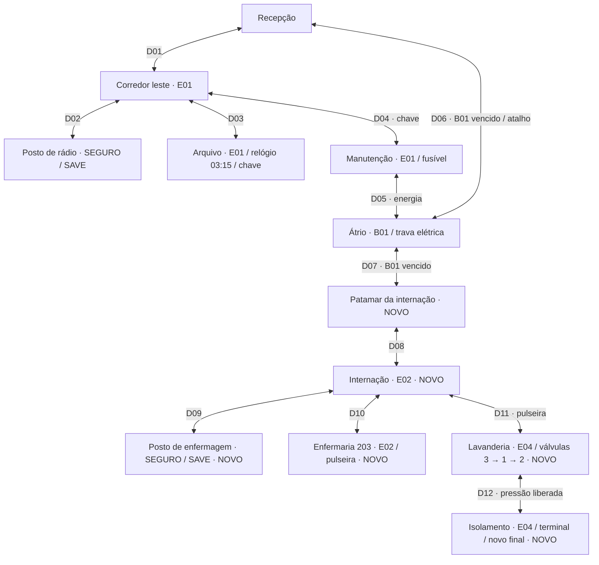

# Mapa de progressão — 0.3.0

Todas as linhas representam portas **bidirecionais**; travas exigem a flag persistente também no retorno. `M` mostra a lista/mapa dentro do jogo, nos dois modos de câmera.

## Orientação sem diagrama

1. Arquivo fornece chave após relógio 03:15. Em manutenção, pegue o fusível junto à entrada e instale no painel do fundo.
2. A trava elétrica do átrio recarrega em 12 s e expõe/danifica B01 mesmo sem balas. Desvie das áreas anunciadas. Vencê-lo abre tanto o atalho D06 quanto a expansão D07; não encerra mais o jogo.
3. O documento do patamar aponta a pulseira no leito 203. O posto à esquerda da internação é o segundo refúgio/gravador. Leia seu documento para a ordem das válvulas.
4. A lavanderia tem um corredor central entre lavadoras. Contorne por ele para chegar ao painel na parede do fundo à direita. Errou a ordem? Todas voltam a fechar; repita 3, 1, 2. Uma vez liberada, a pressão fica persistente e o painel não intercepta mais a porta.
5. No isolamento, neutralize o Febril e use o terminal no fundo para transmitir/selar. O final aponta para a pediatria, **ainda não construída**. É possível continuar explorando e voltar ao posto para salvar.

Saves antigos são migrados com os quatro inimigos novos e documentos já lidos não reaparecem. Salas anteriores não se repovoam: cadáver removido continua morto; recursos coletados continuam ausentes. Saque/recurso ainda não recolhido não é apagado pela limpeza de cadáveres.
