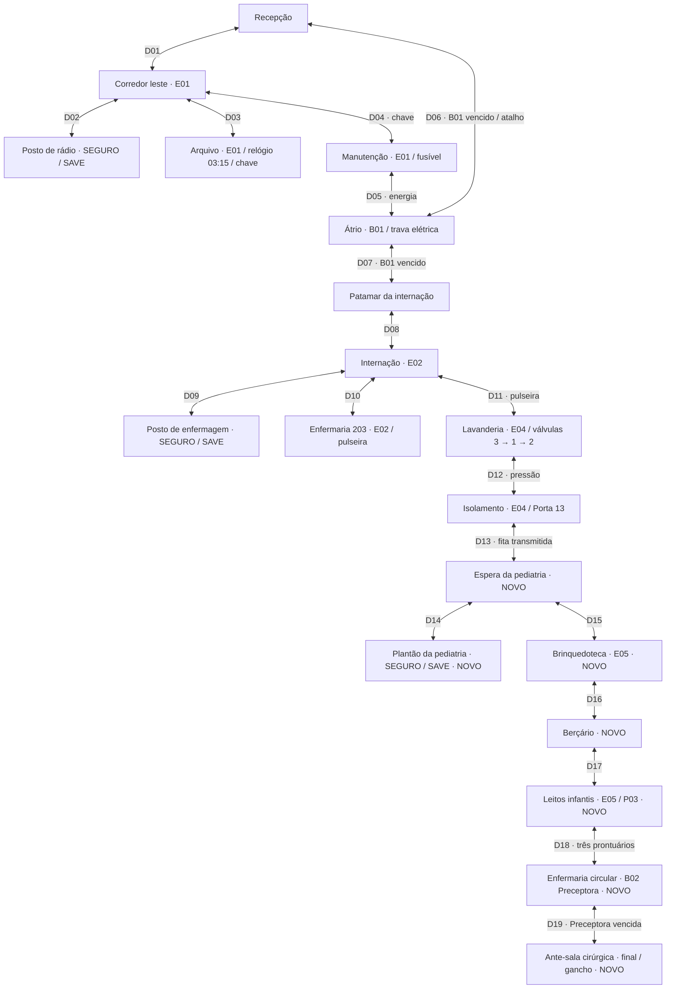

# Mapa de progressão — 0.7.0

Todas as linhas representam portas **bidirecionais**; travas exigem a flag persistente também no retorno. `M` mostra a lista/mapa dentro do jogo, nos dois modos de câmera.

## Orientação sem diagrama

1. Arquivo fornece chave após relógio 03:15. Em manutenção, pegue o fusível junto à entrada e instale no painel do fundo.
2. A trava elétrica do átrio recarrega em 12 s e expõe/danifica B01 mesmo sem balas. Contorne as colunas quando o chão indicar investida. Vencê-lo abre o atalho D06 e a internação D07; não encerra o jogo.
3. O documento do patamar aponta a pulseira no leito 203. O posto à esquerda da internação é o segundo refúgio. Leia seu documento para a ordem das válvulas.
4. A lavanderia tem um corredor central entre lavadoras. No painel do fundo à direita: 3, 1, 2. Ordem errada fecha todas; a pressão liberada persiste.
5. No isolamento, neutralize o Febril e use o terminal no fundo. A Porta 13 abre — a transmissão **já não encerra** a campanha. Saves da 0.6 com a fita já transmitida entram na pediatria.
6. Na espera, o plantão à esquerda é o terceiro gravador (leia os prontuários: baleia, pássaro, árvore). A brinquedoteca à direita tem um Rastejador (E05) no chão: aponte a mira para baixo. O berçário leva aos leitos.
7. Nos leitos infantis, confirme os três leitos marcados (pé azul com baleia, pássaro vermelho, árvore verde). Um leito sem marca é isca e só dá dica. Os três liberam a enfermaria circular.
8. A Preceptora (B02) reage ao gerador auxiliar no fundo à direita: 15 s de claridade e vulnerabilidade, 20 s de recarga. Na segunda fase as luzes baixam e até dois rastejadores saem das camas. O crachá abre o visor da ante-sala. O registro no visor é o final desta versão; o documento aponta o centro cirúrgico e o Mergulhador, ainda não construídos.

Saves da 0.6 (contentVersion 3) migram com os inimigos e salas novos; documentos já lidos não reaparecem; mortos e recursos coletados permanecem. Saque ainda não recolhido não é apagado.
