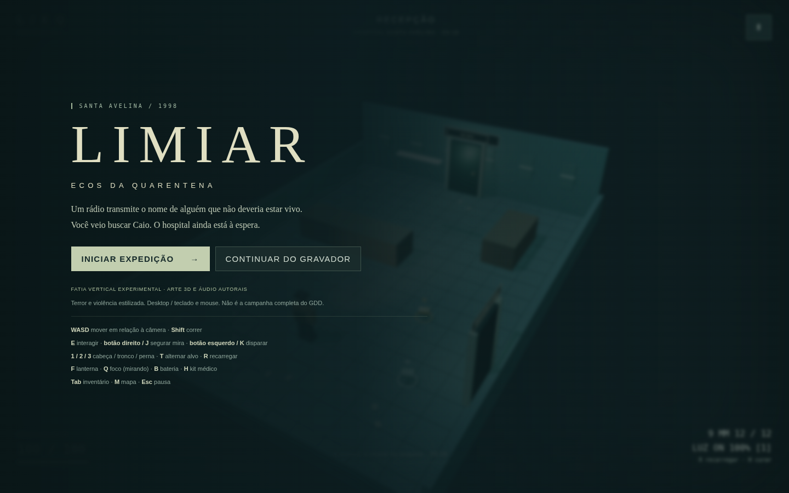
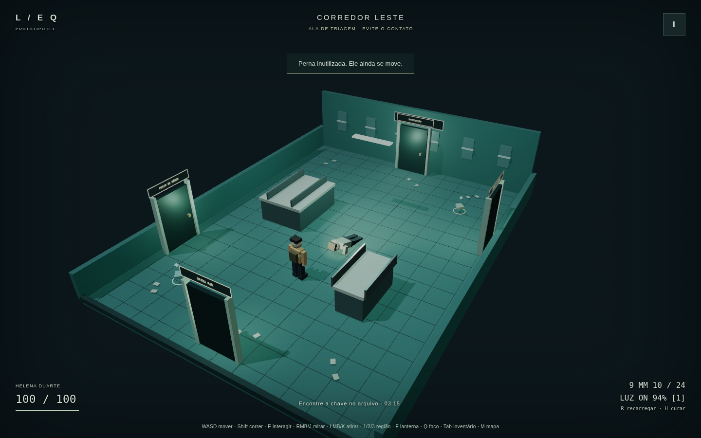
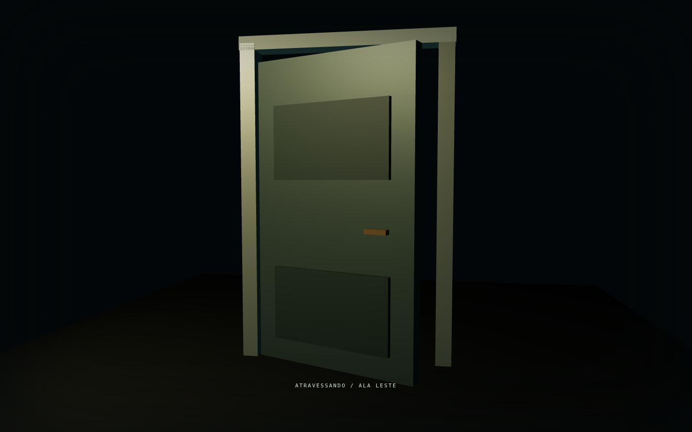
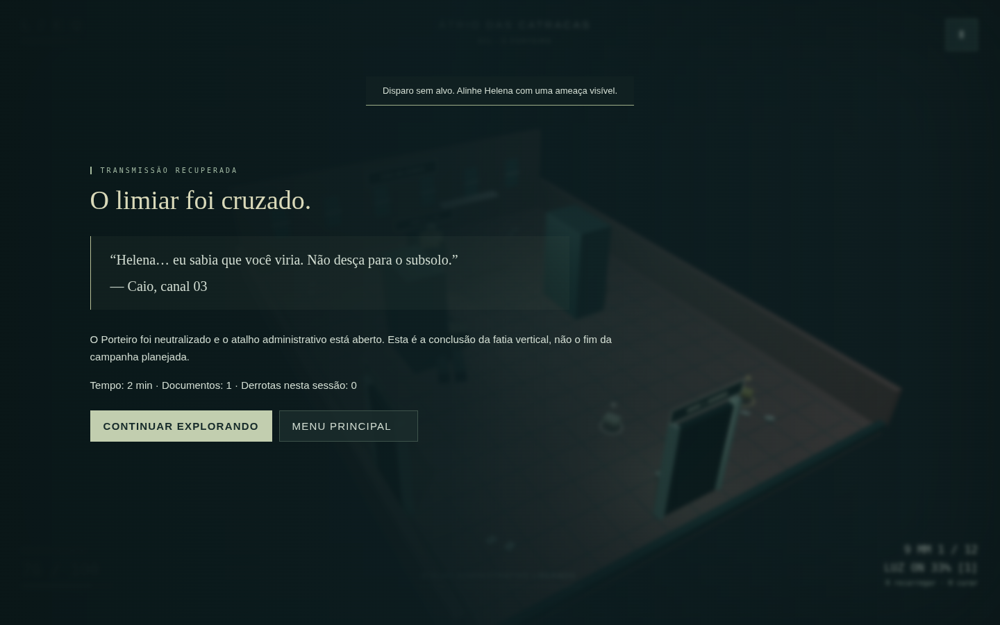

# Evidências de validação — 0.1.0

## Ambiente

- 10/11/2026, horário de São Paulo (UTC−3).
- Box Linux x86_64 virtualizada (KVM), 8 vCPUs Intel Xeon.
- Node.js 24.22.1; Chromium headless 158.0.8127.18, renderização **SwiftShader por software**, viewport 1440 × 900. Não equivale a uma GPU dedicada de referência.

## Resultados locais

- `npm ci`: instalação limpa reproduzida com lockfile.
- `npm run lint`: aprovado, sem erros.
- `npm run typecheck`: aprovado.
- `npm test`: **45 testes aprovados**. Incluem dano por região, crítico, imunidade do chefe a morte aleatória, pernas independentes, prioridade de morte, combo luminoso, bateria 30/60/120 Hz, exposição/cooldown, grafo, bloqueios, **100 travessias na lógica** preservando estado, requests duplicados, rollback por falha, readiness, saves corrompidos/backup e input latch.
- `npm run build`: aprovado. Bundle principal inclui Three.js (~578 kB não comprimido, ~150 kB gzip); há um aviso de chunk maior que 500 kB. Não foi ocultado como se fosse um orçamento cumprido.
- `npm audit`: **0 vulnerabilidades**, incluindo desenvolvimento, após override de `minimatch` 11.0.1+ para corrigir advisory transitório do lint.

## Playthrough automatizado real

`npm run smoke` executou uma partida pela interface e teclado, **sem mutar o estado do jogo ou inserir cheats**:

1. Iniciou, leu documento, coletou munição e abriu/fechou inventário.
2. Atravessou uma zona de câmera e uma porta cinematográfica.
3. Atirou duas vezes na perna do E01, confirmou rastejo e depois morte.
4. Visitou o posto seguro, salvou no gravador e carregou a gravação pela UI.
5. Retornou ao corredor, entrou no arquivo, neutralizou E01 e ajustou o puzzle 03:15.
6. Abriu manutenção com a chave, coletou e instalou o fusível.
7. Entrou no átrio, contornou obstáculos, usou a trava e a pistola e concluiu B01.
8. Confirmou `mode=win`, HP 76 e flags de chave, fusível, energia e chefe concluídas.

**Resultado:** aprovado em 197,7 s de execução de automação; zero erros JavaScript, zero erros de console e zero respostas HTTP 4xx/5xx. Isso é uma rota automatizada eficiente, **não uma promessa de duração da experiência humana**.

O playthrough identificou um aviso da versão atual do Three.js sobre `PCFSoftShadowMap`; o código foi ajustado para `PCFShadowMap`, que era o fallback efetivamente usado. Depois dessa troca, um segundo smoke curto verificou a build final com mouse real (RMB + LMB), corrida com Shift, mapa, inventário, pausa, áudio e resolução, exigindo **zero avisos e zero erros**.

As primeiras tentativas da automação falharam ao roçar mobília e ao tentar atravessar o chefe em linha reta; o roteamento do teste foi corrigido para respeitar os obstáculos e contornar as colunas. Não se desligou colisão nem se enfraqueceu o inimigo para fazer o teste passar.

### Capturas






## Desempenho: não certificado

Na janela final de 600 amostras de render do playthrough por software: mediana **50,0 ms**, p99 **183,4 ms**, **37 frames acima de 100 ms**. O contador no menu final chegou a 6 FPS (backdrop/overlay incluído). O último quadro tinha 218 draw calls e 3.064 triângulos. Esses números são observações da box sem GPU, não metas cumpridas; o protótipo **não está certificado a 30 ou 60 FPS**. Não foram medidos heap/VRAM em stress nem hardware desktop real. A opção de resolução na pausa ajuda a ajustar o custo visual, mas não é um scaler dinâmico completo.

## O que estes testes não demonstram

- As 100 travessias são teste de unidade da transação, **não 100 travessias renderizadas com profiling de memória**.
- O caminho de derrota existe, mas o playthrough vencedor não valida todas as situações de game over/agarrão/reload.
- Rollback foi testado com loader rejeitado; não houve campanha com pacotes remotos, queda de rede ou perda de contexto WebGL.
- Matrizes PERF01–15, FLASH01–20, CHASE01–24, HEAD/LEG e QA completas do GDD **não foram certificadas**.
- R-18, capítulos posteriores, PWA/offline, gamepad/mobile, baú e armas adicionais não existem nesta entrega.
- O smoke não substitui avaliação humana de arte, som, conforto de câmera, acessibilidade e balanceamento.

## Publicação

O workflow `.github/workflows/pages.yml` só publica após lint, tipos, testes e build aprovados. A verificação final da URL pública e do bundle é feita após o deployment, separadamente do push. Reproduza a validação curta com:

```sh
GAME_URL=https://luispauloalves500.github.io/limiar-ecos-da-quarentena/ \
SMOKE_OUT=/workspace/limiar-published-smoke npm run smoke:published
```
