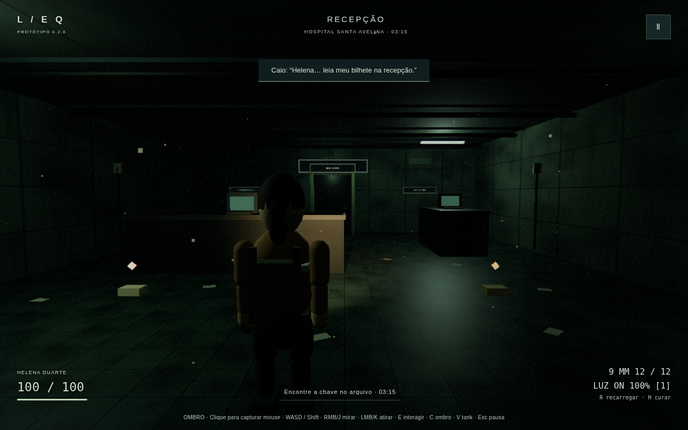
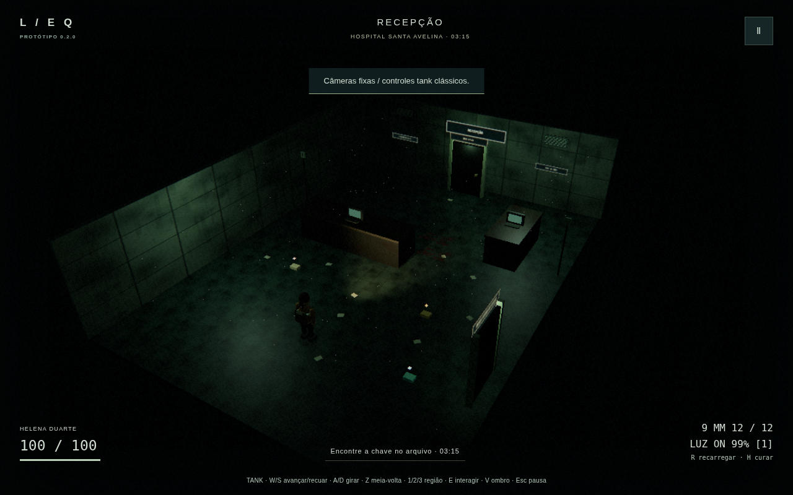
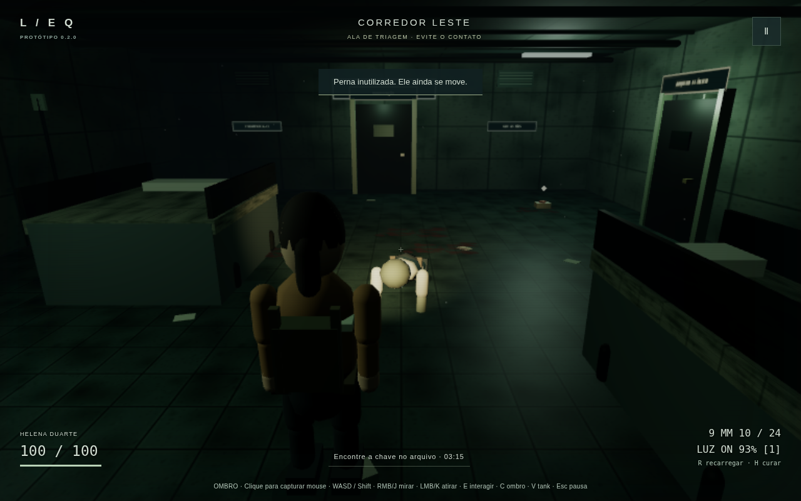

# Evidências de validação — 0.2.0

## Ambiente e escopo

10/11/2026, horário de São Paulo (UTC−3). Linux x86_64 virtualizado, Node.js 24.22.1, Chromium headless 158.0.8127.18 com **SwiftShader por software**. Não representa GPU desktop dedicada. Playthroughs, perfis visuais e probe comparativo em 1280 × 800.

O [QA anterior](QA-v010.md) é histórico, não certifica esta atualização. A campanha completa e as matrizes integrais do GDD continuam fora do escopo.

## Gates reais

- Instalação limpa com `npm ci`; `npm run lint` e `npm run typecheck` aprovados.
- `npm test`: **72 testes em dois arquivos**, todos aprovados. Preservados dano localizado/crítico, integridade independente das pernas, chefe, bateria em diferentes taxas de atualização, exposição, transações de portas, rollback, estado de sala, save/backup e input latch.
- Novos testes: padrões/preferências versionadas, sensibilidade/inversão, perfis; movimento relativo e diagonal normalizada; tank independente do corte; yaw/pitch e meia-volta; raycast regional, erro real de mira, oclusão por parede/cobertura da arma e hitboxes invisíveis; colisão do boom; troca/restauração de bump sem perder textura de cor; movimento varrido e separação entre chefe e jogadora.
- `npm run build`: aprovado; JS **616,58 kB / 161,30 kB gzip**, CSS 6,50 kB. O aviso de chunk maior que 500 kB permanece explícito. Não foi mascarado aumentando o limite.
- `npm audit`: **zero vulnerabilidades** no lockfile testado.

## Playthroughs completos

`GAME_MODE=shoulder npm run smoke` e `GAME_MODE=tank npm run smoke` usam comandos de teclado/UI reais, sem atribuir HP, posição, munição, flags ou estado de inimigos. O diagnóstico `window.limiar` retorna cópias somente leitura. O bot de ombro alinha a **retícula física** usando a alternativa de setas; não substitui o raycast por alvo automático. Captura de mouse real é verificada separadamente.

A rota de ambos: documento/munição/inventário → corredor e combate E01 → duas balas na perna e confirmação de rastejo → eliminação → posto seguro com save/load pela UI → arquivo/E01/relógio 03:15/chave → manutenção/E01/fusível/energia → átrio/trava/combate B01 → conclusão. Depois da vitória, alterna V nos dois sentidos, recarrega a página, verifica preferência e carrega o save seguro sem sobrescrever a preferência.

| Modo | Resultado | Tempo de automação | HP na vitória | Flags |
|---|---|---:|---:|---|
| Ombro | aprovado | 247.76 s | 76 | chave, fusível, energia e B01 |
| Tank | aprovado | 267.53 s | 100 | chave, fusível, energia e B01 |

Zero erros JavaScript, avisos de console ou respostas HTTP 4xx/5xx nos playthroughs aprovados. Os relatórios completos estão na box em `/workspace/limiar-v020-smoke/{shoulder,tank}/report.json`. O último estado do relatório é o save seguro recarregado; o evento **complete** é a evidência da vitória. O tempo de automação não é a duração prometida de uma partida humana.

### Problemas encontrados e corrigidos

- O cookie de SpotLight precisa de RGB radial, não apenas alpha: corrigido e comparação lanterna ligada/desligada confirmou iluminação real.
- A lanterna dentro do peito era obstruída pela própria sombra: deslocada para fora do corpo.
- O rastejador girado a partir dos pés ficava enterrado: corrigidos pivô/posição e limite inferior de pitch para permitir tiro próximo.
- A investida do chefe podia atravessar mobiliário/terminar dentro da jogadora: movimento subdividido e separação física, com dois testes de regressão. Não se reduziu HP/dano dos inimigos para passar.
- Em software lento, esperar apenas tempo de relógio não assegura cooldown simulado: o bot aguarda arma pronta, recarga e consumo real de munição.

## Mouse, preferências e perfis

`npm run smoke:published` (local por padrão, `GAME_URL` para remoto): inicia em ombro, muda sensibilidade/inversão, verifica pointer lock e mudança real de yaw pelo mouse, V sem pausa indevida, Z tank, C troca de ombro, mapa/inventário, tiro J/K consumindo munição, reload de página e preferência persistida. Renderiza **Baixo/Médio/Alto**; confirma ausência de erros/avisos. O playthrough completo foi feito no **Baixo**; Médio/Alto receberam smoke de UI/render/controles, não três campanhas completas por perfil.

### Capturas da build





Demais evidências locais: `/workspace/limiar-v020-smoke/ui/` (lanterna ligada/desligada, Alto/Baixo), `shoulder/` e `tank/` (porta, documentos, inventário, puzzle, chefe e conclusão).

## Desempenho: medido, não certificado

Snapshot antes da atualização do Pages: [dados brutos](benchmark-v020.json). A base publicada ainda era a 0.1.0 (commit 78094ea); as versões locais são 0.2.0, câmera de ombro.

| Cena | Amostras em ≥6 s | Mediana | p99 | Frames >100 ms | Draw calls |
|---|---:|---:|---:|---:|---:|
| 0.1.0 publicada, câmera fixa | 155 | 33,3 ms | 83,4 ms | 0 | 186 |
| 0.2.0 ombro, Baixo | 139 | 49,9 ms | 100 ms | 0 | 103 |
| 0.2.0 ombro, Médio | 44 | 16,8 ms | 450 ms | 18 | 154 |

**A mediana isolada do Médio não significa 60 FPS**: somente 44 quadros foram coletados na janela, com 18 intervalos acima de 100 ms. Há custo/regressão em SwiftShader, sobretudo travadas no Médio, não uma meta de desempenho cumprida. A otimização do Baixo desativou cookie/bump e reduziu resolução; mitigou, mas não eliminou o custo frente à cena fixa antiga. A perspectiva preenche mais a tela e as cenas/iluminação não são idênticas; estes números não isolam uma única causa.

O probe `node scripts/benchmark.mjs` compara a publicação vigente e os perfis locais sequencialmente, com a mesma viewport/Chromium por software, sem playthroughs concorrentes. Cada cena fica parada na recepção; 3 s de aquecimento e 6 s de amostras de requestAnimationFrame. Essa amostra curta não é stress test, nem comparação de GPUs, nem pior caso de combate. O nome `base-publicada` é relativo ao momento da execução; após atualizar o Pages, uma nova execução já usará a publicação nova.

Baixo limita a resolução a 60%, desliga sombras/pós/cookie/bump (preserva texturas de cor) e reduz poeira. Médio usa até 90%, sombra 512 e pós; Alto até 115%, sombra 1024 e mais poeira (todos limitados também pelo DPR da tela). Melhoria visual tem custo: não há promessa de 30/60 FPS nem de ausência universal de regressão. Não se mediram VRAM/heap em stress ou hardware real. Prefira Baixo em máquinas limitadas.

## Limites conhecidos e não certificados

- Seis salas, um inimigo comum e B01 adaptado; sem R-18, capítulos posteriores, gamepad/mobile, baú ou armas adicionais.
- Modelos e texturas continuam low-poly/procedurais; animação não tem mocap/IK. Hitboxes aproximadas, contato/navegação 2D simples.
- Colisão de câmera é boom + margem, não cápsula varrida completa; pode aproximar/ocultar Helena em cantos apertados. Tank usa cutaway intencional de teto e paredes.
- Glow econômico de cinco amostras; sem SSAO/SSR/GI ou pós de produção AAA. O Baixo não mostra sombra/cookie.
- A mira de tank continua assistida por região; apenas ombro usa a retícula física. Assistência leve de ombro é opcional, desligada por padrão.
- As 100 travessias dos testes são de **lógica**, não 100 transições renderizadas com profiling de memória. Saves v1 preservam o formato; preferências têm chave separada.
- Rota vencedora não certifica todas as situações de game over, agarrão, interrupção, perda de contexto WebGL, browser/device e acessibilidade.
- Matrizes completas PERF/FLASH/CHASE/HEAD/LEG do GDD não foram certificadas. QA automatizado não substitui avaliação humana de conforto da câmera, arte, som e balanceamento.

## Publicação

O workflow oficial só publica após lint, tipos, testes e build. Push não é evidência de deployment. A verificação final inclui sucesso do run/deployment, GET do HTML/bundle/CSS com versão 0.2.0 e smoke curto contra a URL pública. Para repetir:

```sh
GAME_URL=https://luispauloalves500.github.io/limiar-ecos-da-quarentena/ \
SMOKE_OUT=/workspace/limiar-v020-smoke/published npm run smoke:published
```
