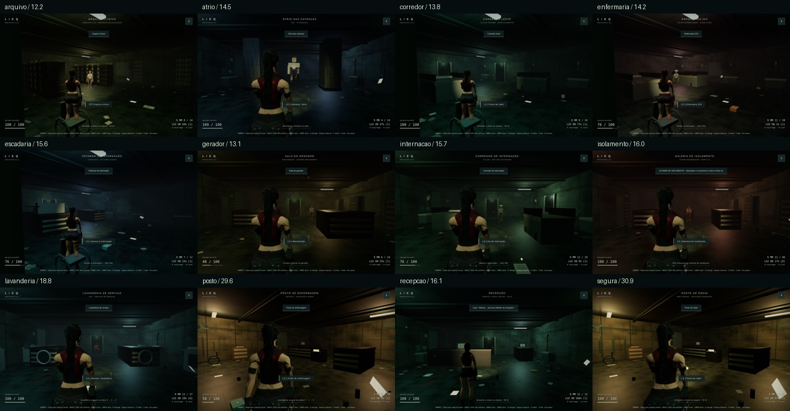
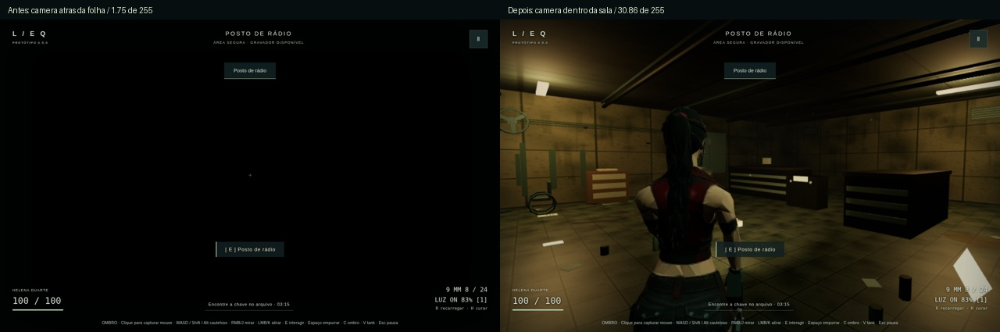
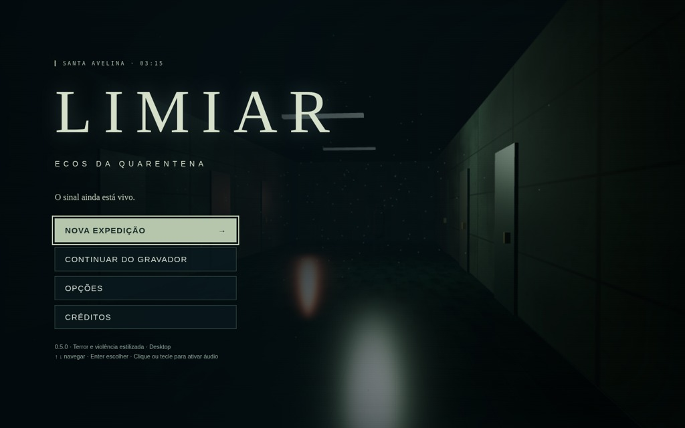
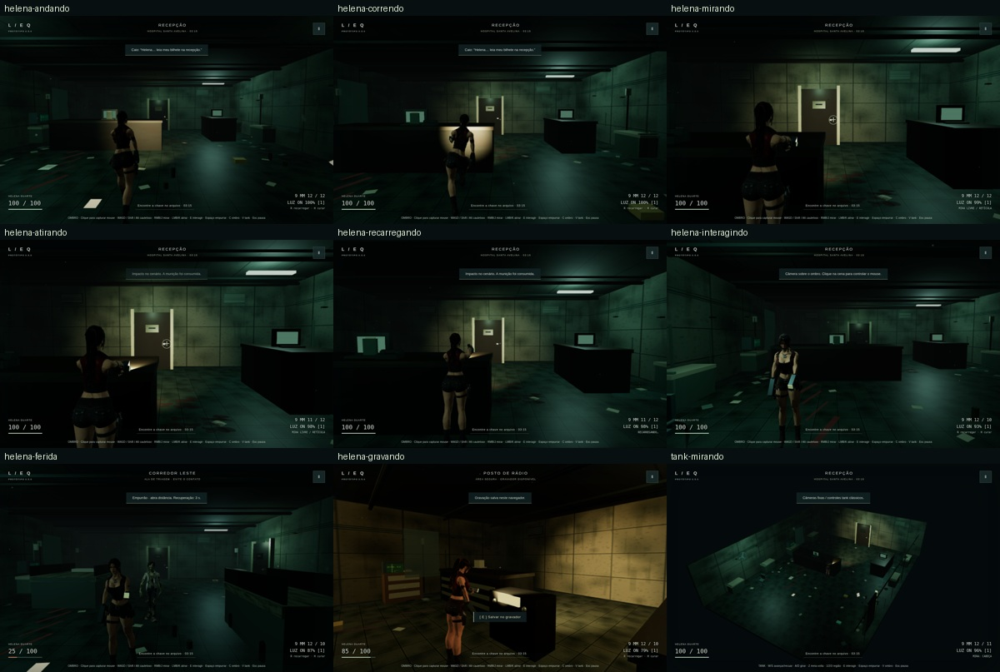

# Capturas 0.5.0 — jogo real

Campanha nova por teclado/mouse, modo ombro Baixo, 12 salas e final com 100 HP (kits usados na rota). Não são galerias de QA nem teleporte. Médias RGB originais: [JSON](../../brightness-v050.json); mínimo geral 12,235/255 e mínimo sem HUD 11,233. Sem alteração de brilho dos PNGs. A imagem acima é apenas montagem/redução de tamanho.

Reprodução antes/depois no mesmo acesso do posto: a câmera ficava entre parede e folha opaca, mesmo com fade zero. Folha e batentes agora bloqueiam o boom. Isso era um bug real do enquadramento, não só exposição ou momento de captura.

PNGs originais e poses em `/workspace/limiar-v050-smoke/shoulder-camera-fixed/` e `quality-camera-fixed/`. Menu e poses abaixo foram inspecionados visualmente. Arma permanece na mão direita em 18 estados reais de ombro/tank, inclusive interação/baixa vida. Limitações de keyframes/oclusão em QA. [Diagnóstico compacto](../../poses-qa-v050.json).

