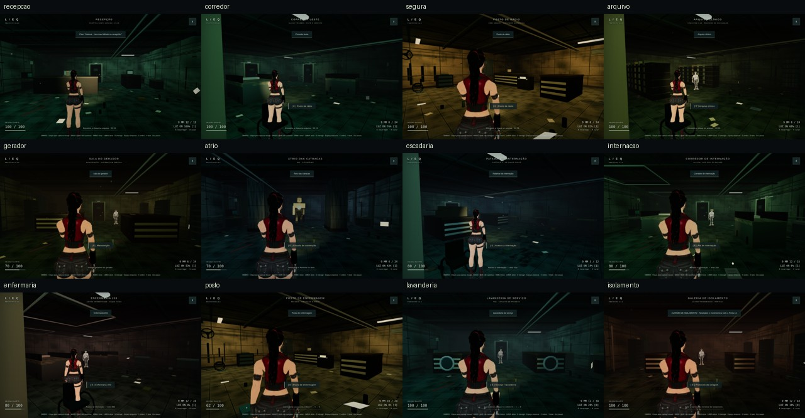
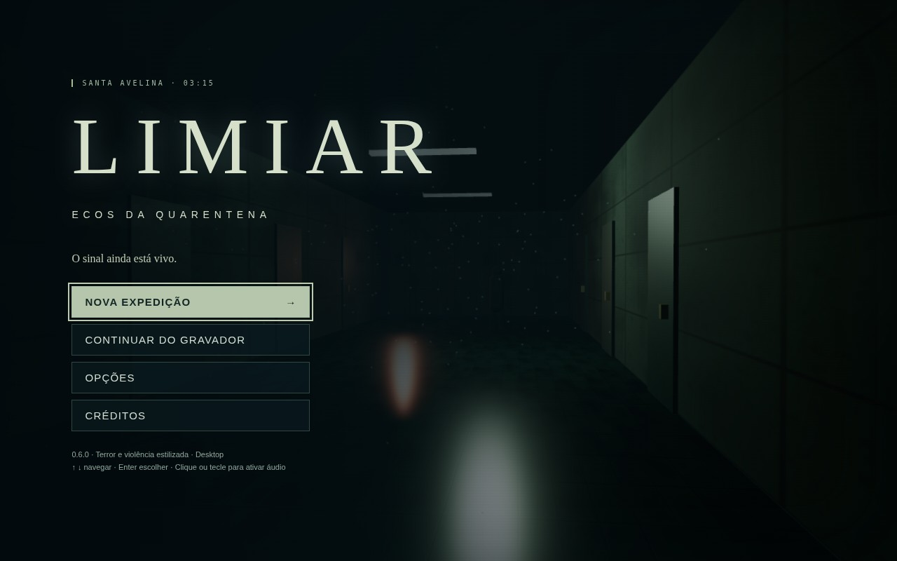
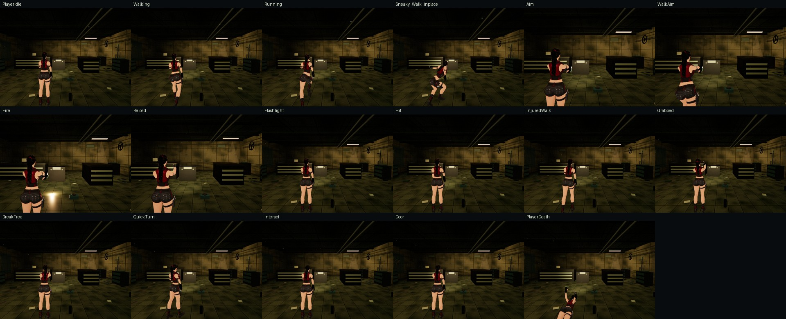
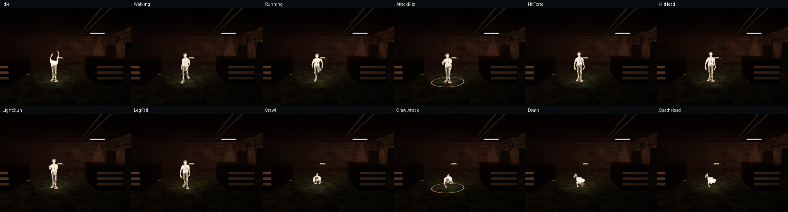

# Capturas 0.6.0 — jogo real

Campanha nova por teclado/mouse, modo ombro Baixo, 12 salas e final com 100 HP. Não são galerias de QA nem teleporte. Médias RGB originais: [JSON](../../brightness-v060.json). Sem alteração de brilho dos PNGs. A imagem acima é apenas montagem/redução de tamanho. Luz prática e AO estão assadas no vértice; a atmosfera continua escura.

[Mesmo percurso em mosaico rotulado](12-salas.jpg) e [fixture de banco por sala](12-salas-fixture.jpg). Comparação 0.5.0 × 0.6.0 no jogo real: [1](antes-depois-1.jpg) · [2](antes-depois-2.jpg) · [3](antes-depois-3.jpg). O mesmo contraste no fixture parado: [1](fixture-antes-depois-1.jpg) · [2](fixture-antes-depois-2.jpg) · [3](fixture-antes-depois-3.jpg).

PNGs originais em `/workspace/limiar-v060-smoke/final-shoulder/` e `final-tank/`. Menu e folhas de pose abaixo foram inspecionados visualmente. As folhas vêm das páginas de QA, com o painel escondido, e incluem as camadas de postura da 0.6. Limitações de keyframes/oclusão e IK só em chão plano em [QA](../../QA.md). [Campanha](../../campaign-qa-v060.json) · [room-bench](../../benchmark-v060.json).

